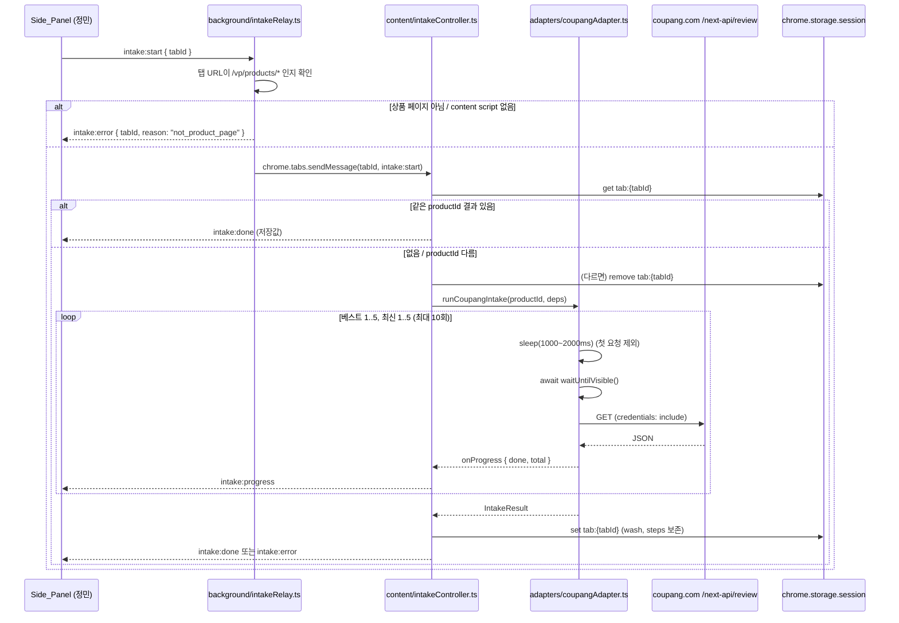

# Design Document: review-intake

## Overview

사이드 패널이 `intake:start`를 보내면 background가 그 탭의 content script로 전달하고, content script가 쿠팡 리뷰 API를 베스트순 5페이지 → 최신순 5페이지 순서로 하나씩 읽는다. 요청 사이에는 1~2초 무작위로 쉬고, 탭이 숨겨지면 멈춘다. 차단이나 예상 밖 응답이면 바로 멈추고 그때까지 읽은 리뷰로 끝낸다. 리뷰는 `cp-{reviewId}`로 중복을 빼고, 결과는 `chrome.storage.session`의 `tab:{tabId}`에 쓰고 `intake:done`으로 알린다.

설계 원칙:
- **순수 로직과 브라우저 연결을 나눈다.** `services/adapters/`는 DOM, `chrome.*`, 전역 `fetch`를 쓰지 않는다. 요청 함수, `sleep`, `random`, `now`, `waitUntilVisible`을 주입받아 Node의 Vitest에서 돌아간다. 실제 `fetch`, `document.visibilityState`, `chrome.*` 연결은 `content/`와 `background/`만 한다.
- **필드 매핑은 `coupangFields.ts` 한 파일에만 둔다.** 미확인 필드(작성일 필드, 본문 전체 여부, 사진 URL 키, 구매 옵션)는 후보와 대체값을 이 파일 상단의 상수로 둔다. 확인 결과가 나오면 이 파일과 fixture, 테스트 기대값만 바꾼다.
- **팀 경계를 지킨다.** 공통 타입은 재현의 `packages/core/src/types/messages.ts`·`review.ts`로 갈 것이므로, 지금은 `adapters/intakeTypes.ts`에 같은 모양의 임시 타입을 둔다. manifest, Vite 설정, `package.json`, 사이드 패널은 건드리지 않는다.

범위 밖 (열린 항목에 정리):
- 화면 DOM에서 보이는 리뷰를 읽는 대체 입고. DOM에 리뷰 ID가 없고 선택자가 확인되지 않았다. MVP는 API로 읽은 리뷰만 쓴다.

## Architecture



background의 다른 역할:
- 시작 시 `chrome.storage.session.setAccessLevel({ accessLevel: 'TRUSTED_AND_UNTRUSTED_CONTEXTS' })`. content script는 기본 접근 수준에서 `storage.session`을 쓸 수 없다. intake.md가 content script의 직접 저장을 정했으므로 이 방식을 택한다. 대안(background가 대신 저장)은 메시지가 늘어나서 택하지 않았다.
- `chrome.tabs.onUpdated`에서 URL의 productId가 저장값과 달라지면 `tab:{tabId}`를 지운다. `itemId`, `vendorItemId` 쿼리만 바뀌면 그대로 둔다.
- `chrome.tabs.onRemoved`에서 `tab:{tabId}`를 지운다.

content script → 사이드 패널 메시지는 `chrome.runtime.sendMessage`로 직접 보낸다 (확장 페이지인 패널과 background가 모두 받는다). background는 이 메시지를 다시 중계하지 않는다.

## Components and Interfaces

### 파일 배치

| 파일 | 역할 | DOM/chrome 의존 |
|---|---|---|
| `apps/extension/src/services/adapters/intakeTypes.ts` | 임시 타입 (`Review`, 메시지, 세션 값, 주입 의존성) | 없음 |
| `apps/extension/src/services/adapters/intakeConstants.ts` | `PAGES_PER_SORT`, `MAX_REVIEWS`, `MAX_REQUESTS_PER_PRODUCT` 등 상수 | 없음 |
| `apps/extension/src/services/adapters/coupangFields.ts` | Raw_Review → `Review` 매핑 (미확인 필드 후보·대체값 포함) | 없음 |
| `apps/extension/src/services/adapters/dedupeReviews.ts` | 임시 중복 제거 (core `dedupeReviews`와 같은 시그니처) | 없음 |
| `apps/extension/src/services/adapters/coupangAdapter.ts` | URL 만들기, 응답 분류, 요청 루프 | 없음 (주입) |
| `apps/extension/src/services/adapters/__fixtures__/*.json` | 가상 응답 fixture | - |
| `apps/extension/src/services/adapters/*.test.ts` | 파싱·어댑터·P1·P2 테스트 | 없음 |
| `apps/extension/src/content/visibility.ts` | `document.visibilityState` 기반 `waitUntilVisible` | DOM 읽기만 |
| `apps/extension/src/content/sessionStore.ts` | `tab:{tabId}` 읽기·병합 쓰기·지우기 | `chrome.storage.session` |
| `apps/extension/src/content/intakeController.ts` | 메시지 처리, 한 번만 입고, 진행 중 중복 시작 방지 | 주입 |
| `apps/extension/src/content/index.ts` | 실제 의존성 연결, `chrome.runtime.onMessage` 등록 | 있음 |
| `apps/extension/src/background/intakeRelay.ts` | `intake:start` 중계, 접근 수준, 탭 키 정리 | `chrome.*` |
| `apps/extension/src/background/index.ts` | `registerIntakeRelay()` 호출 한 줄 (정민 코드와 충돌 최소화) | - |

content script는 Vite에서 한 파일로 묶인다 (tech.md). 진입점 등록과 manifest의 `content_scripts`(`https://www.coupang.com/vp/products/*`)는 정민 담당이다.

### intakeTypes.ts (임시)

```typescript
// 임시: 재현의 @star-laundry/core 타입이 올라오면 교체
export type Source = 'best' | 'latest';

export interface Review {
  id: string;              // "cp-{reviewId}"
  rating: 1 | 2 | 3 | 4 | 5;
  date: string;            // YYYY-MM-DD (KST)
  text: string;            // 제목+본문, 최대 2,000자
  badges: string[];
  hasPhoto: boolean;
  photos?: string[];       // 확장 전용, 최대 5개, https만
  option: string | null;
  source: Source;
}

export type IntakeStopReason = 'blocked' | 'captcha' | 'unexpected' | 'hidden_tab';
export type IntakeErrorReason = 'not_product_page' | 'blocked' | 'parse_failed';
export interface IntakeSources { best: number; latest: number; duplicates: number; }

export interface IntakeResult {
  reviews: Review[];
  partial: boolean;
  reason: IntakeStopReason | null;
  sources: IntakeSources;
  requests: number;        // 보낸 요청 수 (테스트·진단용, 메시지에는 싣지 않음)
}

export type IntakeMessage =
  | { type: 'intake:start'; tabId: number }
  | { type: 'intake:progress'; tabId: number; done: number; total: number }
  | { type: 'intake:done'; tabId: number; reviews: Review[]; partial: boolean;
      reason: IntakeStopReason | null; sources: IntakeSources }
  | { type: 'intake:error'; tabId: number; reason: IntakeErrorReason };

export interface TabSession {
  productId: string;
  reviews: Review[];
  intake: { done: number; total: number; partial: boolean;
            reason: IntakeStopReason | null; sources: IntakeSources };
  wash?: unknown;   // 정민 소유, 입고 코드는 읽지 않고 보존만
  steps?: unknown;  // 정민 소유
}

export interface HttpResponse {
  status: number;
  redirected: boolean;
  contentType: string | null;
  bodyText: string;
}

export interface IntakeDeps {
  fetchPage: (url: string) => Promise<HttpResponse>;
  sleep: (ms: number) => Promise<void>;
  random: () => number;          // [0, 1)
  now: () => number;             // epoch ms
  waitUntilVisible: () => Promise<void>;
  onProgress?: (p: { done: number; total: number }) => void;
}

export interface ReviewAdapter {
  site: 'coupang';
  readProductId(pathname: string): string | null;
  run(productId: string, deps: IntakeDeps): Promise<IntakeResult>;
}
```

- `intake:done`의 `sources`는 intake.md 표에 없는 추가 필드다. 시작 화면의 "베스트 50 + 최신 50, 중복 4개 제외"와 `buildReceipt(…, sources, …)`에 필요하다. 재현·정민에게 core `messages.ts`에 넣자고 제안한다 (열린 항목).
- `hidden_tab`은 타입에만 둔다. MVP는 숨겨지면 무기한 기다리므로 이 이유로 멈추지 않는다.

### intakeConstants.ts

```typescript
export const PAGES_PER_SORT = 5;
export const MAX_REVIEWS = 100;
export const MAX_REQUESTS_PER_PRODUCT = 10;
export const PAGE_SIZE = 10;
export const MIN_GAP_MS = 1000;
export const MAX_GAP_MS = 2000;
export const MAX_TEXT_LENGTH = 2000;
export const MAX_PHOTOS = 5;
export const REVIEW_API_URL = 'https://www.coupang.com/next-api/review';
export const SORTS = [
  { source: 'best', sortBy: 'ORDER_SCORE_ASC' },
  { source: 'latest', sortBy: 'DATE_DESC' },
] as const;
export const SUCCESS_RCODE = 'RET0000';
export const ADVENTURER_BADGE = '쿠팡체험단';
```

### coupangFields.ts (매핑의 유일한 위치)

```typescript
// 확인됨: reviewId, rating, title, content, vine, isAdventurerReview, reviewerBadges[].badgeTitle
// 미확인 (intake.md 체크리스트 [ ]): 아래 상수들. 확인되면 이 상수와 fixture만 바꾼다.

/** 미확인: 화면 날짜가 createdAt인지 reviewAt인지. reviewAt은 수정일일 수 있어 createdAt 우선. */
export const DATE_FIELDS = ['createdAt', 'reviewAt'] as const;
/** 미확인: content가 전체 본문인지. 지금은 title + content를 그대로 쓴다. */
export const TEXT_FIELDS = ['title', 'content'] as const;
/** 미확인: attachments 원소의 사진 URL 키. 앞에서부터 처음 찾은 https URL 하나를 쓴다. */
export const PHOTO_URL_KEYS = [
  'imgSrcOrigin', 'imgSrcThumbnail', 'originalUrl', 'imageUrl',
  'thumbnailUrl', 'url', 'src', 'path',
] as const;
/** 미확인: 구매 옵션 필드. 후보 itemName. 문자열이 아니면 null. */
export const OPTION_FIELD = 'itemName';
/** 읽지 않는 작성자 필드 (참고용 목록. 코드는 이 키를 참조하지 않는다). */
export const AUTHOR_FIELDS = ['member', 'displayWriter', 'displayName',
  'displayWriterIconUrls', 'reviewerDisplayImage', 'reviewerRank'] as const;

export function mapCoupangReview(raw: unknown, source: Source): Review | null;
export function toKstDate(epochMs: number): string | null;   // YYYY-MM-DD
export function truncateText(text: string, max: number): string; // 코드 포인트 기준
export function extractPhotos(attachments: unknown): string[];
```

매핑 규칙:

| `Review` 필드 | 읽는 곳 | 규칙 | 실패 시 |
|---|---|---|---|
| `id` | `reviewId` (number, 확인) | `` `cp-${reviewId}` `` | 숫자가 아니면 리뷰 건너뜀 |
| `rating` | `rating` (확인) | 정수 1~5 | 아니면 건너뜀 |
| `date` | `createdAt` → `reviewAt` (미확인) | 숫자인 첫 필드, `+9h` 후 UTC 기준 `YYYY-MM-DD` | 둘 다 없으면 건너뜀 |
| `text` | `title`, `content` (본문 전체 여부 미확인) | 비어 있지 않은 문자열을 `\n`으로 잇고 trim, 2,000 코드 포인트로 자름 | 둘 다 없으면 `""` |
| `badges` | `reviewerBadges[].badgeTitle` (확인) | 문자열만, 순서 유지, 중복 제거. `vine === true` 또는 `isAdventurerReview === true`면 `"쿠팡체험단"` 보장 | 배열 아니면 `[]` |
| `photos` | `attachments[]`의 `PHOTO_URL_KEYS` (미확인) | 원소마다 첫 URL, `//…`는 `https:` 붙임, `https://`만, 중복 제거, 최대 5개 | `[]` |
| `hasPhoto` | `attachments` | 비어 있지 않은 배열이면 `true` (URL 키를 못 찾아도 `true`. 패널은 "사진 N장"으로 대체 가능) | `false` |
| `option` | `itemName` (미확인) | 비어 있지 않은 문자열이면 trim | `null` |
| `source` | 호출 인자 | 읽은 Sort | - |

- `mapCoupangReview`는 `raw`를 `Record<string, unknown>`로만 다루고 위 키 외에는 읽지 않는다. 결과 객체는 새로 만든 리터럴이라 Author_Fields가 섞일 수 없다.
- KST 변환은 `new Date(ms + 9 * 3600_000)`의 `getUTCFullYear/Month/Date`로 한다. 실행 환경의 시간대에 영향받지 않는다. 예: UTC `2026-01-04T15:00:00Z` → `2026-01-05`, UTC `2026-01-04T14:59:59.999Z` → `2026-01-04`.
- 2,000자 자르기는 `Array.from(text).slice(0, 2000).join('')`로 이모지 같은 서로게이트 쌍을 쪼개지 않는다.
- 체험단 고정 문구는 본문에 그대로 둔다. 재현의 `platform_badge` 규칙이 본문에서도 찾는다.

### dedupeReviews.ts (임시)

```typescript
// 임시: 재현의 @star-laundry/core dedupeReviews가 올라오면 교체
export function dedupeReviews(best: Review[], latest: Review[]):
  { reviews: Review[]; sources: IntakeSources };
```
- 베스트 목록을 순서대로 넣고(같은 id는 처음 것), 그다음 최신 목록 중 아직 없는 id만 순서대로 넣는다.
- `sources.best` = 베스트 목록의 고유 id 수, `sources.latest` = 최신 목록의 고유 id 수, `sources.duplicates` = 두 목록에 모두 있는 고유 id 수. 따라서 `reviews.length === best + latest - duplicates`.
- 입력 배열과 리뷰 객체를 바꾸지 않는다.

### coupangAdapter.ts

```typescript
export function readProductId(pathname: string): string | null; // /products\/(\d+)/
export function buildReviewUrl(productId: string, page: number, sortBy: string): string;
export type PageOutcome =
  | { kind: 'ok'; raws: unknown[]; ratingCount: number | null }
  | { kind: 'stop'; reason: 'blocked' | 'captcha' | 'unexpected' };
export function classifyResponse(res: HttpResponse): PageOutcome;
export async function runCoupangIntake(productId: string, deps: IntakeDeps): Promise<IntakeResult>;
export const coupangAdapter: ReviewAdapter;
```

`buildReviewUrl` 결과 (파라미터 순서 고정, `URLSearchParams` 사용):
`https://www.coupang.com/next-api/review?productId={id}&page={n}&size=10&sortBy={sortBy}&ratingSummary=true&ratings=&market=`

`classifyResponse` 판정 순서:
1. `status === 403 || status === 429` → `blocked`
2. `status !== 200` → `blocked`
3. `redirected` 또는 `contentType`에 `text/html` 포함 → `captcha`
4. `JSON.parse(bodyText)` 실패 → `captcha` (확인 페이지일 가능성이 가장 높음)
5. `rCode !== 'RET0000'` → `blocked`
6. `rData.paging.contents`가 배열이 아님 → `unexpected`
7. 그 밖 → `ok` (`ratingCount`는 `rData.ratingSummaryTotal.ratingCount`가 숫자면 그 값, 아니면 `null`)

`runCoupangIntake` 흐름 (의사 코드가 아닌 실제 구현 순서):

```typescript
let requests = 0; let stop: IntakeStopReason | null = null; let total = MAX_REVIEWS;
const best: Review[] = []; const latest: Review[] = [];
outer: for (const { source, sortBy } of SORTS) {
  for (let page = 1; page <= PAGES_PER_SORT; page++) {
    if (requests >= MAX_REQUESTS_PER_PRODUCT) break outer;
    if (requests > 0) await deps.sleep(MIN_GAP_MS + deps.random() * (MAX_GAP_MS - MIN_GAP_MS));
    await deps.waitUntilVisible();
    requests++;
    let res: HttpResponse;
    try { res = await deps.fetchPage(buildReviewUrl(productId, page, sortBy)); }
    catch { stop = 'unexpected'; break outer; }
    const outcome = classifyResponse(res);
    if (outcome.kind === 'stop') { stop = outcome.reason; break outer; }
    if (outcome.ratingCount !== null) total = Math.min(MAX_REVIEWS, outcome.ratingCount);
    const mapped = outcome.raws.map((r) => mapCoupangReview(r, source)).filter(isReview);
    if (outcome.raws.length > 0 && mapped.length === 0) { stop = 'unexpected'; break outer; }
    (source === 'best' ? best : latest).push(...mapped);
    deps.onProgress?.({ done: Math.min(MAX_REVIEWS, dedupeReviews(best, latest).reviews.length), total });
    if (outcome.raws.length < PAGE_SIZE) break; // 이 Sort 끝
  }
}
const { reviews, sources } = dedupeReviews(best, latest);
return { reviews: reviews.slice(0, MAX_REVIEWS), sources, partial: stop !== null, reason: stop, requests };
```

- 대기는 "앞 응답 처리 끝 → 다음 요청 시작" 사이에 둔다. 탭이 숨겨진 시간은 대기에 더해질 뿐 간격을 줄이지 않는다.
- `now`는 테스트에서 가짜 시계로 "앞 응답 처리 시각 ~ 다음 요청 시각" 간격을 재는 데 쓴다 (`sleep` 가짜 구현이 시계를 앞으로 민다). 어댑터 본체는 `now`를 진행률이나 결과 계산에 쓰지 않는다.
- 같은 요청을 다시 보내는 코드 경로가 없다 (재시도 없음).
- `console.*`로 응답 본문이나 리뷰 원문을 출력하지 않는다.

### content/visibility.ts

```typescript
export function waitUntilVisible(doc: Pick<Document, 'visibilityState' | 'addEventListener' | 'removeEventListener'> = document): Promise<void>;
```
`visibilityState === 'visible'`이면 바로 resolve, 아니면 `visibilitychange`에서 visible이 될 때 resolve하고 리스너를 지운다. DOM을 읽기만 한다.

### content/sessionStore.ts

```typescript
export const tabKey = (tabId: number) => `tab:${tabId}`;
export async function readTabSession(tabId: number): Promise<TabSession | null>;
export async function writeIntakeResult(tabId: number, productId: string, result: IntakeResult, total: number): Promise<void>;
export async function clearTabSession(tabId: number): Promise<void>;
```
`writeIntakeResult`는 기존 값을 읽어 `productId`가 같으면 `wash`, `steps`를 보존하고 `productId`, `reviews`, `intake`만 덮어쓴다. 다르면 새 값으로 쓴다. `chrome.storage.local`은 쓰지 않는다.

### content/intakeController.ts

```typescript
export interface ControllerDeps {
  getPathname: () => string;
  readSession: (tabId: number) => Promise<TabSession | null>;
  writeResult: (tabId: number, productId: string, r: IntakeResult, total: number) => Promise<void>;
  clearSession: (tabId: number) => Promise<void>;
  send: (msg: IntakeMessage) => Promise<void>;          // 실패는 내부에서 삼킴
  adapter: ReviewAdapter;
  adapterDeps: Omit<IntakeDeps, 'onProgress'>;
}
export function createIntakeController(deps: ControllerDeps): { handleStart(tabId: number): Promise<void> };
```
`handleStart(tabId)`:
1. `productId = adapter.readProductId(getPathname())`. 없으면 `intake:error not_product_page`.
2. 진행 중인 입고가 있으면(탭 ID별 `Map<number, {done,total}>`) 현재 진행률로 `intake:progress`만 보내고 끝.
3. `readSession(tabId)`: 같은 `productId`면 저장값으로 `intake:done`. 다른 `productId`면 `clearSession`.
4. `adapter.run(productId, { ...adapterDeps, onProgress })`. `onProgress`마다 `intake:progress`.
5. 결과 리뷰가 1개 이상이거나 `reason === null`이면 `writeResult` 후 `intake:done`. 리뷰 0개이고 `reason !== null`이면 `intake:error` (`blocked`/`captcha` → `"blocked"`, `unexpected` → `"parse_failed"`)이고 저장하지 않는다 (다음 `intake:start`에서 다시 시도할 수 있다. 같은 입고 안에서의 재시도는 아니다).
6. `finally`에서 진행 중 표시를 지운다.

`send`는 `chrome.runtime.sendMessage(msg).catch(() => {})`로 감싸 패널이 닫혀 있어도 실패하지 않는다.

### content/index.ts

```typescript
const controller = createIntakeController({
  getPathname: () => location.pathname,
  readSession: readTabSession, writeResult: writeIntakeResult, clearSession: clearTabSession,
  send: (m) => chrome.runtime.sendMessage(m).then(() => undefined, () => undefined),
  adapter: coupangAdapter,
  adapterDeps: {
    fetchPage: async (url) => {
      const r = await fetch(url, { credentials: 'include' });   // 헤더 추가 없음
      return { status: r.status, redirected: r.redirected,
               contentType: r.headers.get('content-type'), bodyText: await r.text() };
    },
    sleep: (ms) => new Promise((res) => setTimeout(res, ms)),
    random: Math.random, now: Date.now,
    waitUntilVisible: () => waitUntilVisible(document),
  },
});
chrome.runtime.onMessage.addListener((msg) => {
  if (msg?.type === 'intake:start' && typeof msg.tabId === 'number') void controller.handleStart(msg.tabId);
});
```

### background/intakeRelay.ts

```typescript
export const PRODUCT_URL_RE = /^https:\/\/www\.coupang\.com\/vp\/products\/(\d+)/;
export function productIdFromUrl(url: string | undefined): string | null;
export function registerIntakeRelay(): void;
```
`registerIntakeRelay()`:
- `chrome.storage.session.setAccessLevel({ accessLevel: 'TRUSTED_AND_UNTRUSTED_CONTEXTS' })`.
- `chrome.runtime.onMessage`: `intake:start`이고 `sender.tab`이 없을 때(패널에서 온 메시지)만 처리. `chrome.tabs.get(tabId)`의 URL이 상품 페이지가 아니면 `intake:error not_product_page`. 맞으면 `chrome.tabs.sendMessage(tabId, msg)`. 받는 content script가 없어 실패하면(확장 설치 전에 열린 탭) 역시 `intake:error not_product_page`를 보낸다 (열린 항목: 새로고침 안내용 이유 값 제안).
- `chrome.tabs.onUpdated`: `changeInfo.url`이 있으면 `productIdFromUrl`로 비교해 저장된 `productId`와 다르면 `tab:{tabId}` 삭제.
- `chrome.tabs.onRemoved`: `tab:{tabId}` 삭제.
- 사이드 패널 열기·탭별 활성화(`sidePanel.setOptions`)는 정민 코드와 겹칠 수 있어 여기 넣지 않는다.

## Data Models

`chrome.storage.session` 값 (`tab:{tabId}`):

```json
{
  "productId": "9050755607",
  "reviews": [{ "id": "cp-1001", "rating": 5, "date": "2026-01-05", "text": "제목\n본문", "badges": ["쿠팡체험단"], "hasPhoto": true, "photos": ["https://example.invalid/a.jpg"], "option": "블랙 / 10000mAh", "source": "best" }],
  "intake": { "done": 96, "total": 100, "partial": false, "reason": null,
              "sources": { "best": 50, "latest": 50, "duplicates": 4 } },
  "wash": null, "steps": []
}
```

용량: 리뷰 100개 × (본문 2,000자 + 사진 5개)는 1MB 안팎으로 `storage.session` 10MB 제한 안이다.

가상 fixture (`__fixtures__/`, 모두 AI로 만든 가짜 값. 작성자 필드에는 `"가상작성자"` 같은 값을 넣어 제외 여부를 테스트한다):

| 파일 | 내용 |
|---|---|
| `coupangPageNormal.json` | `rCode: "RET0000"`, 리뷰 10개 (사진 있음/없음, 옵션 있음/없음, 제목만/본문만, `createdAt`만/`reviewAt`만), `ratingSummaryTotal.ratingCount` |
| `coupangPageAdventurer.json` | 체험단 리뷰 (`vine`, `isAdventurerReview`, `reviewerBadges` 쿠팡체험단, 고정 문구) + 일반 리뷰 + `TOP_REVIEWER` 배지 |
| `coupangPageEdge.json` | 2,000자 넘는 본문, 사진 7장(`//` 주소, `http://` 주소, 중복 포함), `itemName` 숫자·빈 문자열, `reviewId` 없음, `rating` 0, UTC 15:00 경계 시각 |
| `coupangPageShort.json` | 리뷰 3개 (마지막 페이지) |
| `coupangPageEmpty.json` | `contents: []` |
| `coupangPageRcodeError.json` | `rCode: "RET9999"` |
| `coupangPageBadShape.json` | `rData.paging` 없음 |

## Error Handling

| 상황 | 어댑터 결과 | content script 메시지 | 저장 |
|---|---|---|---|
| 상품 페이지 아님 (URL) | 실행 안 함 | `intake:error not_product_page` | 안 함 |
| 403 / 429 / 그 밖 200 아님 | `reason: "blocked"`, 즉시 멈춤 | 리뷰 ≥1: `intake:done partial` / 0: `intake:error blocked` | ≥1이면 저장 |
| 리다이렉트, HTML, JSON 아님 | `reason: "captcha"` | 리뷰 ≥1: `intake:done partial` / 0: `intake:error blocked` | ≥1이면 저장 |
| `rCode` ≠ `RET0000` | `reason: "blocked"` | 위와 같음 | ≥1이면 저장 |
| 응답 모양 다름, 페이지 전체 매핑 실패, 네트워크 예외 | `reason: "unexpected"` | 리뷰 ≥1: `intake:done partial` / 0: `intake:error parse_failed` | ≥1이면 저장 |
| 개별 리뷰 매핑 실패 | 그 리뷰만 건너뜀 | 영향 없음 | - |
| 리뷰 0개 상품 | `reviews: []`, `partial: false` | `intake:done` | 저장 |
| 탭 숨김 | 다음 요청 전 대기 | 진행률 멈춤 | - |
| 패널 닫힘 (`sendMessage` 실패) | 영향 없음 | 실패 무시 | 저장 계속 |

## Correctness Properties

*A property is a characteristic or behavior that should hold true across all valid executions of a system-essentially, a formal statement about what the system should do. Properties serve as the bridge between human-readable specifications and machine-verifiable correctness guarantees.*

property reflection: prework에서 8.2·8.3(베스트 우선, 같은 Sort 안 처음 것)과 팀 P1은 "중복 제거 결과의 id가 모두 다르고 다시 적용해도 같다"로 합친다. 6.4(최대 100개)와 8.5(`sources` 합)는 팀 P2의 입고 쪽 검증 하나로 합친다. 나머지 기준은 입력에 따라 크게 달라지지 않는 정해진 경우라 예시 테스트로 둔다. 번호는 testing.md의 팀 번호를 그대로 쓴다.

### Property 1: 입고 중복 제거는 멱등이고 결과 ID는 모두 다르다 (P1)

*For any* 두 리뷰 목록 `best`, `latest`(서로, 그리고 각 목록 안에서 id가 겹칠 수 있음)에 대해, `r = dedupeReviews(best, latest)`의 `r.reviews` id는 모두 다르고, `dedupeReviews(r.reviews, [])`의 `reviews`는 `r.reviews`와 같다. 또 두 목록에 모두 있는 id의 리뷰는 `best`에서 처음 나온 리뷰(`source: "best"`)이다.

**Validates: Requirements 8.2, 8.3**

### Property 2: 입고 결과의 리뷰 수는 중복을 뺀 고유 ID 수와 같다 (P2, 입고 쪽)

*For any* 가짜 응답 시퀀스(베스트순·최신순 각 0~5페이지, 페이지마다 0~10개의 가상 Raw_Review, id 겹침 포함)로 `runCoupangIntake`를 실행했을 때, 결과 `reviews.length`는 결과 id의 고유 개수와 같고, `MAX_REVIEWS` 이하이며, `sources.best + sources.latest - sources.duplicates`와 같다. (`basedOn` 자체는 재현의 `buildReceipt`가 계산하고 그쪽 테스트가 확인한다.)

**Validates: Requirements 6.4, 8.5**

## Testing Strategy

- 도구: Vitest + fast-check (재현이 루트에 설치). 실행: 설치 후 루트에서 `npx vitest --run apps/extension/src/services/adapters`. 이 spec의 작업에서는 `npm install`을 하지 않는다. 에이전트 셸에 Node가 없으면 테스트 실행은 사용자가 한다.
- 환경: Node. 어댑터 테스트는 DOM과 `chrome`을 쓰지 않는다. fixture는 `import fixture from './__fixtures__/coupangPageNormal.json'`로 읽는다.
- 속성 테스트: 각 속성 하나당 fast-check 테스트 하나, 최소 100회 (`{ numRuns: 100 }`). 이름에 번호와 태그를 붙인다: `P1: 입고 중복 제거는 멱등이다` / 주석 `Feature: review-intake, Property 1: ...`.
- 예시 테스트 (필수):
  - `coupangFields.test.ts`: 필드 매핑, 결과 키가 정확히 허용 9개(사진 없으면 `photos: []` 포함)이고 Author_Fields 없음, KST 날짜(UTC 14:59:59.999 / 15:00 경계), `createdAt` 없을 때 `reviewAt` 대체, 체험단 배지(`vine`만 있어도 추가, 중복 없음), 고정 문구 유지, 사진 ≤5·https만·`//` 보정, `hasPhoto`, 옵션 `null`(숫자·빈 문자열·없음), 본문 2,000자 자르기(서로게이트 쌍 포함), 잘못된 리뷰 건너뜀.
  - `coupangAdapter.test.ts`: URL 파라미터와 요청 순서(베스트 1~5 → 최신 1~5), 동시에 하나만, 꽉 찬 페이지에서 정확히 10회, 짧은 페이지·빈 페이지에서 그 Sort 조기 종료, `sleep` 인자 1000~2000ms이고 첫 요청 전에는 없음(가짜 시계로 응답 처리 끝~다음 요청 간격 확인), 403/429/500/`rCode`/HTML/JSON 아님/모양 다름/네트워크 예외에서 그 시점 요청 수·`partial: true`·`reason`·읽은 리뷰, 정상 완료 `partial: false`, `waitUntilVisible`가 resolve되기 전 요청 없음, `onProgress`의 `done`/`total`, `fetchPage`에 헤더 인자 없음, `readProductId`.
  - `dedupeReviews.test.ts`: P1과 순서·`sources` 예시.
- 선택 테스트 (`*`): `intakeController.test.ts`(가짜 deps로 저장값 재사용, productId 변경, 진행 중 중복 시작, 0개+멈춤 → error), `intakeRelay.test.ts`(`productIdFromUrl`, 쿼리만 바뀜).
- UI·E2E 테스트는 만들지 않는다 (testing.md).

## 미확인 필드 확인 방법 (사용자와 함께)

쿠팡 상품 페이지 Console에서 아래를 실행한다. 작성자 필드는 건너뛰고, 필드 이름·타입과 개인정보가 아닌 값(ID, 날짜, 길이, 옵션, 사진 주소의 호스트)만 출력한다. 출력은 레포에 올리지 않는다.

```javascript
(async () => {
  const pid = location.pathname.match(/products\/(\d+)/)?.[1];
  const q = new URLSearchParams({ productId: pid, page: '1', size: '10', sortBy: 'ORDER_SCORE_ASC', ratingSummary: 'true', ratings: '', market: '' });
  const j = await (await fetch(`/next-api/review?${q}`, { credentials: 'include' })).json();
  const SKIP = new Set(['member', 'displayWriter', 'displayName', 'displayWriterIconUrls', 'reviewerDisplayImage', 'reviewerRank']);
  const kst = (ms) => (typeof ms === 'number' ? new Date(ms + 9 * 3600e3).toISOString().slice(0, 10) : String(ms));
  const kind = (v) => (Array.isArray(v) ? 'array' : v === null ? 'null' : typeof v);
  const safe = (v) => (typeof v === 'string' && /^(https?:)?\/\//.test(v) ? `URL(${new URL(v, location.href).host})` : kind(v));
  j.rData.paging.contents.slice(0, 5).forEach((r, i) => {
    console.log(i, 'fields:', Object.keys(r).filter((k) => !SKIP.has(k)).map((k) => `${k}:${kind(r[k])}`).join(', '));
    console.log(i, {
      reviewId: r.reviewId, createdAt: kst(r.createdAt), reviewAt: kst(r.reviewAt),
      titleLen: r.title?.length ?? null, contentLen: r.content?.length ?? null,
      itemName: typeof r.itemName === 'string' ? r.itemName : kind(r.itemName),
      attachments: (r.attachments ?? []).slice(0, 2).map((a) => Object.fromEntries(Object.entries(a).map(([k, v]) => [k, safe(v)]))),
    });
  });
})();
```

확인할 것: (1) 화면 추천순 상위 5개 리뷰의 날짜가 `createdAt`과 `reviewAt` 중 어느 쪽과 같은지, (2) 펼친 긴 리뷰 본문 길이와 `contentLen`, (3) `attachments` 원소에서 원본·썸네일 URL 키, (4) 옵션 여러 개인 상품에서 화면 옵션과 `itemName`. 결과에 따라 `coupangFields.ts`의 `DATE_FIELDS`, `TEXT_FIELDS`, `PHOTO_URL_KEYS`, `OPTION_FIELD`와 fixture·테스트 기대값을 고치고, intake.md "쿠팡 페이지 확인 결과 (규리)"의 해당 `[ ]`를 채운다.

## 열린 항목

1. **`intake:done.sources` 추가 제안**: 시작 화면 문구와 `buildReceipt`의 `sources`에 필요하다. 재현(core `messages.ts`)·정민(패널)과 합의 필요. 지금은 임시 타입에만 있다.
2. **content script 미주입 탭**: 확장 설치 전에 열린 상품 탭에서는 받는 쪽이 없다. 지금은 `not_product_page`로 보낸다. 새로고침 안내용 이유 값(예: `"reload_needed"`)을 core 타입에 넣을지 재현·정민과 정한다.
3. **manifest와 빌드 진입점**: `content_scripts`(`https://www.coupang.com/vp/products/*`), background 진입점 등록은 정민 담당.
4. **패널의 재요청 시점**: 같은 탭에서 상품이 바뀌어 키가 지워지면, 패널이 탭 URL 변화나 키 삭제를 보고 `intake:start`를 다시 보내야 한다 (정민).
5. **화면 DOM 대체 입고**: intake.md의 "화면에 보이는 리뷰로 진행"은 선택자와 리뷰 ID가 확인되지 않아 MVP에서 뺐다. 필요해지면 별도 task로 추가한다.
6. **content script `fetch` 동작과 차단 응답 모습**: intake.md 체크리스트의 미확인 두 항목. 확장 로드 후 확인한다. 헤더를 붙이지 않은 요청이 페이지의 요청과 같은 응답을 받는지도 이때 본다.
7. **`reviewId` 없는 리뷰**: intake.md는 작성자·날짜·본문 해시를 대체 id로 적었지만, 작성자를 읽지 않기로 했고 `reviewId`가 확인됐으므로 MVP는 그런 리뷰를 건너뛴다.
8. **`hidden_tab`**: 타입에만 둔다. 숨김 대기에 시간 제한을 둘지는 통합 때 정한다.
