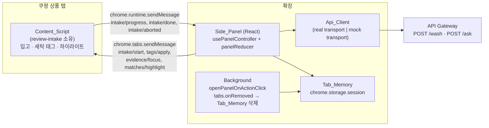
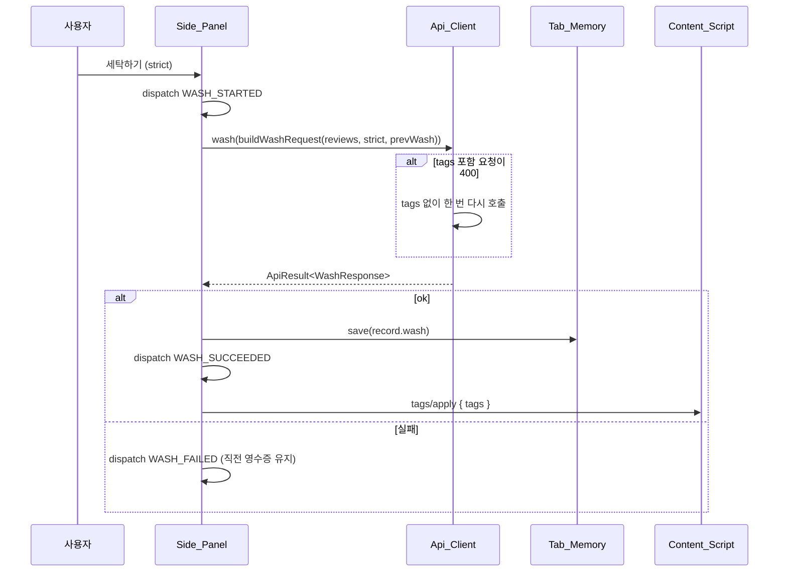

# Design Document

## Overview

사이드 패널은 React 앱 하나로, 현재 탭의 쿠팡 상품에 대해 다음 순서로 동작한다.

1. 현재 탭의 URL에서 Product_Key를 얻고 Tab_Memory를 읽는다.
2. Tab_Memory에 입고 리뷰가 있으면 그대로 복원한다. 없으면 Content_Script에 입고 시작을 요청하고 진행률 메시지를 받는다.
3. 세탁하기를 누르면 Api_Client가 `POST /wash`를 호출하고, 결과(세탁 태그, 세탁 영수증)를 Tab_Memory에 저장한 뒤 Receipt_View에 그리고 Content_Script에 태그 표시를 요청한다.
4. 세탁 요청을 제출하면 `include: true` 리뷰만 담아 `POST /ask`를 호출하고, 결과를 표시하며 Content_Script에 하이라이트를 요청한다.

설계 결정 요약:

| 항목 | 결정 | 이유 |
|---|---|---|
| 빌드 | Vite + `@crxjs/vite-plugin`, React | 사이드 패널·content script·service worker를 한 번에 빌드하고 HMR을 쓴다 |
| 상태 관리 | React `useReducer` + 순수 reducer | 새 라이브러리 없이 상태 전이를 테스트할 수 있다 (새 라이브러리는 먼저 묻는다는 해커톤 규칙) |
| Tab_Memory | `chrome.storage.session`, 키 `tab:{tabId}:{productKey}` | 탭이 열려 있는 동안만 유지. Background가 탭 닫힘 때 `tab:{tabId}:` 접두사로 지운다 |
| 근거 표시 | 패널 안 근거 아코디언은 항상 표시 + Content_Script 스크롤·하이라이트는 선택 | 페이지 DOM에 없는 리뷰(입고로만 읽은 리뷰)도 근거를 보여줄 수 있다 |
| 섬세 세탁 | 직전 `tags`를 재사용, 400이면 `tags` 없이 한 번 다시 호출 | wash-pipeline이 `tags` 필드를 받기 전에도 동작한다 |
| 목 API | 실제 Api_Client에 가짜 `fetch`(transport)를 끼우는 방식 | 시간 초과, 400 재시도, 응답 검증 코드를 목과 실제가 함께 쓴다 |
| 응답 검증 | 손으로 쓴 타입 가드 | 스키마 라이브러리를 새로 넣지 않는다. `packages/core`가 검증 함수를 내보내면 그것으로 바꾼다 |
| 테스트 | Vitest, 순수 로직만 | 응답 검증, 요청 조립, Tab_Memory 키, reducer. 컴포넌트 테스트와 E2E는 만들지 않는다 |

MVP 범위: 16:30 기능 동결에 맞춰 hackathon.md 우선순위대로 만든다. 세탁하기와 영수증 → 근거 아코디언·하이라이트 → 부분 세탁 → 섬세 세탁 토글 순서다. 평점 애니메이션, 부분 세탁 결과의 Tab_Memory 저장, 패널 안 리뷰 검색 같은 기능은 넣지 않는다.

## Architecture



- 메시지는 Background를 거치지 않는다. 사이드 패널은 확장 페이지이므로 Content_Script의 `chrome.runtime.sendMessage`를 직접 받고, `sender.tab.id`로 현재 탭 메시지만 고른다. 패널 → Content_Script는 `chrome.tabs.sendMessage(tabId, msg)`로 보내고 응답을 Promise로 받는다.
- Background의 역할은 두 가지다: `chrome.sidePanel.setPanelBehavior({ openPanelOnActionClick: true })`, `chrome.tabs.onRemoved`에서 해당 탭의 Tab_Memory 항목 삭제. Background 수정은 입고·태그 담당과 합의한 뒤 한다.
- `chrome.storage.session`의 기본 접근 수준은 신뢰된 컨텍스트(확장 페이지, service worker)뿐이라 Content_Script와 페이지 스크립트는 리뷰 데이터를 읽지 못한다. 접근 수준을 바꾸지 않는다.

### 세탁하기 흐름



### 부분 세탁 흐름

1. Wash_Request_Input 제출 → 현재 세탁 결과가 없으면 `strict: false`로 세탁하기 흐름을 먼저 실행한다. 실패하면 거기서 멈추고 세탁 오류를 보여준다.
2. `buildAskRequest(reviews, tags, request)`가 `null`이면(깨끗한 리뷰 0개) 호출하지 않고 안내를 보여준다.
3. `/ask` 응답을 받으면 `ASK_SUCCEEDED`를 dispatch하고 `matches/highlight { reviewIds }`를 Content_Script에 보낸다.

## Components and Interfaces

### 폴더 구조

```
apps/extension/
├── package.json                      # @star-laundry/extension (workspace)
├── vite.config.ts                    # crx({ manifest }), react(), 환경 변수 검사
├── manifest.config.ts                # defineManifest (아래 "manifest" 참고)
├── tsconfig.json                     # strict, paths: "@/*" → "src/*"
├── public/icons/                     # 🧺 아이콘
└── src/
    ├── sidepanel/
    │   ├── index.html                # side_panel.default_path
    │   ├── main.tsx                  # createRoot
    │   ├── App.tsx                   # 화면 상태 분기
    │   ├── panelReducer.ts           # PanelState, PanelAction, panelReducer, selectors
    │   ├── panelReducer.test.ts
    │   ├── usePanelController.ts     # 부수 효과: 탭 추적, 메시지, API 호출, Tab_Memory
    │   ├── tabMemory.ts              # chrome.storage.session 읽기·쓰기·삭제
    │   ├── tabMemoryKey.ts           # 순수 키 함수 (Background도 import)
    │   ├── tabMemoryKey.test.ts
    │   ├── tabMemory.test.ts         # 메모리 내 가짜 storage로 테스트
    │   ├── runtimeMessages.ts        # 메시지 타입 (입고·태그 담당과 합의, 양쪽이 import)
    │   ├── productKey.ts             # parseProductKey(url) (입고·태그 담당과 공용)
    │   └── App.module.css
    ├── components/
    │   ├── common/
    │   │   ├── index.ts
    │   │   ├── EvidenceAccordion.tsx # 근거 리뷰 평점·날짜·본문·세탁 태그
    │   │   ├── EvidenceLink.tsx
    │   │   ├── StainBadge.tsx        # 🔴/🟡 라벨 + signal + evidence
    │   │   ├── ErrorNotice.tsx       # 이유 + 다시 시도 버튼
    │   │   └── PanelFooter.tsx       # 비공식 도구 문구
    │   └── features/
    │       ├── receipt/
    │       │   ├── ReceiptView.tsx
    │       │   ├── RatingCompare.tsx
    │       │   ├── StainCounts.tsx
    │       │   ├── SummarySection.tsx
    │       │   ├── receiptFormat.ts  # formatIntakeProgress, formatRating, formatDelta (basedOn·sources 문구는 RECEIPT_COPY)
    │       │   └── receiptFormat.test.ts
    │       ├── wash-request/
    │       │   ├── WashControls.tsx  # 세탁하기 버튼 + "의심 얼룩도 빼기" 토글
    │       │   ├── WashRequestInput.tsx
    │       │   ├── AskResultView.tsx
    │       │   ├── washRequestInput.ts      # normalizeRequestInput, canSubmitRequest
    │       │   └── washRequestInput.test.ts
    │       └── intake/                       # 패널 전용 입고 표시 (Content_Script 코드 아님)
    │           ├── IntakeProgress.tsx
    │           └── UnsupportedPageNotice.tsx
    ├── services/api/
    │   ├── apiClient.ts              # createApiClient(config, transport)
    │   ├── apiClient.test.ts         # 400 재시도, 오류 분류, 시간 초과
    │   ├── apiConfig.ts              # import.meta.env 읽기 (2개만)
    │   ├── buildRequests.ts          # buildWashRequest, buildAskRequest
    │   ├── buildRequests.test.ts
    │   ├── validateResponse.ts       # isWashResponse, isAskResponse
    │   ├── validateResponse.test.ts
    │   ├── contractTypes.ts          # 공통 타입 shim (packages/core 준비 전 임시 정의)
    │   ├── mockTransport.ts          # Mock_Api: 가짜 fetch
    │   ├── mockData.ts               # tech.md 예시 형태 응답 생성
    │   └── MockScenarioPicker.tsx    # 목 모드에서만 렌더링하는 시나리오 선택
    └── constants/
        ├── fairnessCopy.ts           # 판정 관련 UI 문구 전부 (Content_Script 배지도 재사용 가능)
        └── fairnessCopy.test.ts
```

- `components/features/intake/`는 structure.md 예시에 없는 폴더다. 패널에서만 쓰는 입고 표시 컴포넌트를 둔다. 팀이 원하지 않으면 `sidepanel/` 안으로 옮긴다.
- `runtimeMessages.ts`, `productKey.ts`는 Content_Script도 import한다. 파일 위치와 내용은 입고·태그 담당과 합의하고, 합의 후에는 한 사람만 수정한다.
- `constants/`는 공용 폴더다. `fairnessCopy.ts`는 이 spec이 만들고, 다른 담당이 문구를 추가하려면 먼저 말한다.

### 컴포넌트 트리와 화면 상태

```
App
├── MockScenarioPicker            (USE_MOCK_API일 때만)
├── [screen = "unsupported"]  UnsupportedPageNotice
├── [screen = "intake"]       IntakeProgress ("입고 중 37/100")
├── [screen ∈ ready | washing | receipt | error]
│   ├── IntakeProgress (완료/중단 요약: "리뷰 96개 입고" 또는 중단 이유)
│   ├── WashControls (세탁하기 + 토글)
│   ├── [washing]  세탁 중 로딩
│   ├── [error]    ErrorNotice (wash 오류, 다시 시도)
│   ├── [receipt 또는 error + 직전 영수증]  ReceiptView
│   │   ├── 섬세 세탁 표시 (strict일 때)
│   │   ├── RatingCompare (before → after, 차이)
│   │   ├── StainCounts (stains, removed)
│   │   ├── partial 안내
│   │   └── SummarySection × 3 (summary, pros, cons)
│   │       └── EvidenceLink → EvidenceAccordion → StainBadge
│   └── WashRequestInput + AskResultView (ask 오류는 이 영역 안의 ErrorNotice)
└── PanelFooter
```

| 화면 (`selectScreen`) | 조건 | 세탁하기 버튼 | 토글 | 세탁 요청 제출 |
|---|---|---|---|---|
| `unsupported` | 탭 없음 또는 `parseProductKey(url) === null` | 숨김 | 숨김 | 숨김 |
| `intake` (입고 중) | `intake.status === "running"` 또는 `"idle"` | 비활성 | 활성 | 비활성 |
| `ready` (준비) | 입고 완료·중단, 세탁 결과 없음, 세탁 중 아님 | `reviews.length > 0`이면 활성 | 활성 | `reviews.length > 0`이면 활성 |
| `washing` (세탁 중) | `wash.status === "running"` | 비활성 | 비활성 | 비활성 |
| `receipt` (영수증) | `wash.result` 있음, 세탁 중·오류 아님 | 활성 | 활성 | 활성 |
| `error` (오류) | `wash.status === "error"` | 활성 (다시 시도와 같음) | 활성 | 직전 결과가 있으면 활성 |

`intake.status === "aborted"`이고 읽은 리뷰가 0개이면 중단 이유와 "세탁할 리뷰가 없어요" 안내를 함께 보여준다. `"done"`이고 0개이면 "세탁할 리뷰가 없어요"만 보여준다.

### 상태 관리 (`panelReducer.ts`)

```typescript
import type { AskResponse, Review, WashResponse } from '@/services/api/contractTypes';
import type { ApiError } from '@/services/api/apiClient';
import type { IntakeAbortReason } from './runtimeMessages';

export type PanelTarget = { tabId: number; productKey: string };

export type WashResult = WashResponse & {
  strict: boolean;
  reviewIds: string[]; // 이 결과를 만든 리뷰 집합 (재사용 판단용)
};

export type PanelState = {
  target: PanelTarget | null;               // null이면 unsupported
  intake: {
    status: 'idle' | 'running' | 'done' | 'aborted';
    read: number;
    target: number;
    reason: IntakeAbortReason | null;
    reviews: Review[];
    duplicates: number | null;
  };
  strict: boolean;                          // 토글 상태
  wash: {
    status: 'idle' | 'running' | 'error';
    error: ApiError | null;
    result: WashResult | null;              // 직전 성공 결과. 오류 때도 유지
  };
  ask: {
    status: 'idle' | 'running' | 'done' | 'error';
    request: string;
    error: ApiError | null;
    response: AskResponse | null;
    notice: 'no_clean_reviews' | null;
  };
  evidence: {
    openReviewId: string | null;
    notInDom: string[];                     // 페이지에 없다고 응답한 리뷰 ID
  };
};

export type PanelAction =
  | { type: 'TARGET_CHANGED'; target: PanelTarget | null }
  | { type: 'MEMORY_RESTORED'; target: PanelTarget; record: TabMemoryRecord }
  | { type: 'INTAKE_STARTED'; target: PanelTarget }
  | { type: 'INTAKE_PROGRESS'; target: PanelTarget; read: number; total: number }
  | { type: 'INTAKE_DONE'; target: PanelTarget; reviews: Review[]; duplicates: number }
  | { type: 'INTAKE_ABORTED'; target: PanelTarget; reason: IntakeAbortReason; reviews: Review[]; duplicates: number }
  | { type: 'STRICT_TOGGLED'; strict: boolean }
  | { type: 'WASH_STARTED'; target: PanelTarget }
  | { type: 'WASH_SUCCEEDED'; target: PanelTarget; result: WashResult }
  | { type: 'WASH_FAILED'; target: PanelTarget; error: ApiError }
  | { type: 'ASK_INPUT_CHANGED'; request: string }
  | { type: 'ASK_STARTED'; target: PanelTarget }
  | { type: 'ASK_SUCCEEDED'; target: PanelTarget; response: AskResponse }
  | { type: 'ASK_FAILED'; target: PanelTarget; error: ApiError }
  | { type: 'ASK_SKIPPED'; target: PanelTarget; notice: 'no_clean_reviews' }
  | { type: 'EVIDENCE_TOGGLED'; reviewId: string }
  | { type: 'EVIDENCE_NOT_IN_DOM'; target: PanelTarget; reviewId: string };

export function panelReducer(state: PanelState, action: PanelAction): PanelState;
export function selectScreen(state: PanelState): 'unsupported' | 'intake' | 'ready' | 'washing' | 'receipt' | 'error';
export function selectCanWash(state: PanelState): boolean;
```

reducer 규칙:
- `target`을 가진 액션은 `state.target`과 `tabId`, `productKey`가 모두 같을 때만 반영한다. 다르면 state를 그대로 돌려준다. 늦게 도착한 다른 상품의 응답이나 메시지가 화면을 덮지 않게 한다.
- `TARGET_CHANGED`는 `initialState`에 새 `target`만 넣은 상태로 바꾼다. `strict`는 사용자의 선택이므로 유지한다.
- `WASH_STARTED`는 `wash.error`를 지우고 `wash.result`는 유지한다(오류 후 직전 영수증 표시용). 화면은 `washing`이 된다.
- `WASH_FAILED`는 `wash.result`를 건드리지 않는다.
- `WASH_SUCCEEDED`는 `ask`를 초기화하지 않는다. 직전 부분 세탁 결과는 다음 질문 전까지 보인다.
- `ASK_INPUT_CHANGED`는 `normalizeRequestInput`을 거친 값만 저장한다.

### 부수 효과 (`usePanelController.ts`)

`App`은 `const { state, actions } = usePanelController()` 하나만 쓴다. 훅 안에서 하는 일:

| 일 | 구현 |
|---|---|
| 현재 탭 추적 | 처음에 `chrome.tabs.query({ active: true, currentWindow: true })`. 이후 `chrome.tabs.onActivated`, `chrome.tabs.onUpdated`(같은 탭의 `url` 변경)에서 `parseProductKey(tab.url)`를 다시 계산해 `TARGET_CHANGED` |
| 대상 변경 시 | 진행 중인 API 요청을 `AbortController.abort()`로 끊는다 → Tab_Memory 읽기 → 있으면 `MEMORY_RESTORED` 후 `tags/apply` 재전송, 없으면 `intake/start` 전송 후 `INTAKE_STARTED` |
| 입고 메시지 수신 | `chrome.runtime.onMessage`에서 `isContentToPanelMessage(msg)`이고 `sender.tab?.id === target.tabId`인 것만 dispatch. `intake/done`, `intake/aborted`는 Tab_Memory에 입고 리뷰를 저장 |
| 세탁 | `actions.wash()` → `buildWashRequest` → `apiClient.wash` → 성공 시 Tab_Memory 저장, `WASH_SUCCEEDED`, `tags/apply` |
| 부분 세탁 | `actions.ask()` → 세탁 결과 없으면 `wash({ strict: false })`를 기다림 → `buildAskRequest` → `null`이면 `ASK_SKIPPED` → `apiClient.ask` → `matches/highlight` |
| 근거 | `actions.openEvidence(reviewId)` → `EVIDENCE_TOGGLED` 후 `evidence/focus` 전송. `found: false`이거나 전송 실패면 `EVIDENCE_NOT_IN_DOM` |
| 다시 시도 | 마지막 명령(`{ kind: 'wash', strict }` 또는 `{ kind: 'ask', request }`)을 `useRef`에 두고 그대로 다시 실행 |

Content_Script로 보내는 메시지가 실패해도(`Receiving end does not exist` 등) 패널 상태는 바뀌지 않는다. 단, `intake/start` 실패는 `INTAKE_ABORTED { reason: 'unavailable' }`로 처리해 "페이지를 새로고침한 뒤 패널을 다시 열어 주세요"를 보여준다. 확장 설치 전에 열린 탭에는 Content_Script가 없기 때문이다.

### Api_Client (`services/api/apiClient.ts`)

```typescript
import type { AskRequest, AskResponse, WashRequest, WashResponse } from './contractTypes';

export type ApiError =
  | { kind: 'network' }
  | { kind: 'timeout'; timeoutMs: number }
  | { kind: 'bad_request'; status: 400 }
  | { kind: 'server'; status: number }      // 400 외 4xx, 5xx
  | { kind: 'invalid_response' };

export type ApiResult<T> = { ok: true; data: T } | { ok: false; error: ApiError };

export type Transport = (url: string, init: RequestInit) => Promise<Response>;

export type ApiClient = {
  wash(request: WashRequest, options?: { signal?: AbortSignal }): Promise<ApiResult<WashResponse>>;
  ask(request: AskRequest, options?: { signal?: AbortSignal }): Promise<ApiResult<AskResponse>>;
};

export const WASH_TIMEOUT_MS = 30_000;
export const ASK_TIMEOUT_MS = 20_000;

export function createApiClient(config: { baseUrl: string }, transport: Transport): ApiClient;
export function classifyHttpStatus(status: number): ApiError | null; // 2xx → null
```

동작:
- 두 함수 모두 예외를 던지지 않고 `ApiResult`를 돌려준다. reducer가 오류 종류별로 화면을 고른다.
- 요청 헤더는 `Content-Type: application/json` 하나뿐이다. API 키, 자격 증명, 쿠키를 보내지 않는다(`credentials: 'omit'`).
- 시간 초과: 호출마다 `AbortController`를 만들고 `setTimeout(timeoutMs)`에서 `abort()`한다. 호출자의 `signal`이 abort되면 같이 끊는다. 타이머가 끊은 경우만 `timeout`, 호출자가 끊은 경우는 결과를 버린다(대상 변경). 타이머는 `finally`에서 정리한다.
- 응답 처리 순서: transport 거부 → `network` / `classifyHttpStatus(status)` → 오류 / `response.json()` 실패 또는 `isWashResponse`·`isAskResponse` 실패 → `invalid_response` / 성공.
- 섬세 세탁 재사용 폴백: `wash()`는 요청에 `tags`가 있고 결과가 `bad_request`이면 `tags`를 뺀 요청으로 한 번 더 호출하고 그 결과를 돌려준다. 두 번째 호출은 새 30초 타이머를 쓴다. `tags`가 없는 요청의 400은 다시 호출하지 않는다.
- `wash-pipeline`이 `tags`를 지원한 뒤에도 폴백은 남겨 둔다. 계약 외 요청이 거절돼도 기본 동작으로 돌아간다.

`apiConfig.ts`:

```typescript
export const apiConfig = {
  baseUrl: import.meta.env.VITE_API_BASE_URL as string,
  useMock: import.meta.env.VITE_USE_MOCK_API === 'true',
};
// 사이드 패널 진입 시 1번 생성
export const apiClient = createApiClient(
  { baseUrl: apiConfig.useMock ? 'https://mock.local' : apiConfig.baseUrl },
  apiConfig.useMock ? mockTransport : (url, init) => fetch(url, init),
);
```

`useMock`이 `false`인데 `baseUrl`이 비어 있으면 패널은 세탁 전에 "API 주소가 설정되지 않은 빌드예요" 오류(`server` 분류)를 보여준다. 배포용 zip을 잘못 만든 경우를 빨리 알 수 있다.

### 요청 조립 (`services/api/buildRequests.ts`)

```typescript
export const MAX_WASH_REVIEWS = 100;

export function buildWashRequest(
  reviews: Review[],
  strict: boolean,
  prevWash: WashResult | null,
): WashRequest {
  const sent = reviews.slice(0, MAX_WASH_REVIEWS);
  const reuse =
    prevWash !== null &&
    prevWash.strict !== strict &&
    sameIdSet(prevWash.reviewIds, sent.map((r) => r.id));
  return reuse
    ? { site: 'coupang', strict, reviews: sent, tags: prevWash.tags }
    : { site: 'coupang', strict, reviews: sent };
}

/** include: true인 리뷰가 없으면 null (호출하지 않음) */
export function buildAskRequest(reviews: Review[], tags: WashTag[], request: string): AskRequest | null;
```

- `buildAskRequest`는 입고 순서를 유지한 채 `tags`에서 `include: true`인 ID의 리뷰만 고른다. `tags`에 없는 리뷰는 보내지 않는다. `request`는 `trim()`한 값을 보낸다.
- `WashResult.reviewIds`는 `sent`의 ID 목록이다.

### 응답 검증 (`services/api/validateResponse.ts`)

```typescript
export function isWashResponse(value: unknown): value is WashResponse;
export function isAskResponse(value: unknown): value is AskResponse;
```

확인하는 것: 필수 필드 존재와 타입, `stain ∈ {certain, suspected, none}`, `signal ∈ {platform_badge, disclosure, review_event, suspected, null}`, `evidence: string | null`, `after: number | null`, `summary`·`pros`·`cons`·`matches`가 배열이고 각 항목의 `reviewIds`가 문자열 배열. 값의 의미(평점 범위, ID가 입력에 있는지)는 API가 검수하므로 다시 확인하지 않는다. 추가 필드는 허용한다. `packages/core`가 같은 검증 함수를 내보내면 이 파일은 그것을 다시 내보내는 파일로 바꾼다.

### Mock_Api (`services/api/mockTransport.ts`)

Mock_Api는 `Transport` 타입의 가짜 fetch다. 그래서 실제 Api_Client의 시간 초과, 400 폴백, 응답 검증 코드가 목 모드에서도 그대로 돈다.

```typescript
export type MockScenario =
  | 'normal' | 'after_null' | 'summary_empty' | 'partial' | 'matches_empty'
  | 'network_error' | 'bad_request' | 'timeout' | 'invalid_shape';

export function setMockScenario(scenario: MockScenario): void; // 모듈 변수. 저장하지 않음
export const mockTransport: Transport;
```

- `normal`: 800ms 뒤 tech.md 예시 형태의 응답. 태그와 `reviewIds`는 요청에 들어온 실제 리뷰 ID로 만든다(근거 아코디언과 하이라이트 확인용). `badges`에 "체험단"이 있으면 `certain`/`platform_badge`, 7번째마다 `suspected`. 영수증 숫자는 tech.md 예시 값을 쓰되 `basedOn`은 요청 리뷰 수로 한다.
- `network_error`: `TypeError`로 거부. `bad_request`: 400. `timeout`: `signal`이 abort될 때까지 응답하지 않는다(실제 30초/20초 타이머 확인). `invalid_shape`: 200에 `{ "foo": 1 }`.
- 시나리오 선택은 `MockScenarioPicker`(목 모드에서만 렌더링되는 작은 select)로 한다. 환경 변수를 늘리지 않기 위해서다(Requirement 1.4).

### 런타임 메시지 프로토콜 (`sidepanel/runtimeMessages.ts`, 초안)

입고·태그 담당과 합의할 초안이다. 이름에 `/`를 넣어 방향과 기능을 구분한다. 합의 후 양쪽이 이 파일 하나를 import한다.

```typescript
import type { Review, WashTag } from '@/services/api/contractTypes';

export type IntakeAbortReason =
  | 'blocked'              // 403, 429
  | 'captcha'              // 확인 페이지
  | 'unexpected_response'  // 예상과 다른 응답
  | 'unavailable';         // 패널 전용: Content_Script 응답 없음

// Side_Panel → Content_Script (chrome.tabs.sendMessage)
export type PanelToContentMessage =
  | { type: 'intake/start'; productKey: string }
  | { type: 'tags/apply'; productKey: string; tags: WashTag[] }
  | { type: 'evidence/focus'; productKey: string; reviewId: string }      // 스크롤 + 하이라이트
  | { type: 'matches/highlight'; productKey: string; reviewIds: string[] } // [] 이면 하이라이트 해제
  ;

// Content_Script의 sendResponse 응답
export type IntakeStartResponse = { accepted: boolean };   // 이미 입고 중이면 true, 상품 불일치면 false
export type TagsApplyResponse = { applied: number; missingIds: string[] };
export type EvidenceFocusResponse = { found: boolean };     // review-in-dom 응답
export type MatchesHighlightResponse = { found: string[]; missingIds: string[] };

// Content_Script → Side_Panel (chrome.runtime.sendMessage)
export type ContentToPanelMessage =
  | { type: 'intake/progress'; productKey: string; read: number; total: number }
  | { type: 'intake/done'; productKey: string; reviews: Review[]; duplicates: number }
  | { type: 'intake/aborted'; productKey: string; reason: Exclude<IntakeAbortReason, 'unavailable'>;
      reviews: Review[]; duplicates: number };

export function isContentToPanelMessage(value: unknown): value is ContentToPanelMessage;
```

합의할 점:
- `productKey` 형식: `parseProductKey(url)`는 `https://www.coupang.com/vp/products/{productId}` 경로에서 `coupang:{productId}`를 만든다. 상품 페이지가 아니면 `null`. 옵션 쿼리(`itemId`, `vendorItemId`)는 같은 상품으로 본다. 입고·태그 담당이 다른 규칙을 쓰면 이 함수 하나를 바꾼다.
- `intake/progress`의 `total`은 목표 리뷰 수(`MAX_REVIEWS`, 리뷰가 적으면 페이지가 알려준 수)다.
- 입고 중에 패널이 닫히면 Content_Script는 입고를 계속하고, `intake/done`은 받을 패널이 없어 사라진다. MVP에서는 다시 열 때 Tab_Memory가 비어 있으므로 `intake/start`를 다시 보낸다. Content_Script는 같은 상품의 입고 결과를 탭 안 메모리에 두었다가 `intake/start`에 바로 `intake/done`으로 답해 주면 좋다(요청을 다시 보내지 않기 위해). 이 동작은 review-intake 쪽 결정이다.
- 리뷰 `id`는 DOM 요소와 1:1로 대응해야 `evidence/focus`, `matches/highlight`가 동작한다(tech.md).

### Tab_Memory (`sidepanel/tabMemoryKey.ts`, `sidepanel/tabMemory.ts`)

```typescript
// tabMemoryKey.ts — 순수 함수. Background도 import한다.
export const TAB_MEMORY_KEY_PREFIX = 'tab:';
export function tabMemoryKey(tabId: number, productKey: string): string; // `tab:${tabId}:${productKey}`
export function tabMemoryPrefix(tabId: number): string;                   // `tab:${tabId}:`
export function parseTabMemoryKey(key: string): { tabId: number; productKey: string } | null;

// tabMemory.ts
export type StorageAreaLike = Pick<chrome.storage.StorageArea, 'get' | 'set' | 'remove'>;
export function createTabMemory(area: StorageAreaLike): {
  load(tabId: number, productKey: string): Promise<TabMemoryRecord | null>;
  saveIntake(tabId: number, productKey: string, intake: TabMemoryRecord['intake']): Promise<void>;
  saveWash(tabId: number, productKey: string, wash: WashResult): Promise<void>;
  removeTab(tabId: number): Promise<void>; // 접두사가 같은 키를 모두 삭제
};
export const tabMemory = createTabMemory(chrome.storage.session);
```

- 접두사 끝의 `:` 때문에 `tab:1:`이 `tab:12:...`와 겹치지 않는다.
- `load`는 저장된 값이 `version: 1` 형태가 아니면 `null`을 돌려준다(이전 빌드의 값 무시).
- `removeTab`은 `area.get(null)`로 키를 모두 읽고 `tabMemoryPrefix(tabId)`로 시작하는 키를 `remove`한다. Background의 `chrome.tabs.onRemoved`가 호출한다.
- `chrome.storage.session` 용량(현재 Chrome 기준 10MB)은 리뷰 100개 × 2,000자로 충분하다. 쓰기 실패는 콘솔에 오류 종류만 남기고 화면 동작은 계속한다.
- 저장 대상은 `chrome.storage.session` 하나뿐이다. `chrome.storage.local`, `localStorage`, `IndexedDB`를 쓰지 않는다.

### 공정한 표현 상수 (`constants/fairnessCopy.ts`)

판정과 관련된 모든 UI 문구를 이 파일 하나에 둔다. 컴포넌트는 문자열을 직접 쓰지 않는다.

```typescript
export const STAIN_LABEL = {
  certain: '🔴 대가성 가능성 높음',
  suspected: '🟡 대가성 가능성 의심',
} as const;

export const SIGNAL_LABEL = {
  platform_badge: '플랫폼 체험단 표시',
  disclosure: '대가성 명시 문구',
  review_event: '리뷰 이벤트 참여 표시',
  suspected: '구체성이 적은 극찬 등 의심 신호',
} as const;

export const RECEIPT_COPY = {
  basedOn: (n: number) => `리뷰 ${n}개 기준`,
  sources: (s: { best: number; latest: number; duplicates: number }) =>
    `베스트순 ${s.best} + 최신순 ${s.latest}, 중복 ${s.duplicates}개 제외`,
  afterNull: '계산할 리뷰 없음',
  strictBadge: '섬세 세탁 결과 (의심 얼룩까지 뺐어요)',
  partial: '일부 리뷰만 읽었거나 일부 판정을 규칙 결과로 대신했어요',
  summaryEmpty: '요약을 만들지 못했어요. 평점과 세탁 태그는 그대로 볼 수 있어요',
  removed: (n: number) => `대가성 가능성이 있는 리뷰 ${n}개를 평점에서 뺐어요`,
} as const;

export const INTAKE_COPY = { /* 입고 중, 입고 완료, 중단 이유별 문구, 리뷰 없음, 상품 페이지 아님 */ } as const;
export const ASK_COPY = { /* 글자 수, 매칭 수, 찾을 수 없는 질문 + 예시, 깨끗한 리뷰 없음 */ } as const;
export const ERROR_COPY = { /* network, bad_request, timeout(wash/ask), server, 다시 시도 */ } as const;
export const EVIDENCE_COPY = { notInDom: '지금 페이지에 보이지 않는 리뷰예요. 내용은 위에서 확인할 수 있어요' } as const;
export const DISCLAIMER = '쿠팡과 제휴하지 않은 비공식 도구예요';

export const BANNED_WORDS = ['가짜', '조작', '사기'] as const;

/** 의심 얼룩은 "의심" 라벨, evidence가 null이면 신호 이름 */
export function describeTag(tag: WashTag): { label: string; signal: string; evidence: string } | null;
```

`describeTag`는 `stain: "none"`이면 `null`, 아니면 `STAIN_LABEL[stain]`, `SIGNAL_LABEL[signal]`, `evidence ?? SIGNAL_LABEL[signal]`을 돌려준다.

### 영수증 포맷 (`components/features/receipt/receiptFormat.ts`)

```typescript
export function formatIntakeProgress(read: number, total: number): string; // "입고 중 37/100"
export function formatRating(value: number): string;                       // "4.3"
export function formatDelta(before: number, after: number | null): string | null; // "-0.5", "+0.2", "±0.0", null
```

- `formatDelta`는 `Math.round((after - before) * 10) / 10`을 `toFixed(1)`로 쓰고 부호를 붙인다. `after === null`이면 `null`.
- 평점과 개수는 API 응답 값만 쓴다. 패널에서 리뷰로 평점을 다시 계산하지 않는다(차이 표시는 두 응답 값의 표시용 뺄셈이다).

### 확장 빌드

`vite.config.ts`:

```typescript
import { defineConfig, loadEnv } from 'vite';
import react from '@vitejs/plugin-react';
import { crx } from '@crxjs/vite-plugin';
import manifest from './manifest.config';

const ALLOWED_ENV = ['VITE_API_BASE_URL', 'VITE_USE_MOCK_API'];

export default defineConfig(({ mode }) => {
  const env = loadEnv(mode, process.cwd(), 'VITE_');
  const extra = Object.keys(env).filter((k) => !ALLOWED_ENV.includes(k));
  if (extra.length > 0) throw new Error(`확장에 노출할 수 없는 환경 변수: ${extra.join(', ')}`);
  return {
    plugins: [react(), crx({ manifest })],
    resolve: { alias: { '@': '/src' } },
    test: { environment: 'node', include: ['src/**/*.test.ts'] },
  };
});
```

`manifest.config.ts` (`defineManifest`):
- `manifest_version: 3`, `action`(🧺 아이콘), `side_panel.default_path: "src/sidepanel/index.html"`
- `description`: 쿠팡, 카카오와 제휴하지 않은 비공식 도구라는 문구를 넣는다(fairness.md "확장 설명"). 두 회사 로고는 아이콘에 쓰지 않는다
- `background: { service_worker: "src/background/index.ts", type: "module" }`
- `content_scripts`: `matches: ["https://www.coupang.com/vp/products/*"]`, `js: ["src/content/index.ts"]`
- `permissions: ["sidePanel", "storage"]`
- `host_permissions: ["https://www.coupang.com/*", <VITE_API_BASE_URL의 origin>/*]`. 목 모드에서는 API origin을 넣지 않는다. 쿠팡 host 권한이 있어서 `tabs` 권한 없이도 쿠팡 탭의 `url`을 읽는다(다른 사이트 탭은 `url`이 없어 `unsupported`가 된다).

structure.md는 manifest를 `public/manifest.json`에 둔다고 적었다. `public/`의 파일은 그대로 복사되어 crxjs가 만든 manifest와 충돌하므로, manifest는 `manifest.config.ts`로 두고 `public/`에는 아이콘만 둔다. API origin을 환경 변수에서 넣을 수 있는 것도 이유다. 이 변경은 입고·태그 담당과 infra 담당에게 알린다.

`package.json` 의존성(팀 확인 필요):
- tech.md에서 정해짐: `react`, `react-dom`, `typescript`, `vitest`
- 이 design이 고름(팀 승인 후 설치): `vite`, `@crxjs/vite-plugin`(tech.md는 확장 빌드를 "미정 (Vite 후보)"로 둠), `@vitejs/plugin-react`(JSX 변환), `@types/chrome`, `@types/react`, `@types/react-dom`
- 워크스페이스: `@star-laundry/core`
- 스크립트: `dev`(사용자가 직접 실행), `build`, `test: vitest --run`, `zip`은 infra 담당과 합의

### 타입 (`services/api/contractTypes.ts`)

공통 타입은 `packages/core/src/types`에만 정의한다(structure.md). core 타입이 올라오기 전(11:20 계약 확정 전)에는 이 파일에 tech.md 계약을 그대로 옮긴 임시 타입을 두고, 확장 코드는 항상 이 파일에서 import한다. core가 준비되면 이 파일 내용을 아래 한 줄로 바꾼다. 그러면 다른 파일의 import는 바뀌지 않는다.

```typescript
export type { Review, WashTag, Receipt, WashRequest, WashResponse, AskRequest, AskResponse } from '@star-laundry/core';
```

## Data Models

임시 타입 (tech.md 계약을 그대로 옮김. core가 다른 이름을 쓰면 core를 따른다):

```typescript
export type Site = 'coupang';
export type Stain = 'certain' | 'suspected' | 'none';
export type Signal = 'platform_badge' | 'disclosure' | 'review_event' | 'suspected';

export type Review = {
  id: string;                 // "cp-123456"
  rating: number;             // 1~5
  date: string;               // "2026-10-21"
  text: string;
  badges: string[];
  source: 'best' | 'latest';
};

export type WashTag = {
  id: string;
  stain: Stain;
  signal: Signal | null;      // stain: "none"이면 null
  evidence: string | null;
  include: boolean;
};

export type EvidenceItem = { text: string; reviewIds: string[] };

export type Receipt = {
  basedOn: number;
  sources: { best: number; latest: number; duplicates: number };
  before: number;
  after: number | null;
  stains: Record<Signal, number>;
  removed: number;
  partial: boolean;
  summary: EvidenceItem[];
  pros: EvidenceItem[];
  cons: EvidenceItem[];
};

export type WashRequest = { site: Site; strict: boolean; reviews: Review[]; tags?: WashTag[] };
export type WashResponse = { tags: WashTag[]; receipt: Receipt };

export type AskRequest = { site: Site; request: string; reviews: Review[] };
export type AskResponse = {
  topics: string[];
  matches: { id: string; quote: string }[];
  matched: number;
  summary: EvidenceItem[];
};
```

Tab_Memory 레코드:

```typescript
export type TabMemoryRecord = {
  version: 1;
  productKey: string;
  intake: {
    status: 'done' | 'aborted';
    reason: IntakeAbortReason | null;
    reviews: Review[];
    read: number;
    total: number;
    duplicates: number | null;
  };
  wash: WashResult | null;   // 직전 성공 세탁 1개 (strict 포함)
};
```

- 키: `tab:{tabId}:{productKey}` (예: `tab:381:coupang:7012345678`)
- 부분 세탁 결과는 저장하지 않는다(MVP).
- 패널 상태 중 `strict` 토글은 저장하지 않는다. 복원하면 `wash.strict`를 토글 초기값으로 쓴다.

## Error Handling

| 상황 | 감지 | 화면 | 다음 행동 |
|---|---|---|---|
| 쿠팡 상품 페이지가 아님 | `parseProductKey(url) === null` | `INTAKE_COPY.notProductPage` | 쿠팡 상품 페이지에서 열기 |
| Content_Script 없음 | `intake/start` 전송 실패 | 중단(`unavailable`) | 페이지 새로고침 후 다시 열기 |
| 입고 차단·캡차·예상 외 응답 | `intake/aborted` | 이유 + 읽은 수 | 읽은 리뷰가 1개 이상이면 세탁하기 |
| 읽은 리뷰 0개 | `intake/done` 또는 `aborted`의 `reviews.length === 0` | 세탁할 리뷰 없음 | 세탁하기 비활성 |
| 네트워크 오류 | transport 거부 (`TypeError`) | `ERROR_COPY.network` | 다시 시도 |
| 400 (`tags` 없음) | `status === 400` | `ERROR_COPY.badRequest` (리뷰 100개, 리뷰당 2,000자, 질문 200자 범위) | 질문을 줄이거나 다시 세탁 |
| 400 (`tags` 있음) | 첫 응답 400 | 보이지 않음 | Api_Client가 `tags` 없이 한 번 재호출, 그 결과로 처리 |
| `/wash` 30초 초과 | 타이머 abort | `ERROR_COPY.washTimeout` | 다시 시도 |
| `/ask` 20초 초과 | 타이머 abort | `ERROR_COPY.askTimeout` | 다시 시도 |
| 그 외 4xx, 5xx | `classifyHttpStatus` | `ERROR_COPY.server` | 다시 시도 |
| 응답 형식 오류 | JSON 파싱 실패, 타입 가드 실패 | `ERROR_COPY.server` | 다시 시도 |
| 근거 리뷰가 DOM에 없음 | `evidence/focus` → `found: false` 또는 전송 실패 | 아코디언 유지 + `EVIDENCE_COPY.notInDom` | 없음 |
| `/ask` `matches: []` | 응답 | 찾을 수 없는 질문 + 예시 질문 | 다른 질문 |
| 깨끗한 리뷰 0개 | `buildAskRequest === null` | 질문할 깨끗한 리뷰 없음 | `/ask` 호출 안 함 |
| Tab_Memory 쓰기 실패 | `set` 거부 | 화면 변화 없음 | 다음에 패널을 열면 다시 입고 |
| 대상(탭·상품) 변경 중 응답 도착 | reducer의 target 비교 | 무시 | 없음 |

- 오류 화면에서도 `wash.result`가 있으면 ReceiptView를 계속 보여준다(Requirement 10.7). `/ask` 오류는 부분 세탁 영역 안에만 표시한다.
- 콘솔 로그에는 `ApiError.kind`, `status`, 메시지 `type`만 남긴다. 리뷰 객체, `text`, `evidence`, `quote`, `request`를 로그에 넣지 않는다.

## Correctness Properties

*A property is a characteristic or behavior that should hold true across all valid executions of a system-essentially, a formal statement about what the system should do. Properties serve as the bridge between human-readable specifications and machine-verifiable correctness guarantees.*

속성 정리 과정: prework에서 속성으로 분류한 항목 중 같은 함수를 검사하는 것을 합쳤다. 3.1·3.5·4.2는 `buildWashRequest` 하나로, 2.2·2.3·2.4·2.6은 `selectCanWash` 하나로, 2.1·5.1~5.5·5.9는 포맷 함수 하나로, 7.1·7.7은 입력 정규화 하나로, 9.3·9.4는 `describeTag` 하나로, 10.1·10.2·10.5는 오류 분류 하나로 묶었다. 7.8(깨끗한 리뷰 0개)은 7.2 속성의 경계로 넣었다.

### Property 1: 세탁 요청은 입고 순서대로 최대 100개와 토글 값을 담는다

*For any* 리뷰 목록(0~150개)과 `strict` 값, 직전 세탁 결과에 대해 `buildWashRequest`의 `reviews`는 입력의 앞 `min(n, 100)`개와 순서까지 같고, `strict`는 입력 값과 같으며, `site`는 `"coupang"`이다.

**Validates: Requirements 3.1, 3.5, 4.2**

### Property 2: 판정 재사용은 strict만 바뀌고 리뷰 집합이 같을 때만 일어난다

*For any* 리뷰 목록, `strict` 값, 직전 세탁 결과(없음 포함)에 대해 `buildWashRequest` 결과에 `tags`가 있는 것은 직전 결과가 있고 `prevWash.strict !== strict`이고 보낼 리뷰 ID 집합이 `prevWash.reviewIds` 집합과 같을 때뿐이며, 그때 `tags`는 `prevWash.tags`와 같다.

**Validates: Requirements 4.3**

### Property 3: tags 포함 요청의 400은 tags 없이 정확히 한 번 다시 호출한다

*For any* 세탁 요청과 transport 응답 순서에 대해, 요청에 `tags`가 있고 첫 응답이 400이면 transport는 정확히 2번 호출되고 두 번째 본문에는 `tags`가 없으며 결과는 두 번째 응답을 따른다. 요청에 `tags`가 없으면 400이어도 transport는 1번만 호출되고 결과는 `bad_request`다.

**Validates: Requirements 4.4, 10.2**

### Property 4: HTTP 상태와 transport 실패는 정해진 오류 종류로 분류된다

*For any* HTTP 상태 코드(100~599)에 대해 `classifyHttpStatus`는 2xx이면 `null`, 400이면 `bad_request`, 그 밖의 4xx·5xx이면 `server`를 돌려준다. *For any* 거부하는 transport에 대해 Api_Client는 `network`를 돌려준다.

**Validates: Requirements 10.1, 10.2, 10.5**

### Property 5: 응답 검증은 계약에 맞는 값을 통과시키고 어긋난 값을 거부한다

*For any* 계약에 맞게 생성한 `WashResponse`·`AskResponse`에 대해 `JSON.parse(JSON.stringify(x))`는 `isWashResponse`·`isAskResponse`를 통과하고 Api_Client 결과의 `data`는 원래 값과 같다. *For any* 그 값에서 필수 필드 하나를 지우거나 타입을 바꾼 값에 대해 검증은 실패하고 Api_Client는 `invalid_response`를 돌려준다.

**Validates: Requirements 10.6, 11.3**

### Property 6: 부분 세탁 요청은 include: true 리뷰만 입고 순서대로 담는다

*For any* 리뷰 목록, 세탁 태그 목록, 질문에 대해 `buildAskRequest`의 `reviews`는 태그가 `include: true`인 리뷰만 입고 순서대로 담고 `request`는 `trim()`한 질문이다. `include: true`인 리뷰가 하나도 없으면 결과는 `null`이다.

**Validates: Requirements 7.2, 7.8**

### Property 7: 세탁 요청 입력은 200자로 제한되고 공백만 있으면 제출할 수 없다

*For any* 문자열에 대해 `normalizeRequestInput`의 결과 길이는 200 이하이고 원래 문자열의 앞부분이다. `canSubmitRequest`는 정규화한 값을 `trim()`한 결과가 비어 있지 않을 때만 `true`다.

**Validates: Requirements 7.1, 7.7**

### Property 8: 세탁하기 버튼은 입고가 끝나고 리뷰가 있을 때만 활성화된다

*For any* 같은 대상에 대한 입고 메시지 순서(`INTAKE_STARTED`, `INTAKE_PROGRESS` 여러 개, 마지막에 `INTAKE_DONE`·`INTAKE_ABORTED`·없음)에 대해 `selectCanWash`는 마지막 입고 상태가 `done` 또는 `aborted`이고 리뷰가 1개 이상이고 세탁 중이 아닐 때만 `true`다.

**Validates: Requirements 2.2, 2.3, 2.4, 2.6**

### Property 9: 세탁 중에는 조작이 잠기고 실패해도 직전 영수증이 남는다

*For any* 패널 상태(직전 세탁 결과 있음·없음 포함)에 대해 `WASH_STARTED` 뒤에는 `selectScreen`이 `washing`이고 `selectCanWash`가 `false`다. 이어서 `WASH_FAILED`를 적용하면 `wash.result`는 `WASH_STARTED` 전과 같고 화면은 `error`다.

**Validates: Requirements 3.2, 10.7**

### Property 10: 다른 탭·상품의 액션은 상태를 바꾸지 않는다

*For any* 패널 상태와 `target`을 가진 액션에 대해, 액션의 `tabId` 또는 `productKey`가 `state.target`과 다르면 `panelReducer`는 입력과 같은 상태를 돌려준다.

**Validates: Requirements 8.3**

### Property 11: Tab_Memory 키는 되돌릴 수 있고 탭 접두사는 다른 탭과 겹치지 않는다

*For any* 양의 정수 `tabId`와 Product_Key에 대해 `parseTabMemoryKey(tabMemoryKey(tabId, productKey))`는 `{ tabId, productKey }`다. *For any* 서로 다른 `tabId` 두 개 `a`, `b`에 대해 `tabMemoryKey(b, p)`는 `tabMemoryPrefix(a)`로 시작하지 않는다.

**Validates: Requirements 8.1, 8.3, 8.4**

### Property 12: Tab_Memory는 저장한 값을 돌려주고 탭 삭제는 그 탭 키만 지운다

*For any* 메모리 내 가짜 storage에 저장된 여러 탭·상품의 레코드에 대해, `saveIntake`·`saveWash` 뒤 `load`는 저장한 값과 같은 레코드를 돌려준다. `removeTab(t)` 뒤에는 `t`의 키가 하나도 남지 않고 다른 탭의 키와 값은 그대로다.

**Validates: Requirements 8.1, 8.2, 8.4**

### Property 13: 영수증 표시 값은 API 응답 값을 그대로 담는다

*For any* 계약에 맞는 `Receipt`에 대해 `RECEIPT_COPY.basedOn`·`sources` 문자열은 `basedOn`, `best`, `latest`, `duplicates` 값을 그대로 담는다. `after`가 숫자이면 `formatDelta(before, after)`는 `Math.round((after - before) * 10) / 10`을 소수 첫째 자리로 쓴 값이고, `after`가 `null`이면 `null`이다. *For any* `read`, `total`에 대해 `formatIntakeProgress`는 `"입고 중 {read}/{total}"`이다.

**Validates: Requirements 2.1, 5.1, 5.2, 5.3, 5.4, 5.5, 5.9**

### Property 14: 세탁 태그 설명은 의심 수준을 드러내고 근거가 없으면 신호 이름을 쓴다

*For any* `stain`이 `none`이 아닌 세탁 태그에 대해 `describeTag`의 `signal`은 `SIGNAL_LABEL[tag.signal]`이고, `evidence`는 `tag.evidence`가 문자열이면 그 값, `null`이면 `SIGNAL_LABEL[tag.signal]`이다. `stain`이 `suspected`이면 `label`에 "의심"이 들어간다. `stain`이 `none`이면 결과는 `null`이다.

**Validates: Requirements 9.3, 9.4**

### Property 15: 판정 문구 상수에는 단정 표현이 없다

*For any* `fairnessCopy.ts`가 내보내는 문자열과, 문구 함수에 임의의 숫자·객체 인자를 넣어 만든 문자열에 대해 `BANNED_WORDS`("가짜", "조작", "사기")의 어떤 단어도 들어 있지 않다.

**Validates: Requirements 9.2**

## Testing Strategy

### 범위

hackathon.md 규칙대로 순수 로직만 테스트한다. React 컴포넌트, `chrome.*` 호출, 메시지 전송은 테스트하지 않고 수동 체험 시나리오로 확인한다. 테스트 파일은 대상 옆에 `*.test.ts`로 두고 `vitest --run`으로 한 번 실행한다.

| 우선순위 | 테스트 파일 | 속성 | 예시·경계 테스트 |
|---|---|---|---|
| P0 | `services/api/validateResponse.test.ts` | 5 | tech.md 예시 JSON 통과, `after: null`·`summary: []`·`matches: []` 통과 |
| P0 | `services/api/buildRequests.test.ts` | 1, 2, 6 | 리뷰 0개, 정확히 100개, 101개 |
| P0 | `services/api/apiClient.test.ts` | 3, 4 | 가짜 타이머로 `/wash` 30초·`/ask` 20초 시간 초과, 호출자 abort는 결과 버림, 헤더가 `Content-Type` 하나뿐, URL이 `baseUrl + "/wash"` |
| P0 | `sidepanel/tabMemoryKey.test.ts` | 11 | `tab:1:` vs `tab:12:` |
| P0 | `sidepanel/panelReducer.test.ts` | 8, 9, 10 | 입고 0개 안내, `MEMORY_RESTORED` 후 화면 `receipt`, `EVIDENCE_NOT_IN_DOM` 후 아코디언 유지 |
| P1 | `sidepanel/tabMemory.test.ts` | 12 | 이전 `version` 값은 `null` |
| P1 | `components/features/receipt/receiptFormat.test.ts` | 13 | `before 4.8, after 4.3 → "-0.5"`, 차이 0 → `"±0.0"` |
| P1 | `components/features/wash-request/washRequestInput.test.ts` | 7 | 공백·줄바꿈만 있는 입력 |
| P1 | `constants/fairnessCopy.test.ts` | 14, 15 | `evidence: null`인 `platform_badge` 태그 → "플랫폼 체험단 표시" |

P0는 세탁하기 연결 전에, P1은 16:30 전 남는 시간에 쓴다.

### 속성 테스트 방법

- 속성 테스트 라이브러리(fast-check)는 새 라이브러리이므로 팀에 먼저 묻는다. 승인되면 fast-check로 속성마다 `numRuns: 100` 이상 돌린다.
- 승인 전이거나 거절되면 테스트 파일 안의 작은 생성 함수(시드를 고정한 `mulberry32` 같은 난수 함수로 리뷰·태그·영수증·상태를 만든다)로 같은 속성을 100회 반복한다. 실패하면 시드와 입력 요약을 메시지에 넣는다(리뷰 원문은 가상 데이터이므로 괜찮다).
- 생성 데이터는 가상 리뷰만 쓴다. `packages/core/__fixtures__`의 가상 리뷰를 쓸 수 있으면 그것을 시드로 쓴다. 실제 리뷰 원문은 쓰지 않는다.
- 각 속성 테스트에 다음 형식의 주석을 단다:
  `// Feature: side-panel-receipt, Property {번호}: {속성 제목}`

### 수동 확인 (목 모드 → 실제 API)

- 목 모드(`VITE_USE_MOCK_API=true`)에서 `MockScenarioPicker`로 9개 시나리오를 하나씩 골라 화면을 확인한다.
- 계약 확정 후 실제 API로 product.md 평가자 체험 시나리오 2~5를 실행한다.
- 빌드 확인: `npm run build -w apps/extension` 후 `dist/manifest.json`의 `manifest_version: 3`, 사이드 패널 HTML, service worker, content script가 있는지 본다. 크롬에 압축해제 확장으로 로드한다.
- 저장소 확인: 코드에 `chrome.storage.local`, `localStorage`, 리뷰를 담은 `console.*`가 없는지 검색한다.

## 의존성과 미결 사항

| 대상 | 필요한 것 | 그 전까지 |
|---|---|---|
| wash-pipeline | `packages/core/src/types` 공통 타입과 `@star-laundry/core` 패키지 export | `contractTypes.ts` 임시 타입 |
| wash-pipeline | `/wash` 요청의 선택 필드 `tags` 지원 (본세탁 건너뛰기) | 400이면 전체 재세탁 폴백 |
| wash-pipeline | `receipt.sources.duplicates`를 API가 어떻게 아는지 (요청에 중복 수가 없음) | 입고 메시지의 `duplicates`를 패널이 가지고 있다가 계약에 맞춰 보낸다. 계약 확정 때 정한다 |
| wash-pipeline | 응답 검증 함수를 core에서 내보낼지 | `validateResponse.ts`의 타입 가드 |
| wash-pipeline | 입고가 중단됐을 때 `receipt.partial: true`를 API가 어떻게 아는지 (API는 상태가 없고 요청에 입고 중단 표시가 없음) | 계약 확정 때 요청 필드를 정한다. 정하지 못하면 패널이 `intake.status === "aborted"`일 때 입고 중단 안내를 따로 보여준다 |
| review-intake | 메시지 프로토콜 합의 (`runtimeMessages.ts` 초안), Product_Key 규칙, 리뷰 ID와 DOM 1:1 대응 | 목 모드에서는 패널이 가짜 입고 진행률을 dispatch한다 |
| review-intake | Background 수정(`openPanelOnActionClick`, `tabs.onRemoved`)과 manifest를 `manifest.config.ts`로 두는 것. structure.md는 Background에 "메시지 중계"를 적었지만 이 design은 패널과 Content_Script가 직접 메시지를 주고받는다 | 이 spec이 초안을 만들고 담당자 확인 후 커밋 |
| review-intake | 페이지 리뷰 옆 배지를 그리는 `components/features/wash-tag/`의 소유자. 패널 폴더(`components`) 안에 있지만 Content_Script가 쓴다 | 이 spec은 `wash-tag/`를 건드리지 않는다. `StainBadge`·`describeTag`를 재사용할 수 있게 둔다 |
| 팀 | 루트 `package.json`(npm workspaces `apps/*`, `packages/*`, `infra`)이 아직 없음. `-w apps/extension` 명령과 `@star-laundry/core` 의존성이 이것을 전제로 한다 | 먼저 만드는 사람이 팀에 알리고 만든다 |
| 팀 | `@vitejs/plugin-react`, `@types/chrome`, React 타입, (선택) fast-check 추가 승인 | 승인 전에는 설치하지 않는다 |
| infra | Releases zip 만들기 스크립트, 배포 API 주소(`VITE_API_BASE_URL`) | 목 모드로 개발 |
