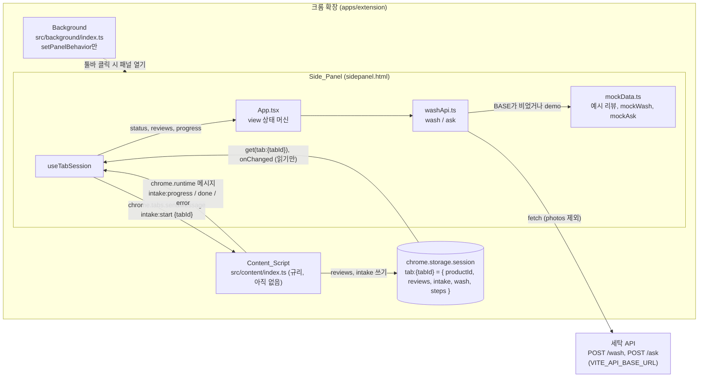

# Design Document

## Overview

이 문서는 커밋 `3d32b72`(feat(side-panel-receipt): 사이드 패널 화면과 예시 데이터 모드)에 들어간 사이드 패널 코드를 **있는 그대로** 설명하고, 각 부분을 requirements.md의 요구사항 번호에 연결한다. 코드가 아직 요구사항을 채우지 못한 곳은 마지막 절 "코드와 요구사항의 차이 (남은 일)"에 모았다.

이전 design.md의 `@crxjs`, 페이지 태그·스크롤 메시지, 근거 아코디언, `tab:{tabId}:{productKey}` 키 설명은 모두 지웠다. 지금 코드에는 없다.

사용자 흐름(현재 코드 기준):

1. 툴바 아이콘을 누르면 사이드 패널이 열린다. 패널은 활성 탭을 찾아 쿠팡 상품 페이지인지 확인하고 Content_Script에 `intake:start`를 보낸다.
2. 입고가 끝나면 시작 화면에서 기본·섬세·부분 세탁 중 하나를 누른다. 누르는 즉시 `/wash`가 시작된다.
3. 세탁 중 화면 → 세탁 끝 화면(1.6초) → 영수증 화면 순서로 넘어간다.
4. 영수증 위 ModeBar로 기본·섬세·부분 세탁을 오간다. 부분 세탁 화면에서 질문하면 `/ask` 결과가 단계로 쌓인다.

### 결정 표

| 항목 | 현재 코드의 결정 | 근거 / 요구사항 |
|---|---|---|
| 빌드 | `build.mjs`에서 Vite JS API를 두 번 호출. 1회차: `sidepanel.html` + `src/background/index.ts`(ES 모듈), 2회차: `src/content/index.ts`(IIFE, 단일 파일) | Req 1.1, 1.2. `@crxjs` 없음 |
| content 진입점이 없을 때 | 빈 `dist/content.js`를 쓰고 경고 출력. manifest 항목은 그대로 | Req 1.3과 다름 (차이 목록 G-B2) |
| 경로 별칭 | `@` → `apps/extension/src` (build.mjs `resolve.alias`, tsconfig `paths`) | 구조 규칙 |
| 공통 타입·함수 | `@star-laundry/core`에서 직접 import (`Review`, `WashTag`, `Receipt`, `Step`, `IntakeMessage`, `applyStrict`, `averageRating`, `pushStep`, `popStep`, `narrowSteps`, `MAX_STEPS`). 패널 쪽 임시 타입 없음 | Req 3.4, 20.6 (Core가 이미 내보내므로 임시 타입 불필요) |
| 세션 저장 | 패널은 `chrome.storage.session`의 `tab:{tabId}`를 **읽기만** 한다. 세탁 결과와 단계는 React 상태에만 둔다 | Req 2.1, 2.3. Req 2.4는 미충족 (G-S1) |
| 입고 메시지 | `intake:start` 송신, `intake:progress`·`intake:done`·`intake:error` 수신. `tabId`로 거른다 | Req 3.1~3.3, 3.6 |
| 목 모드 판정 | `VITE_API_BASE_URL`이 비면 목 응답(`isMockApi`). "예시 리뷰로 체험하기"를 눌러도 목 응답 | Req 5와 다름 (G-M1) |
| 재세탁 판정 재사용 | 직전 `tags`가 있으면 항상 `applyStrict(tags, strict)`를 `/wash`에 담는다 | Req 20.3~20.4와 다름 (G-W1) |
| 요청 시간 제한 | `/wash`, `/ask` 모두 32초 하나 | Req 4.8과 다름 (G-A3) |
| 바탕 세탁 전환 | 부분 세탁 중 기본 → 섬세는 Core `narrowSteps`로 단계를 좁힌다. 섬세 → 기본은 단계를 지우고 안내 | api-contract.md "세탁 순서 자유롭게 섞기"의 시간 부족 대안 |
| 근거 보기 | 근거 문장을 누르면 같은 화면의 리뷰 카드로 스크롤하고 카드를 펼친다 (별도 04 화면 없음) | Req 16과 다름 (G-U9) |
| 빠진 리뷰 | 영수증 화면 아래 탭 "빠진 리뷰 {n}" | Req 17과 다름 (G-U10) |
| 테스트 | 아직 없음 | Req 14 미충족 (G-T1) |

## Architecture



- 패널은 Tab_Session에 쓰지 않는다. `wash`, `steps` 필드는 아직 아무도 쓰지 않는다 (G-S1).
- 패널을 닫으면 세탁 결과와 단계 스택이 사라진다. 다시 열면 입고 결과만 남아 있다.
- 탭 전환·새로고침은 `chrome.tabs.onActivated`, `chrome.tabs.onUpdated`(같은 탭, `status: complete` 또는 `url` 변경)로 감지한다.

## Components and Interfaces

### 폴더와 파일

| 경로 | 역할 | 요구사항 |
|---|---|---|
| `apps/extension/build.mjs` | 확장 빌드 (아래 "빌드" 참고) | 1.1~1.3 |
| `apps/extension/package.json` | `dev`(watch), `build`, `typecheck`. 의존성: `@star-laundry/core`, `@types/chrome`, `@vitejs/plugin-react`, `react`, `react-dom`, `vite` | 1.9 |
| `apps/extension/public/manifest.json` | MV3 manifest. Vite `publicDir`로 `dist/`에 복사 | 1.6~1.8 |
| `apps/extension/sidepanel.html` | 패널 HTML. `/src/sidepanel/main.tsx` 로드 | 1.1 |
| `apps/extension/.env.example` | `VITE_API_BASE_URL=` (비우면 예시 데이터) | 1.4 |
| `apps/extension/tsconfig.json` | `tsconfig.base.json` 상속, `jsx: react-jsx`, `types: [chrome, vite/client]`, `@/*` 경로 | - |
| `src/sidepanel/main.tsx` | `StrictMode`로 `App` 렌더, `styles/sidepanel.css` import | - |
| `src/sidepanel/App.tsx` | 화면 전환, 세탁·질문 실행, 단계 스택 상태 | 2, 6~11, 15, 18, 20 |
| `src/hooks/useTabSession.ts` | 활성 탭, 입고 상태, 예시 리뷰 체험 | 2.1, 3, 5.2, 21.5 |
| `src/services/api/washApi.ts` | `wash`, `ask`, `ApiError`, `isMockApi` | 4, 20.3 |
| `src/services/api/mockData.ts` | 예시 리뷰 30여 개, `mockWash`, `mockAsk` | 5.6, 5.7 |
| `src/types/api.ts` | `WashResponse`, `AskResponse` (Core 타입 조합) | 4.7 |
| `src/utils/format.ts` | `fmtRating(value)`: 소수 첫째 자리, `null`이면 `"-"` | 8.2 |
| `src/styles/sidepanel.css` | 디자인 토큰과 전체 스타일 (약 290줄) | 13, 21.4 |
| `src/components/common/` | `CitedList`, `ModeBar`, `Notice`, `Stars`, `StatusScreen`, `WashingMachine` | - |
| `src/components/features/start/StartScreen.tsx` | 시작 화면 (01 대응) | 6 |
| `src/components/features/receipt/` | `WashingScreen`(02), `DoneScreen`(02-2), `ReceiptView`(03) | 7, 8, 17, 21.2 |
| `src/components/features/refine/` | `RefineView`(05), `StepChips`(조건 칩) | 11, 15 |
| `src/components/features/review-list/` | `ReviewList`, `ReviewCard`, `highlight` | 9 |
| `src/components/features/wash-request/AskBox.tsx` | 질문 입력 | 10 |
| `src/components/features/wash-tag/WashTag.tsx` | 세탁 태그 배지, `signalLabel` | 9.8, 12.3 |
| `src/background/index.ts` | `onInstalled`에서 `chrome.sidePanel.setPanelBehavior({ openPanelOnActionClick: true })` | 규리 폴더 (G-X2) |
| `src/constants/` | 비어 있음 (`.gitkeep`) | 12.1 미충족 (G-C1) |

### App.tsx: 화면 상태

`type View = 'home' | 'washing' | 'done' | 'receipt' | 'refine' | 'error'`

`session.status`(useTabSession)가 먼저 화면을 고르고, `intake` 또는 `ready`일 때만 `view`를 쓴다.

| 조건 | 그리는 것 | 와이어프레임 / 요구사항 |
|---|---|---|
| `status === 'loading'` | "불러오는 중이에요" | - |
| `status === 'unsupported'` | `StatusScreen` "쿠팡 상품 페이지에서 열어 주세요" + "예시 리뷰로 체험하기" | 06 / 19, 21.5 |
| `status === 'failed'` | `StatusScreen` "리뷰를 읽지 못했어요" + "다시 불러오기", "예시 리뷰로 체험하기" | 01 입고 실패 / 6.6 |
| `view === 'home'` | `StartScreen` | 01 / 6 |
| `view === 'washing'` | `WashingScreen` | 02 / 7 |
| `view === 'done'` | `DoneScreen` (첫 세탁에만. 재사용 세탁은 바로 `pending.next`) | 02-2 / 21.2 |
| `view === 'receipt'` | `ReceiptView` | 03 / 8, 17 |
| `view === 'refine'` | `RefineView` | 05 / 11, 15 |
| `view === 'error'` | `StatusScreen` "세탁하지 못했어요" + "다시 시도", "처음 화면으로" | 07 / 18 |

상태:

| 상태 | 타입 | 뜻 |
|---|---|---|
| `washState` | `{ tags, receipt, strict } \| null` | 마지막 세탁 결과 (메모리만) |
| `pending` | `{ strict, quick, next }` | 진행 중이거나 마지막으로 시도한 세탁. `quick`은 판정 재사용 여부, `next`는 끝난 뒤 갈 화면 |
| `steps` | `Step[]` | 단계 스택 (메모리만) |
| `quotes` | `Map<id, quote>[]` | 단계마다 `matches`의 `quote`. `steps`와 같은 길이로 유지 |
| `asking` | `boolean` | `/ask` 진행 중 |
| `notice` | `{ tone, text } \| null` | 부분 세탁 화면 안내·오류 |
| `focus` | `{ ids, key } \| null` | 근거 문장을 눌렀을 때 스크롤할 리뷰 |
| `run` | `useRef<number>` | 요청 세대 번호. 탭이 바뀌거나 취소하면 올려서 늦게 온 `/wash` 응답을 버린다 |

주요 함수:

- **초기화 effect**: `session.tabId`, `session.demo`, `session.reviews.length`가 바뀌면 `run`을 올리고 `view`, `washState`, `steps`, `quotes`, `notice`, `focus`를 비운다 (Req 2.5에 가까움).
- **`runWash(strict, next)`**: `reuse = washState?.tags`. `wash(session.reviews, strict, reuse, useMock)` 호출. 응답이 오면 세대 번호를 확인하고, 바탕 세탁이 바뀌었고 단계가 있으면 기본 → 섬세는 `narrowSteps`, 섬세 → 기본은 단계 삭제. 그 뒤 `washState`를 바꾸고 `reuse`가 있으면 `next`, 없으면 `done`으로 간다. 실패하면 `error`.
- **`pick(mode)`**: ModeBar와 StartScreen이 부른다. `refine`이면 세탁 결과가 있을 때 05, 없으면 기본 세탁 후 05. `basic`/`strict`는 같은 코스 결과가 있으면 03, 아니면 `runWash`.
- **`onAsk(request)`**: 현재 단계의 `ids` 리뷰(없으면 세탁된 리뷰 전체)를 `ask`에 보낸다. `history`는 `steps.map(s => s.request)`. `matches`가 비면 안내만 하고 단계를 쌓지 않는다. 아니면 `pushStep`으로 쌓고 `quotes`에 맵을 더한다. 실패하면 `notice`에 오류 문구.
- **`ERROR_TEXT`**: `busy`(429), `server`(그 밖의 비정상 응답), `timeout`, `network`, `invalid`(400)별 문구.
- **헤더**: 로고와 "별점세탁소" 버튼(누르면 `home`), 목/체험이면 "예시 데이터" 배지. "+" 버튼은 없다.

### StartScreen (01)

- 입고 중: "리뷰를 불러오는 중이에요", 진행 막대(퍼센트 폭), `{done} / {total}`. 5초 동안 진행이 없으면 "페이지 새로고침" 안내.
- 입고 완료: "리뷰 {n}개를 불러왔어요", 예시 모드면 출처 줄.
- 입고 중단: `Notice` "일부 리뷰만 불러왔어요 ({이유})". 이유 문구는 파일 안 `REASON` 상수.
- 세탁 선택지 세 개(`OPTIONS`: 기본, 섬세, 부분). 각 항목은 누르면 바로 세탁하는 버튼과 "?" 설명 토글. 입고 전에는 비활성.
- "지난 세탁 결과 보기"(세탁 결과가 있을 때), 하단 안내 "리뷰는 이 탭에만 잠시 두고 서버에 저장하지 않아요. 쿠팡과 제휴하지 않은 비공식 도구예요."

### WashingScreen (02)

`WashingMachine state="spin"`, 제목 "세탁 중이에요"(재사용이면 "평점과 요약을 다시 계산하고 있어요"), 코스와 리뷰 수, 3단계 표시(입고 완료 / 판정과 요약 진행 / 영수증), "{sec}초 지남 · 보통 30초 안에 끝나요", "세탁 그만두기". 그만두기는 `run`을 올리고 이전 화면으로 간다 (fetch는 계속 돈다).

### DoneScreen (02-2)

멈춘 세탁기, 영수증 쪽지(`before → after`, "얼룩 {removed}개 뺐어요"). 1.6초 뒤(움직임 줄이기면 0초) 또는 누르면 다음 화면.

### ReceiptView (03)

- 머리: "세탁 영수증", 코스 이름.
- 범위 줄: "리뷰 {basedOn}개 기준 · 베스트 {best} + 최신 {latest}, 중복 {duplicates}개 제외".
- `partial`이면 `Notice` "일부 리뷰는 AI 판정을 끝내지 못해 규칙으로만 판정했어요."
- 평점: 세탁 전 `fmtRating(before)` → 세탁 후 (`after === null`이면 "계산할 리뷰 없음"), 차이 알약 `delta()` ("{x} 낮아짐", "{x} 높아짐", "그대로").
- 얼룩 줄: 확실한 얼룩(세 신호 합) "{N}개 뺐어요"와 신호별 개수, 의심 얼룩 "{n}개 뺐어요/표시만 했어요", "평점에 쓴 리뷰 {basedOn − removed}개".
- `summary`가 비면 `Notice`, 아니면 `CitedList` "세탁 후 요약". 장점·단점 `CitedList`(빈 배열이면 그리지 않음).
- "🎯 이 결과에서 원하는 리뷰 찾기" → 05.
- 탭 "세탁된 리뷰 {n}" / "빠진 리뷰 {n}" + `ReviewList`.

### RefineView (05)와 StepChips

- `StepChips`: 첫 칩 "{🧺 기본|🔍 섬세} {세탁된 리뷰 수} ★{averageRating(세탁된 리뷰)}"(누르면 03), 단계마다 "{label} {rating.count} ★{rating.average}", 마지막 칩에 ✕(`onPop`), "처음부터"(`onReset`).
- 범위 안내, `AskBox`(첫 질문일 때만 예시 칩 "사진 있는 리뷰만", "3점 이하 중에 발열 얘기", "무게 관련 리뷰"), 5단계면 입력 비활성과 안내.
- 진행 중: "조건에 맞는 리뷰를 찾고 있어요" 막대. `notice` 표시.
- 현재 단계가 있으면 결과 카드(평균 별점, 리뷰 수, 요약, 장점, 단점).
- "찾은 리뷰 {n}" 또는 "세탁된 리뷰 {n}" + `ReviewList`(마지막 `quotes` 맵 전달).

### ReviewList, ReviewCard, highlight

- `ReviewList`: `focus`가 바뀌면 첫 근거 리뷰 카드로 `scrollIntoView`(움직임 줄이기면 `auto`). 비면 `empty` 문구.
- `ReviewCard`: 별점(`Stars`), 날짜(`YYYY.MM.DD`), 출처(베스트/최신), `WashTag`, 구매 옵션, 사진 최대 3장(+나머지 수) 또는 "사진 있는 리뷰", 본문(110자 넘으면 접기, "더보기/접기"). `focused`면 펼친다. 작성자 정보는 없다.
- `highlight(text, marks)`: 각 문구를 `indexOf`로 찾아 겹치지 않는 범위만 `<mark>`로 감싼다. 원문에 없는 문구는 무시한다. `quote`는 `mark-quote`, 얼룩 `evidence`는 `mark-certain`/`mark-suspected`.

### WashTag

`stain === 'none'`이면 그리지 않는다. "확실한 얼룩 · {신호}" 또는 "의심 얼룩 · {신호}"와 점(`washtag-dot`). `SIGNAL_LABEL`: `platform_badge` "체험단 표시", `disclosure` "대가성 문구", `review_event` "리뷰 이벤트", `suspected` "광고 의심 신호".

### AskBox

입력 최대 200자, 앞뒤 공백 제거 후 빈 값이면 제출하지 않음, `busy`·`disabled`면 비활성. 예시 칩은 누르면 입력칸에 문구를 넣는다(제출하지 않음). 이름표는 화면에 보이지 않는 "찾고 싶은 리뷰"(sr-only).

### useTabSession

```ts
export type SessionStatus = 'loading' | 'unsupported' | 'intake' | 'ready' | 'failed';
export interface TabSession {
  status: SessionStatus; demo: boolean; tabId: number | null; productName: string | null;
  reviews: Review[]; progress: { done: number; total: number };
  partial: boolean; reason: IntakeDoneReason; failure: IntakeErrorReason | null;
  sources: { best: number; latest: number; duplicates: number } | null;
  startDemo: () => void; retryIntake: () => void;
}
```

- `hasChrome`이 거짓(일반 브라우저)이면 처음부터 `unsupported`.
- `refresh()`: 활성 탭 조회 → 상태 초기화 → URL이 `^https://www.coupang.com/vp/products/`가 아니면 `unsupported` → `tab:{id}` 읽기(`applyStored`) → 입고 완료가 아니면 `intake:start` 송신. 송신 실패(content script 없음)는 무시한다.
- `finished(t)`: `reviews`가 1개 이상이고 `intake`가 있으며 `partial`이거나 `done >= total > 0`.
- 메시지 수신: `msg.tabId !== tabId`면 버린다. `intake:done`은 `reviews`, `partial`, `reason`을 받아 `ready`. `intake:error`는 `not_product_page`면 `unsupported`, 아니면 `failed`.
- `chrome.storage.onChanged`(`session` 영역의 `tab:{tabId}`)도 `applyStored`로 반영한다.
- `startDemo()`: 160ms마다 3개씩 `demoDone`을 늘리다 다 차면 `ready`. 체험 중에는 `MOCK_PRODUCT`, `MOCK_REVIEWS`, `MOCK_SOURCES`를 돌려준다.
- 실제 탭에서는 `productName`이 항상 `null`이다.

### washApi

```ts
export const isMockApi: boolean;              // VITE_API_BASE_URL === ''
export type ApiErrorKind = 'busy' | 'server' | 'timeout' | 'network' | 'invalid';
export class ApiError extends Error { kind: ApiErrorKind }
export function wash(reviews: Review[], strict: boolean, reuse?: WashTag[], useMock?: boolean): Promise<WashResponse>;
export function ask(request: string, history: string[], reviews: Review[], useMock?: boolean): Promise<AskResponse>;
```

- `forApi(reviews)`: 각 리뷰에서 `photos`만 빼고 나머지 필드를 그대로 보낸다.
- `post(path, body)`: `AbortController` + 32초 타이머. 429 → `busy`, 400 → `invalid`, 그 밖의 `!ok` → `server`, `AbortError` → `timeout`, 그 밖의 예외 → `network`. 성공 응답은 `res.json()`을 타입 단언만 하고 검증하지 않는다.
- `wash`: `tags = reuse ? applyStrict(reuse, strict) : undefined`. 본문 `{ site: 'coupang', strict, reviews: forApi(reviews), tags? }`.
- `ask`: `today = new Date().toISOString().slice(0, 10)`. 본문 `{ site: 'coupang', request, today, history, reviews: forApi(reviews) }`.
- 헤더는 `Content-Type: application/json`만. 비밀 정보 없음 (Req 4.6 충족).

### mockData

- 예시 리뷰(`SEEDS` → `MOCK_REVIEWS`, ID `cp-1001`부터). AI로 쓴 가상 문장, 실존 업체·작성자 없음 (Req 5.6, 5.7).
- `judge(r)`: 배지·문구로 얼룩을 흉내 낸 판정.
- 파일 안에 `averageRating`, `applyStrict` 사본이 있다 (Core에 이미 있음, G-M3).
- `mockWash(reviews, strict, reuse)`: 3.2초(재사용이면 0.9초) 지연 후 계약 모양 응답.
- `mockAsk(request, reviews)`: 질문 문자열의 키워드로 조건을 흉내 낸 응답.
- 목 시나리오 선택은 없다 (G-M2).

### 빌드

- `node build.mjs`: `dist/`를 지우고 1회차 빌드(`sidepanel` HTML, `background` → `background.js`, 청크 `chunks/`, 자산 `assets/`, `publicDir`로 `manifest.json` 복사), 2회차 content IIFE(`content.js`, `process.env.NODE_ENV` 치환). `--watch`면 두 빌드 모두 watch, sourcemap 켬.
- `configFile: false`. Vite 설정 파일 없이 스크립트가 직접 설정한다.
- 환경 변수는 Vite 기본 접두사(`VITE_`)를 따른다. `VITE_API_BASE_URL`만 코드에서 읽는다.
- manifest: 이름 "별점세탁소", `description`에 비공식 도구 문구, `minimum_chrome_version: 116`, `action.default_title`, `side_panel.default_path`, `background.service_worker`(module), `permissions: [sidePanel, storage, tabs]`, `host_permissions: [https://www.coupang.com/*, http://localhost:8787/*]`, content script `https://www.coupang.com/vp/products/*`(`document_idle`). Req 1.6~1.8 중 배포 API origin만 빠졌다.

## Data Models

모든 공통 타입은 `@star-laundry/core`(`packages/core/src/types`)에서 온다. 패널이 새로 정의한 타입은 아래뿐이다.

```ts
// src/types/api.ts
interface WashResponse { tags: WashTag[]; receipt: Receipt }
interface AskResponse {
  conditions: Conditions; label: string; unsupported: string | null;
  matches: Match[]; matched: number;
  rating: { average: number | null; count: number };
  summary: Cited[]; pros: Cited[]; cons: Cited[];
}

// useTabSession.ts 내부: Tab_Session에서 읽는 부분
interface StoredTab {
  productId?: string;
  reviews?: Review[];
  intake?: { done?: number; total?: number; partial?: boolean; reason?: IntakeDoneReason };
  // wash, steps는 읽지도 쓰지도 않는다
}

// App.tsx 내부
interface WashState { tags: WashTag[]; receipt: Receipt; strict: boolean }
```

Tab_Session 레코드(intake.md): `tab:{tabId}` → `{ productId, reviews, intake: { done, total, partial, reason }, wash, steps }`. Requirements가 정한 `wash` 모양은 `{ strict, tags, receipt }`, `steps`는 Core `Step[]`(최대 5개). `quote`는 저장하지 않는다 (Req 11.2).

요청 본문(현재 코드가 실제로 보내는 것):

| 요청 | 필드 | 리뷰 항목 |
|---|---|---|
| `/wash` | `site`, `strict`, `reviews`, `tags?` | `photos`를 뺀 `Review` 전체 (`id, rating, date, text, badges, hasPhoto, option, source`) |
| `/ask` | `site`, `request`, `today`(UTC), `history`, `reviews` | `/wash`와 같음. `badges`도 들어간다 (Req 4.5와 다름) |

## Error Handling

| 상황 | 현재 처리 | 요구사항 |
|---|---|---|
| 쿠팡 상품 페이지가 아님 | `unsupported` → 06 | 19.1 |
| `intake:error` `not_product_page` | `unsupported` → 06 | 3.6 |
| `intake:error` `blocked`/`parse_failed` | `failed` → StatusScreen, "다시 불러오기" | 6.6 (문구·배치 다름) |
| content script 없음 (`sendMessage` 실패) | 무시. 5초 뒤 StartScreen이 새로고침 안내 | 3.5 (06이 아님) |
| 입고 0개로 완료 | `finished()`가 거짓이라 입고 중 화면에 머문다 | 6.10 미충족 |
| `/wash` 429 / 400 / 그 밖의 오류 / 시간 초과 / 네트워크 | `view = 'error'`, `ERROR_TEXT[kind]`, "다시 시도"(같은 `strict`, `next`) | 18.4~18.6, 18.9 (문구와 화면 다름) |
| `/ask` 실패 | `notice`(warn)에 `ERROR_TEXT[kind]`. 다시 시도 버튼 없음 | 18.9 미충족 |
| `/ask` `matches: []` | 단계 안 쌓음, "조건에 맞는 리뷰가 없어요. 목록은 그대로 두었어요." | 11.8 (문구 다름) |
| `unsupported` 있음 | `"{unsupported}" 부분은 적용하지 못했어요.` | 11.6 (문구 다름) |
| `receipt.partial` | 영수증 안 `Notice` | 18.1 (다시 세탁 버튼 없음) |
| `summary: []` | `Notice` "요약을 만들지 못했어요. 평점과 태그는 그대로 볼 수 있어요." | 18.3 (회색 막대, 다시 세탁 없음) |
| 탭 전환 중 응답 | `/wash`는 세대 번호로 버림. `/ask`는 확인하지 않음 | 2.6 부분 충족 |
| 응답 모양이 계약과 다름 | 검사하지 않음. 화면이 깨질 수 있음 | 4.7 미충족 |

## Correctness Properties

*A property is a characteristic or behavior that should hold true across all valid executions of a system-essentially, a formal statement about what the system should do. Properties serve as the bridge between human-readable specifications and machine-verifiable correctness guarantees.*

대상은 패널의 순수 로직뿐이다 (Req 14.7). Core의 `applyStrict`(P3)와 `pushStep`·`popStep`·`resetSteps`(P14)는 Core(wash-rules spec)에서 테스트하고 여기서는 다시 테스트하지 않는다. 아래 속성 대부분은 요청 조립·응답 검증을 순수 함수로 꺼내야 테스트할 수 있다 (G-T1). 지금 코드에서 그대로 테스트할 수 있는 것은 Property 7(`highlight`)과 Property 8의 표시 규칙(`delta`를 꺼내면)이다.

### Property 1: API로 가는 리뷰 항목은 허용 필드만 담는다

*For any* 리뷰 배열(임의의 `photos`, 추가 필드 포함)에 대해, `/wash` 요청 본문의 모든 리뷰 항목 키는 `{id, rating, date, text, badges, hasPhoto, option, source}`의 부분집합이고, `/ask` 요청 본문의 모든 리뷰 항목 키는 `{id, rating, date, text, hasPhoto, option, source}`의 부분집합이며, 어느 항목에도 `photos`가 없다.

**Validates: Requirements 4.2, 4.5, 14.1**

### Property 2: `/wash` 리뷰는 입고 순서대로 최대 100개

*For any* 0~150개 입고 리뷰에 대해, `/wash` 요청의 `reviews` 길이는 `min(n, 100)`이고, 그 ID 순서는 입고 리뷰 앞쪽 ID 순서와 같다.

**Validates: Requirements 4.1, 14.3**

### Property 3: 질문 대상 목록

*For any* 세탁 결과(`tags`)와 단계 스택에 대해, 첫 질문의 `/ask` `reviews` ID 집합은 `include: true`인 리뷰 ID 집합과 같고, 이어지는 질문의 `reviews` ID 집합은 마지막 단계 `ids`와 같으며 세탁된 리뷰 ID 집합의 부분집합이고, `history`는 단계 `request`를 순서대로 담은 길이 5 이하의 배열이다.

**Validates: Requirements 4.4, 14.2**

### Property 4: 질문 문자열과 날짜

*For any* 앞뒤에 공백·줄바꿈이 섞인 질문과 임의의 기기 시각에 대해, `/ask`의 `request`는 `trim()` 결과와 같고, `today`는 그 시각의 로컬 연·월·일로 만든 `YYYY-MM-DD`와 같다.

**Validates: Requirements 4.3**

### Property 5: 재세탁은 완전한 판정만 재사용한다

*For any* 저장된 세탁 결과(`tags`, `receipt.partial` 무작위)와 `strict` 값에 대해, 재세탁 요청은 `receipt.partial === false`일 때만 `tags`를 담고, 담은 `tags`는 Core `applyStrict(저장된 tags, strict)` 결과와 같다.

**Validates: Requirements 14.4, 20.3, 20.4**

### Property 6: 응답 검증

*For any* api-contract.md 모양으로 생성한 `/wash`·`/ask` 응답은 검증을 통과하고, *for any* 그 응답에서 필수 필드 하나를 지운 값은 응답 형식 오류로 분류된다.

**Validates: Requirements 4.7, 14.5**

### Property 7: 강조는 원문을 바꾸지 않는다

*For any* 본문과 문구 목록(본문에서 잘라 낸 문구와 본문에 없는 문구를 섞음)에 대해, `highlight(text, marks)` 조각의 글자를 순서대로 이어 붙이면 `text`와 같고, `<mark>`로 감싼 조각은 모두 넘긴 문구 중 하나와 같으며, 본문에 없는 문구는 `<mark>`를 만들지 않는다.

**Validates: Requirements 9.2, 9.6, 9.7**

### Property 8: 평점 차이 표시

*For any* 소수 첫째 자리 `before`, `after`(각각 `null` 포함)에 대해, 둘 중 하나가 `null`이면 알약 문구가 없고, 아니면 `x = |after − before|`(소수 첫째 자리)일 때 `after < before`면 "{x} 낮아짐", `after > before`면 "{x} 높아짐", 같으면 "변화 없음"이다.

**Validates: Requirements 8.2, 8.3**

### Property 9: 오류 분류

*For any* HTTP 상태 코드(200~599)에 대해, 실패 분류는 400 → 400, 429 → 429, 그 밖의 4xx → 그 밖의 4xx, 5xx → 5xx이고, 2xx는 응답 형식 검사로 넘어간다.

**Validates: Requirements 4.9**

### Property 10: quote 목록은 단계 스택과 함께 움직인다

*For any* 질문 성공·✕·처음부터 동작 순서에 대해, 패널 메모리의 `quotes` 길이는 `steps` 길이와 같고, ✕ 뒤 화면에 넘기는 `quote`는 없다.

**Validates: Requirements 11.2, 15.3**

## Testing Strategy

- 도구: Vitest + fast-check (`apps/extension`에서 `npx vitest --run`). 루트 `node_modules`에 둘 다 있다. 의존성 추가는 재현에게 요청한다.
- 위치: `apps/extension/src/**/*.test.ts`. 테스트 파일이 없어도 `vitest --run`이 성공으로 끝나야 한다 (Req 14.6, `passWithNoTests`).
- 속성 테스트: Property 1~10. 각각 최소 100회(`fc.assert(..., { numRuns: 100 })`). 태그 주석 형식: `// Feature: side-panel-receipt, Property {번호}: {제목}`.
- 테스트하려면 먼저 꺼낼 순수 함수:
  - `services/api/requests.ts`: `toWashReview`, `toAskReview`, `buildWashBody(reviews, strict, saved?)`, `buildAskBody(request, now, steps, reviews)`, `askTargets(tags, steps, reviews)`
  - `services/api/validate.ts`: `isWashResponse`, `isAskResponse`
  - `services/api/errors.ts`: `classifyStatus(status)`
  - `utils/format.ts`: `ratingDelta(before, after)`, `localDate(now)`
- 예시 테스트(소수): 시간 제한(`/wash` 30초, `/ask` 20초, 가짜 타이머), 400 재시도 1회, 목 시나리오 10개 응답 모양, 문구 상수에 "가짜"·"조작"·"사기"가 없음.
- 하지 않는 것: UI 렌더링 테스트, E2E (Req 14.7). 화면 01~07은 목 모드와 확장 로드로 수동 확인한다.
- 빌드 확인(수동): `npm run build -w @star-laundry/extension` 후 `dist/`에 `sidepanel.html`, `background.js`, `content.js`, `manifest.json`이 있는지, `content.js`에 `import`가 없는지.

## 코드와 요구사항의 차이 (남은 일)

`3d32b72` 기준으로 코드를 직접 확인했다. ID 앞 글자: W 세탁, C 문구, X 작업 범위, B 빌드, A API, S 세션, M 목, U 화면, T 테스트.

### 요청받은 확인 항목

| ID | 확인 결과 | 위치 | 고칠 일 | 요구사항 |
|---|---|---|---|---|
| G-W1 | **맞음.** `const reuse = washState?.tags`로 재세탁마다 판정을 재사용한다. `partial: true` 결과의 "다시 시도"·코스 전환도 본세탁을 건너뛴다. 같은 코스 다시 세탁 경로는 아예 없다 | `App.tsx` 69, 75 | `strict`가 바뀌고 저장된 `receipt.partial === false`일 때만 `reuse`. "다시 세탁"은 `tags` 없이 전체 판정 | 20.3, 20.4, 18.10 |
| G-C2 | **맞음.** "광고로 의심되는 리뷰는 표시만 해요", "광고로 의심되는 리뷰도 빼고", "광고일 수 있는 신호", "가짜라고 단정하지 않아요" | `StartScreen.tsx` 33, 40, 41 | "대가성 가능성" 표현으로 바꾸고 `constants`로 옮긴 뒤 `fairness-reviewer` 검토 | 12.2, 12.5 |
| G-X1 | **맞음.** 커밋이 루트 `package-lock.json`에서 `"libc": [...]` 줄 30줄을 지웠다 | `package-lock.json` | `git checkout 3d32b72~1 -- package-lock.json`로 되돌려 따로 커밋. 재현 소유 파일 | 범위 규칙 |
| G-A1 | **맞음.** `isMockApi = BASE === ''`. 릴리스 빌드에서 주소를 빼먹으면 조용히 예시 응답으로 동작한다. `.env.example`도 "비워 두면 예시 데이터"라고 적었다. `VITE_USE_MOCK_API`는 읽지 않는다. manifest `host_permissions`는 `http://localhost:8787/*`만 있다 | `washApi.ts` 7, 11; `.env.example`; `manifest.json` | 목 모드는 `VITE_USE_MOCK_API === 'true'`로만. `build.mjs`가 목 모드가 아니고 주소가 비면 변수 이름을 출력하고 실패. 빌드 때 `VITE_API_BASE_URL`의 origin을 manifest `host_permissions`에 넣는다. 배포 API 주소는 주영에게 받는다 | 1.4, 1.5, 1.6, 5.1 |
| G-B1 | **맞음.** 루트 `node_modules/@types`에 `react`, `react-dom`이 없다(`chai`, `chrome`, `deep-eql`, `estree`, `har-format`만 있음). `typecheck`가 JSX 타입 오류를 낼 수 있다 | `package.json` | 재현에게 `@types/react`, `@types/react-dom` 설치 요청 | 1.9 |
| G-A2 | **맞음.** `new Date().toISOString().slice(0, 10)`은 UTC 날짜다. 한국 시간 0~9시에는 하루 전 날짜가 간다 | `washApi.ts` 58 | 로컬 `getFullYear/getMonth/getDate`로 만드는 `localDate(now)` | 4.3 |
| G-A3 | **둘 다 없음.** 400 실패 시 `tags`를 빼고 다시 부르는 코드가 없다. 시간 제한은 `TIMEOUT_MS = 32_000` 하나로 `/wash`, `/ask`에 같이 쓴다 | `washApi.ts` 8, 26~54 | `/wash` 30초, `/ask` 20초. `tags`를 담은 요청이 400이면 `tags` 없이 한 번 다시 호출 | 4.8, 20.5 |

### 그 밖에 찾은 차이

**작업 범위·빌드**

| ID | 내용 | 위치 | 요구사항 |
|---|---|---|---|
| G-X2 | 규리 폴더 `src/background/index.ts`를 이 커밋에서 만들었다 (`setPanelBehavior`). 규리와 합의하거나 규리 파일로 넘긴다 | `src/background/index.ts` | 범위 규칙 |
| G-B2 | content 진입점이 없으면 빈 `content.js`를 쓰고 manifest 항목은 그대로 둔다. background 진입점은 존재 확인이 없어 파일이 없으면 빌드가 깨진다 | `build.mjs` | 1.3, 1.8 |
| G-B3 | `vitest`, `fast-check`가 `apps/extension` 의존성에 없다(루트에만 있음). `test` 스크립트도 없다 | `package.json` | 14.6 |

**API 클라이언트**

| ID | 내용 | 위치 | 요구사항 |
|---|---|---|---|
| G-A4 | 응답을 `as T`로 단언만 하고 모양을 검사하지 않는다. 응답 형식 오류 분류가 없다 | `washApi.ts` 39 | 4.7, 4.9 |
| G-A5 | 오류 분류가 5가지(`busy, server, timeout, network, invalid`)다. "그 밖의 4xx"와 5xx를 구분하지 않고, 응답 형식 오류가 없다 | `washApi.ts` 13, 36~43 | 4.9 |
| G-A6 | `/wash` `reviews`를 100개로 자르지 않는다 (입고 쪽 상한에만 기댄다) | `washApi.ts` 53 | 4.1 |
| G-A7 | `forApi`가 `photos`만 빼고 나머지를 그대로 보낸다. 허용 목록 방식이 아니고, `/ask`에 `badges`가 들어간다 | `washApi.ts` 22~24 | 4.2, 4.5 |
| G-A8 | `wash`/`ask`가 외부 `AbortSignal`을 받지 않는다. 세탁 중단·탭 전환 때 fetch가 계속 돈다. `onAsk`는 세대 번호도 확인하지 않아 탭을 바꾼 뒤 늦게 온 `/ask` 결과가 새 탭 단계에 쌓일 수 있다 | `washApi.ts`, `App.tsx` 114~150, 229 | 2.6, 4.10, 7.8 |
| G-A9 | 첫 질문과 이어지는 질문을 구분하지 않는다. 03에서 질문해도 단계가 있으면 이어지는 질문이 되고, `resetSteps`를 쓰지 않는다 | `App.tsx` 115~141 | 4.4, 10.6, 11.1 |

**탭 세션**

| ID | 내용 | 위치 | 요구사항 |
|---|---|---|---|
| G-S1 | `wash`, `steps`를 Tab_Session에 쓰지 않는다. 패널을 닫았다 열면 세탁 결과가 사라지고, 열 때 03/05로 복원하지 않는다 | `App.tsx` 36, 43 | 2.2, 2.4 |
| G-S2 | 같은 탭에서 상품이 바뀌는 것을 `reviews.length` 변화로만 감지한다. `productId`를 보지 않는다 | `App.tsx` 59 | 2.5 |
| G-S3 | content script가 없을 때 06이 아니라 5초 뒤 새로고침 안내를 보여준다 | `useTabSession.ts` 71~73, `StartScreen.tsx` | 3.5 |
| G-S4 | 입고가 0개로 끝나면 `finished()`가 거짓이라 입고 중 화면에 머문다 | `useTabSession.ts` 38~42 | 6.9, 6.10 |
| G-S5 | 실제 탭의 `productName`이 항상 `null`이다 (탭 제목에서 " \| 쿠팡"을 빼는 코드 없음) | `useTabSession.ts` 196 | 6.2 |

**목 모드**

| ID | 내용 | 위치 | 요구사항 |
|---|---|---|---|
| G-M1 | 목 모드 기준이 `VITE_USE_MOCK_API`가 아니라 빈 주소다 (G-A1과 같이 고친다) | `washApi.ts` 11 | 5.1 |
| G-M2 | 목 시나리오 10개와 선택 메뉴가 없다. 목 응답은 정상 경우 하나뿐이다 | `mockData.ts`, `App.tsx` | 5.4, 5.5 |
| G-M3 | `mockData.ts`에 `averageRating`, `applyStrict` 사본이 있다. Core가 이미 내보내므로 Core에서 import한다 | `mockData.ts` 8~16 | 외부 의존(평점 계산 임시 구현 금지) |
| G-M4 | `chrome.storage.session`이 없는 환경에서 패널이 `unsupported`로 시작해 목 모드로 01~05를 볼 수 없다 ("예시 리뷰로 체험하기"를 눌러야 한다) | `useTabSession.ts` 46 | 5.3 |

**문구**

| ID | 내용 | 위치 | 요구사항 |
|---|---|---|---|
| G-C1 | `src/constants`가 비어 있다. 판정·신호·이유·경고 문구가 `StartScreen`(`REASON`, `OPTIONS`), `WashTag`(`SIGNAL_LABEL`), `App`(`ERROR_TEXT`), 각 화면에 흩어져 있다 | 여러 파일 | 12.1 |
| G-C3 | 신호 이름이 다르다: `disclosure` "대가성 문구"(→ "대가성 명시"), `suspected` "광고 의심 신호"(→ "대가성 가능성") | `WashTag.tsx` 4~9 | 12.3, 12.5 |
| G-C4 | 입고 이유 문구가 다르다 (예: `blocked` "쿠팡이 요청을 잠시 막았어요" → "요청 차단") | `StartScreen.tsx` REASON | 6.5 |
| G-C5 | 리뷰 카드 세탁 태그에 근거 문장이 없다. `evidence`는 본문 강조로만 보인다 | `WashTag.tsx`, `ReviewCard.tsx` | 9.8, 12.4 |

**화면** (②~④ 포함. 우선순위는 requirements.md 표를 따른다)

| ID | 내용 | 요구사항 |
|---|---|---|
| G-U1 | 01: "+" 버튼, 페이지 카드("지금 보는 페이지 · 쿠팡"), 코스 라디오 + "세탁하기" 주 버튼, 안내 "베스트순 50 + 최신순 50…", Question_Input이 없다. 대신 선택지 3개(기본·섬세·부분)를 누르면 바로 세탁한다. 입고 문구도 "불러왔어요"/`{done} / {total}`로 다르다 | 6.1~6.5, 6.7, 6.8, 6.11~6.13, 10.1 |
| G-U2 | 02: 요청 말풍선, 5단계 표시(접수·입고·판정·검수·영수증), 끝을 알 수 없는 진행 막대, 임시 영수증(`averageRating`, `detectCertainStains`), Question_Input 비활성 안내가 없다. 경과 문구 "{sec}초 지남 · 보통 30초 안에 끝나요"는 "얼룩 판정 중 · {경과}초"와 다르고, 버튼 이름이 "세탁 그만두기"다 | 7.1~7.3, 7.5, 7.6, 7.8, 7.9 |
| G-U3 | 02-2가 1.6초다 (1.5초). 판정 재사용 세탁에서는 건너뛴다 | 21.2 |
| G-U4 | 03: 차이 "그대로" → "변화 없음", `before`가 `null`이면 "-" → "계산할 리뷰 없음", 범위 두 줄 형식, 얼룩 요약이 버튼이 아니고 "확실한 얼룩 {N}개 제외" 형식이 아님, 요약 제목 "세탁 후 요약 · 문장을 누르면 근거 리뷰로 이동", "의심 얼룩도 빼고 다시 세탁" 버튼 없음(ModeBar로 대신) | 8.2~8.6, 20.1 |
| G-U5 | 리뷰 카드: 접는 기준 110자(→ 150자), 사진 로드 실패 시 "사진 {n}장" 없음, `quote`가 있어도 펼치지 않음(포커스될 때만), 출처(베스트/최신)를 추가로 보여준다 | 9.1, 9.4~9.6 |
| G-U6 | 질문 입력: 01·03에 없다. 이름표가 보이지 않는다. 세탁 결과 없이 질문하면 기본 세탁 뒤 같은 질문을 보내는 흐름 없음, 세탁된 리뷰 0개 안내 없음, 진행 중 요청 말풍선과 경과 초 없음 | 10.1, 10.4~10.8 |
| G-U7 | 05: 접힌 영수증 행, 결과 카드 "부분 세탁 · {label}", "{matched}개", "{보낸 리뷰 수}개 중…"이 없다. `unsupported`, `matches: []` 문구가 다르다 | 11.3, 11.4, 11.6, 11.8 |
| G-U8 | 조건 칩: 첫 칩 평점을 `averageRating(세탁된 리뷰)`로 다시 계산한다(→ `receipt.after`). 예시 칩 문구가 다르고(→ "사진 있는 리뷰만", "3점 이하만", "최근 한 달"), 첫 질문에만 보이며, 누르면 제출하지 않고 입력칸만 채운다. 5단계 안내 문구와 "처음부터" 버튼이 다르다. "처음부터"가 `resetSteps` 대신 `setSteps([])`이고 03으로 가지 않는다. ✕ 뒤 단계가 비어도 03으로 가지 않는다. ✕ 뒤 직전 단계 `quote`가 계속 강조된다 | 15.1, 15.3~15.9 |
| G-U9 | 04 근거 보기 화면이 없다. 근거 문장을 누르면 같은 화면에서 스크롤한다 | 16 |
| G-U10 | 빠진 리뷰가 03의 탭이다. Removed_Screen, 뒤로 가기, "세탁 태그 읽는 법" 카드가 없다 | 17 |
| G-U11 | Warning_Card가 없다. 오류는 `StatusScreen`이 화면 전체를 바꾸거나 `Notice`로 나온다. 직전 영수증·목록이 사라지고, `partial`·빈 요약에 "다시 세탁" 버튼이 없고, `/ask` 실패에 "다시 시도"가 없다. 입고 중단으로 세탁한 영수증의 "리뷰를 {n}개까지만 읽었어요"도 없다. 오류 문구가 요구사항과 다르다 | 18.1~18.11 |
| G-U12 | 06 문구가 다르고("쿠팡 상품 페이지에서 열어 주세요"), "페이지 새로고침" 버튼, 안내 카드, 비활성 "세탁 요청" 입력이 없다 | 19.2~19.5 |
| G-U13 | 사진 크게 보기가 없다. 예시 체험 중 "예시 리뷰" 표시가 헤더 배지뿐이고 페이지 카드·리뷰 카드에는 없다 | 21.1, 21.6 |
| G-U14 | 글꼴 순서가 `'Pretendard', 'Apple SD Gothic Neo', 'Noto Sans KR', …`다 (→ "Noto Sans KR", 시스템 글꼴). 주 버튼 48px, 모든 누르는 영역 44px은 CSS에서 일부만 확인했다(입력, 탭, 선택지 행). 확실한 얼룩 점·의심 얼룩 고리 모양 구분은 CSS에서 다시 확인해야 한다 | 13.2~13.4, 9.9 |

**테스트**

| ID | 내용 | 요구사항 |
|---|---|---|
| G-T1 | `apps/extension`에 테스트 파일이 없다. 요청 조립·응답 검증·오류 분류가 순수 함수로 분리돼 있지 않아 Property 1~6, 9를 바로 테스트할 수 없다 | 14.1~14.6 |

### 우선 처리 제안 (17:15 동결 전)

1. G-X1(lock 되돌리기), G-B1(설치 요청), G-X2(규리와 background 파일 합의): 코드 수정 없이 바로.
2. G-W1, G-A3, G-A2, G-C2·G-C3: 정확성과 공정 표현 문제. 수정 범위가 작다.
3. G-A1·G-M1: 릴리스 zip 전에 반드시. 배포 API 주소가 필요하다.
4. G-A4~G-A9, G-T1: ① 등급 요구사항(4, 14).
5. G-S1, 화면 차이(G-U*): requirements.md 우선순위 표와 자르는 순서(④ → ③ → 단계 쌓기)를 따른다.
