# Design Document

## Overview

wash-llm은 `apps/api`에 세탁 API를 만든다. `POST /wash`와 `POST /ask`를 Lambda 핸들러 2개로 제공하고, 같은 핸들러를 로컬 서버(`http://localhost:8787`)로도 띄운다.

설계 원칙:

- 숫자와 검증은 `@star-laundry/core`가 한다. 이 spec은 코어 함수와 LLM 호출을 순서대로 이어 붙이는 일만 한다. 평점, 개수, 근거 검증을 앱에서 다시 구현하지 않는다.
- LLM 호출은 `Llm_Calls` 인터페이스 하나로 감싼다. 파이프라인은 Bedrock을 모른다. 그래서 테스트에서 가짜 LLM을 넣을 수 있고, 모델을 바꿀 때 `services/llm`만 고친다.
- LLM이 무엇을 돌려주든(느림, 실패, 형식 오류, 원문에 없는 인용) 응답은 계약 형식과 fairness.md를 지킨다. 실패는 계약이 정한 대체값(애벌빨래 결과, 빈 요약)이나 503으로 처리한다.
- 라이브러리는 tech.md 표의 `@aws-sdk/client-bedrock-runtime`, `zod`만 쓴다. 로컬 서버는 Node 내장 `node:http`만 쓴다.

## 확인된 사실 (15:10~15:35, 주영)

| 항목 | 값 | 출처 |
|---|---|---|
| 모델 | Kimi K3.1 Pro - Highspeed (Moonshot AI) | Bedrock 콘솔 플레이그라운드, AWS 모델 카드 |
| 호출 ID | `global.moonshotai.kimi-k3.1` (글로벌 교차 리전 프로필) | 모델 카드 |
| 리전 | `ap-northeast-2`(서울)에서 호출. 서울은 리전 내 실행·지역 프로필이 없고 글로벌 프로필만 된다 | 모델 카드 지역 표 |
| 구독 | Moonshot AI는 Marketplace 구독 없이 바로 실행됨 | 플레이그라운드 실행 |
| Claude | 이 계정에서 `AccessDeniedException ... not available for this account` | 플레이그라운드 |
| 추론 | 기본값 `max`. `reasoning_effort: "none"`으로 끌 수 있다. Converse API는 이 값을 검증하지 않으므로 `InvokeModel`을 쓴다 | 모델 카드 |
| 가격 (글로벌) | 입력 $4.00, 출력 $20.00 / 100만 토큰. 할당량에서 출력 토큰은 10배로 계산 | 모델 카드 |
| 판정 테스트 (추론 켬) | 리뷰 5개: 2,715 ms, 입력 934 / 출력 378 토큰. 리뷰 25개: 4,611 ms, 입력 1,176 / 출력 1,490 토큰. 25개 모두 기대 판정과 같고 evidence 원문 일치 | 플레이그라운드 + 대조 스크립트 |
| 요약 테스트 (추론 켬) | 리뷰 2개: 4,121 ms, 입력 279 / 출력 933 토큰 (출력 대부분이 추론) | 플레이그라운드 |

- 판정 모델과 요약 모델 모두 같은 ID를 쓴다. tech.md의 "판정은 경량, 요약은 상위"는 환경 변수만 바꾸면 되도록 그대로 둔다.
- 글로벌 프로필은 요청을 서울 밖 리전에서 처리할 수 있다. README의 데이터 원칙에 한 줄 추가가 필요하다 (열린 결정).

## Architecture

### 파일 구조

```
apps/api/
├── package.json                  # 재현이 task 1에서 만든다. 이 spec은 scripts만 추가 (dev, test, typecheck)
├── tsconfig.json                 # base 상속 + lib ES2022, types ["node"]
├── .env                          # 로컬 전용, git 제외 (루트 .gitignore의 `.env`)
└── src/
    ├── handlers/
    │   ├── washHandler.ts        # Lambda 진입점: handler(event)
    │   └── askHandler.ts
    ├── services/
    │   ├── wash/
    │   │   ├── washPipeline.ts   # runWash(body, llm, clock)
    │   │   ├── askPipeline.ts    # runAsk(body, llm, clock)
    │   │   └── batches.ts        # chunk, runBatches (병렬 + 마감)
    │   └── llm/
    │       ├── bedrockClient.ts  # invokeJson: InvokeModel → 최종 텍스트 → JSON → zod
    │       ├── llmSchemas.ts     # LLM 응답 zod 스키마 4개
    │       └── llmCalls.ts       # Llm_Calls 실제 구현 (프롬프트 + invokeJson)
    ├── prompts/
    │   ├── judgePrompt.ts
    │   ├── summaryPrompt.ts      # /wash 요약과 /ask 요약이 같이 쓴다 (topic, withProsCons)
    │   ├── interpretPrompt.ts
    │   └── selectPrompt.ts
    ├── dev/
    │   ├── localServer.ts        # node:http, 8787
    │   └── bedrockPing.ts        # 가상 리뷰 2개로 응답 형태·지연 확인 (task 1.3)
    └── utils/
        ├── http.ts               # 이벤트 해석, CORS, json 응답
        ├── requestSchemas.ts     # /wash, /ask 요청 zod 스키마
        └── deadline.ts           # 시작 시각, 남은 시간, AbortSignal
```

zod 스키마는 `apps/api`에만 둔다. 코어에 공용 스키마를 두지 않는다 (wash-rules design "열린 결정"에 답: 코어의 zod는 쓰지 않음).

### 흐름

```mermaid
flowchart TD
  subgraph WASH["POST /wash"]
    W0[요청 검증 zod] --> W1[detectCertainStains]
    W1 -->|tags 있음| W4
    W1 -->|stain none 리뷰만| W2[본세탁 judge<br/>25개씩 병렬, 마감 +20s]
    W2 -->|실패 묶음은 규칙 결과, partial| W4[verifyJudgments → applyStrict]
    W4 --> W5[buildReceipt]
    W5 --> W6[요약 summary<br/>include true만, 마감 +26s]
    W6 --> W7[verifyCitations<br/>allowed = include true]
  end
  subgraph ASK["POST /ask"]
    A0[요청 검증 zod] --> A1[질문 해석 interpret<br/>마감 +5s, 실패 503]
    A1 -->|answerable false| AX[빈 결과 + 안내]
    A1 --> A2[applyConditions]
    A2 -->|semantic 없음| A4
    A2 -->|semantic 있음| A3[고르기 select<br/>25개씩 병렬, 마감 +17s, 실패 503]
    A3 --> A4[verifyMatches → averageRating]
    A4 -->|matched 0| AE[빈 요약]
    A4 -->|1~3: summary만<br/>4+: summary·pros·cons| A5[요약, 마감 +26s]
    A5 --> A6[verifyCitations<br/>allowed = matches ids]
  end
```



## Components and Interfaces

### `Llm_Calls` (파이프라인이 아는 유일한 LLM 경계)

```ts
// services/llm/llmCalls.ts
import type { Cited, Conditions, Match, WashTag } from '@star-laundry/core';

export interface JudgeInput { id: string; text: string; }
export interface SummaryInput { id: string; rating: number; text: string; }
export interface SummaryOutput { summary: Cited[]; pros: Cited[]; cons: Cited[]; }
export interface Interpretation {
  conditions: Conditions;        // 코드가 lastDays를 date.from으로 바꾼 뒤의 값
  label: string;
  unsupported: string | null;
  answerable: boolean;
}

export interface LlmCalls {
  judge(batch: JudgeInput[], signal: AbortSignal): Promise<WashTag[]>;
  summarize(reviews: SummaryInput[], opts: { topic: string | null; withProsCons: boolean }, signal: AbortSignal): Promise<SummaryOutput>;
  interpret(input: { request: string; history: string[]; today: string }, signal: AbortSignal): Promise<Interpretation>;
  select(batch: JudgeInput[], semantic: string, signal: AbortSignal): Promise<Match[]>;
}

export function createBedrockLlmCalls(env: LlmEnv): LlmCalls;
```

- `judge`는 LLM 출력 `{ id, stain, signal, evidence }`에 `include: true`를 붙여 `WashTag`로 돌려준다. `include`는 뒤의 `applyStrict`가 다시 정한다. 검증은 `verifyJudgments`가 한다.
- `judge`, `select`에 rating을 넣지 않는다 (stain-rules.md "별점만 보고 판단하지 않는다", 데이터 최소화).
- `interpret`에는 리뷰를 보내지 않는다.

### `bedrockClient.ts`

```ts
export async function invokeJson<T>(args: {
  modelId: string;
  system: string;
  user: string;
  maxTokens: number;
  schema: z.ZodType<T>;
  signal: AbortSignal;
}): Promise<T>;
```

요청 본문 (`InvokeModelCommand`, `contentType`·`accept` 모두 `application/json`):

```json
{
  "messages": [
    { "role": "system", "content": "<system>" },
    { "role": "user", "content": "<user JSON>" }
  ],
  "max_tokens": 3000,
  "temperature": 0,
  "reasoning_effort": "none"
}
```

응답 처리:
1. 본문을 JSON으로 읽는다. 최종 답은 `choices[0].message.content`(OpenAI 호환 형식)로 예상한다. 모델 카드 예제가 이 형식만 보여 주므로 **task 1.3에서 실제 응답으로 확인하고 이 문서를 고친다**. 추론 텍스트(`reasoning_content` 등)는 읽지 않는다.
2. `extractJson(text)`: 코드 펜스(```` ``` ````)를 벗기고, 첫 `{`부터 짝이 맞는 `}`까지를 잘라 `JSON.parse`.
3. `schema.safeParse` 실패 → `schema_mismatch` 오류.
4. 오류 종류: `timeout`(signal로 중단), `bedrock_error`(SDK 예외, 이름만 남김), `invalid_json`, `schema_mismatch`.

`BedrockRuntimeClient`는 모듈 수준에서 한 번만 만든다 (Lambda 재사용). `maxAttempts: 1`로 SDK 재시도를 끈다. 재시도는 마감 시간을 넘기기 쉽다.

| 호출 | 모델 환경 변수 | `max_tokens` |
|---|---|---|
| judge (25개) | `BEDROCK_JUDGE_MODEL_ID` | 3000 |
| select (25개) | `BEDROCK_JUDGE_MODEL_ID` | 3000 |
| interpret | `BEDROCK_JUDGE_MODEL_ID` | 600 |
| summarize | `BEDROCK_SUMMARY_MODEL_ID` | 1500 |

### LLM 응답 스키마 (`llmSchemas.ts`)

| 스키마 | 형태 | 비고 |
|---|---|---|
| `judgeOutput` | `{ tags: { id, stain: none\|certain\|suspected, signal: disclosure\|review_event\|suspected\|null, evidence: string\|null }[] }` | `platform_badge`는 받지 않는다 (규칙 전용). 입력에 없는 id, 빠진 id는 `verifyJudgments`가 정리 |
| `summaryOutput` | `{ summary: Cited[], pros?: Cited[], cons?: Cited[] }` | `reviewIds`는 문자열 배열. 검증은 `verifyCitations` |
| `interpretOutput` | `{ conditions: {...계약 필드, lastDays?: 1~3650 정수}, label: string, unsupported: string\|null, answerable: boolean }` | 알 수 없는 키는 버린다 (`strip`) |
| `selectOutput` | `{ matches: { id, quote: string }[] }` | 검증은 `verifyMatches` |

`lastDays` 변환: `date.from = today - lastDays일`(UTC 날짜 계산), `date.to`는 LLM이 준 값이 있으면 그대로. "올해"처럼 절대 날짜는 LLM이 `date.from`을 직접 준다. `label`은 30자에서 자른다.

### 프롬프트 (`src/prompts`)

모두 한국어. 시스템 메시지에 규칙, 사용자 메시지에 입력 JSON을 넣는다. 출력은 "JSON만"을 요구한다. "가짜", "조작", "사기"라는 단어를 쓰지 않는다 (금지 표현을 설명할 때도 단어 자체를 쓰지 않고 "단정하는 표현"이라고 쓴다).

| 프롬프트 | 핵심 규칙 |
|---|---|
| `judgePrompt` | stain-rules.md 🟡 네 기준을 그대로 적는다. `certain`은 원문에 제품 제공·체험단·협찬·원고료·리뷰 이벤트 문장이 있을 때만, `signal`은 `disclosure` 또는 `review_event`. 애매하면 `none`. 별점·문장 길이만으로 의심하지 않는다. `evidence`는 원문 한 문장을 글자 그대로 복사, `none`이면 `null`. 입력의 모든 id를 한 번씩 출력 |
| `summaryPrompt` | 주어진 리뷰에 쓰인 내용만 쓴다. 스펙, 가격, 다른 상품 비교를 더하지 않는다. `summary` 2~3문장, 문장마다 근거 `reviewIds` 1개 이상. `topic`이 있으면 그 주제만. `withProsCons: false`면 `pros`, `cons`를 쓰지 않는다. 평점·개수 같은 숫자를 새로 계산해 쓰지 않는다 |
| `interpretPrompt` | `today`, `history`(앞 질문)를 주고 이번 질문을 계약의 조건 표로 바꾼다. 정해진 조건(별점, 기간, 사진, 정렬, 구매 옵션, 정확한 단어)과 의미 조건(`semantic`)을 나눈다. 상대 기간은 `lastDays`로. 해석 못 한 부분은 `unsupported`에 원문 그대로. 리뷰 내용과 관계없는 질문(배송 일정, 재고 등)은 `answerable: false`. `label`은 칩용 짧은 문구 |
| `selectPrompt` | `semantic` 조건에 맞는 리뷰만 고른다. 고른 리뷰마다 조건을 보여주는 원문 문장을 글자 그대로 `quote`로 복사. 애매하면 고르지 않는다 |

### `washPipeline.ts`

```ts
export async function runWash(body: WashRequest, llm: LlmCalls, clock: Deadlines): Promise<WashResponse>
```

```
ruleTags   = detectCertainStains(reviews)
partial    = body.partial ?? false
if body.tags:
  judged = verifyJudgments(reviews, ruleTags, body.tags)
else:
  pending = reviews where ruleTag.stain == 'none'  → { id, text }
  results = runBatches(chunk(pending, 25), b => llm.judge(b, signal), clock.judgeEnd)   // allSettled + 마감
  llmTags = 성공한 묶음의 태그 합치기
  if 실패·시간 초과 묶음이 하나라도 있으면 partial = true
  judged = verifyJudgments(reviews, ruleTags, llmTags)       // 빠진 리뷰는 규칙 결과로 채워짐
tags     = applyStrict(judged, body.strict)
counts   = buildReceipt(reviews, tags, sources(body), partial)
included = reviews where tag.include
summary  = included 비면 빈 값, 아니면 llm.summarize(included→{id,rating,text}, {topic:null, withProsCons:true}) (마감 clock.summaryEnd, 실패 시 빈 값)
allowed  = included ids
return { tags, receipt: { ...counts, summary: verifyCitations(summary.summary, allowed),
                          pros: verifyCitations(pros, allowed), cons: verifyCitations(cons, allowed) } }
```

`sources(body)`: 요청에 `sources`가 있으면 그대로, 없으면 `{ best: source=best 개수, latest: source=latest 개수, duplicates: 0 }` (열린 결정 1).

### `askPipeline.ts`

```ts
export async function runAsk(body: AskRequest, llm: LlmCalls, clock: Deadlines): Promise<AskResponse>
```

```
it = llm.interpret({request, history, today}, signal(clock.interpretEnd))   // 실패 → LlmUnavailable (503)
if !it.answerable: return empty(it.label, unsupported = it.unsupported ?? NOT_ANSWERABLE_MESSAGE)
filtered = applyConditions(reviews, it.conditions)
if semantic 비어 있음:
  matches = filtered.map(r => ({ id: r.id, quote: null }))
else:
  results = runBatches(chunk(filtered→{id,text}, 25), b => llm.select(b, semantic, signal), clock.selectEnd)
  하나라도 실패·시간 초과 → LlmUnavailable (503)
  matches = verifyMatches(filtered, 합친 결과)
matchedReviews = 입력 순서대로 matches id의 리뷰
rating   = { average: averageRating(matchedReviews), count: matches.length }
summary  = matched 0 → 빈 값
           1~3 → llm.summarize(..., { topic: semantic, withProsCons: false })
           4+  → llm.summarize(..., { topic: semantic, withProsCons: true })
           (마감 clock.summaryEnd, 실패 시 빈 값)
allowed  = matches ids
return { conditions: it.conditions, label, unsupported, matches, matched: matches.length, rating,
         summary/pros/cons: verifyCitations(..., allowed) (1~3개면 pros, cons는 [] 고정) }
```

`NOT_ANSWERABLE_MESSAGE = "리뷰에서 찾을 수 없는 질문이에요"`. 계약 응답에 별도 안내 필드가 없어서 `unsupported`에 담는다 (열린 결정 3).

### `batches.ts`, `deadline.ts`

```ts
export function chunk<T>(items: T[], size: number): T[][];
export async function runBatches<T, R>(batches: T[][], call: (b: T[], s: AbortSignal) => Promise<R>, endsAt: number, now?: () => number)
  : Promise<{ ok: R[]; failed: number }>;
export interface Deadlines { start: number; judgeEnd: number; interpretEnd: number; selectEnd: number; summaryEnd: number; }
export function createDeadlines(start: number): Deadlines;   // +20s, +5s, +17s, +26s
export function signalUntil(endsAt: number, now?: () => number): AbortSignal;  // AbortSignal.timeout(남은 ms)
```

- `runBatches`는 `Promise.allSettled`로 모은다. 마감에 걸린 호출은 signal로 중단되어 실패로 센다.
- 남은 시간이 1초보다 적으면 호출하지 않고 바로 실패로 처리한다.

### 시간 예산

| 구간 | `/wash` | `/ask` |
|---|---|---|
| 해석 | | 시작 + 5s까지 |
| 판정 / 고르기 | 시작 + 20s까지 (25개씩 병렬) | 시작 + 17s까지 (25개씩 병렬) |
| 요약 | 시작 + 26s까지 | 시작 + 26s까지 |
| 응답 여유 | 약 3s (API Gateway 29s) | 약 3s |

api-contract.md의 `/ask` 목표(해석 3s + 고르기 10s + 요약 5s)는 정상 경로의 목표로 두고, 위 값은 넘으면 끊는 상한이다. 플레이그라운드에서 추론을 켠 25개 판정이 4.6s였으므로 추론을 끄면 정상 경로는 목표 안에 들어올 것으로 예상한다. task 1.3에서 실제 값을 잰다.

### 핸들러와 `http.ts`

```ts
export async function handler(event: HttpEvent): Promise<HttpResult>;   // washHandler, askHandler 같은 모양

interface HttpEvent {
  httpMethod?: string;                                  // API Gateway REST
  requestContext?: { http?: { method?: string } };      // Function URL
  headers?: Record<string, string | undefined>;
  body?: string | null;
  isBase64Encoded?: boolean;
}
interface HttpResult { statusCode: number; headers: Record<string, string>; body: string; }
```

- `@types/aws-lambda`를 추가하지 않고 필요한 필드만 직접 정의한다.
- 순서: 메서드 확인(OPTIONS 204, 그 외 405) → base64 해제 → `JSON.parse` → zod → 파이프라인 → JSON 응답.
- CORS: `Origin`(대소문자 무시)이 `chrome-extension://`로 시작하면 그 값을 `Access-Control-Allow-Origin`에 그대로 넣는다. `Access-Control-Allow-Methods: POST, OPTIONS`, `Access-Control-Allow-Headers: Content-Type`. 그 외 출처에는 CORS 헤더를 넣지 않는다.
- 로그: 한 요청에 한 줄 JSON `{ route, status, ms, reviews, batches, failedBatches, partial, matched, errorKind }`.

| 상황 | 상태 | 본문 |
|---|---|---|
| 성공 | 200 | 계약 응답 |
| JSON·스키마 오류 | 400 | `{ error: "invalid_request", message }` |
| 메서드 | 405 | `{ error: "method_not_allowed" }` |
| `/ask` 해석·고르기 실패 | 503 | `{ error: "llm_unavailable" }` |
| 그 외 예외 | 500 | `{ error: "internal" }` |

`/wash`는 LLM이 전부 실패해도 200이다 (규칙 판정 + `partial: true` + 빈 요약).

### 로컬 서버 (`dev/localServer.ts`)

- `node:http`로 8787 포트. `POST /wash` → `washHandler.handler`, `POST /ask` → `askHandler.handler`, `OPTIONS`도 같은 핸들러로 보낸다. 다른 경로 404. 본문 1MB 초과 413.
- 요청을 `HttpEvent`(`httpMethod`, `headers`, `body`)로 바꿔 넘기고, `HttpResult`를 그대로 쓴다.
- 시작할 때 `AWS_REGION`, `BEDROCK_JUDGE_MODEL_ID`, `BEDROCK_SUMMARY_MODEL_ID`가 없으면 변수 이름을 출력하고 종료한다. 값은 출력하지 않는다.
- 실행: `apps/api`에서 `npm run dev` = `node --env-file=.env src/dev/localServer.ts` (Node 24는 타입 스트리핑이 기본. 22라면 `--experimental-strip-types` 추가).
- 그래서 `apps/api` 코드도 wash-rules와 같은 규칙을 따른다: 상대 import에 `.ts` 확장자, `enum`·`namespace` 금지, `import type`.

### 자격 증명

| 환경 | 방법 |
|---|---|
| Lambda | 실행 역할. `bedrock:InvokeModel` 권한을 글로벌 추론 프로필 ARN과 그 프로필이 가리키는 모델 ARN에 준다 (infra 담당에게 전달) |
| 로컬 서버 | SDK 기본 자격 증명 체인. 방법은 열린 결정 2 |

## Correctness Properties

이 spec에 해당하는 testing.md 속성은 P3, P6, P7, P8, P9, P13, P15다. 함수 단위 검증은 wash-rules가 코어에서 한다. 이 spec은 **LLM이 무엇을 돌려줘도 파이프라인 출력이 같은 속성을 지킨다**는 것을 가짜 `LlmCalls`로 확인한다. 가짜 LLM은 fast-check로 만든 임의 출력(입력에 없는 id, 원문에 없는 evidence·quote, 빈 배열, 예외, 지연)을 돌려준다.

### W1 (P6, P7 경유): 판정 태그는 입력과 1:1이고 evidence는 원문에 있다
*For any* 리뷰 배열과 임의 judge 동작에 대해, `runWash` 결과의 `tags`는 입력과 같은 길이·순서·id이고, 모든 `evidence`는 `null`이거나 해당 리뷰 원문에 `containsQuote`로 들어 있다. `stain: "none"`이면 `signal`, `evidence`가 `null`이다.
**Validates: Requirements 3.1, 3.4, 3.5, 3.6**

### W2 (P8): 요약 근거는 허용 ID 안에 있다
*For any* 리뷰 배열과 임의 judge·summarize 동작에 대해, `/wash`의 `summary`, `pros`, `cons` 모든 항목의 `reviewIds`는 비어 있지 않고 `include: true` 리뷰 ID의 부분집합이다. `/ask`에서는 `matches` ID의 부분집합이다.
**Validates: Requirements 4.3, 7.5**

### W3 (P3): strict는 포함 집합을 줄이기만 한다
*For any* 리뷰 배열과 같은 judge 출력에 대해, `strict: true` 결과의 `include: true` ID 집합은 `strict: false` 결과의 부분집합이다.
**Validates: Requirements 3.5**

### W4 (P9, P13): 부분 세탁 결과는 입력 안에 있고 quote는 원문에 있다
*For any* 리뷰 배열, 임의 interpret 결과(조건), 임의 select 동작에 대해, 성공한 `runAsk`의 `matches` id는 입력 `reviews`의 부분집합이고 중복이 없으며, 모든 `quote`는 `null`이거나 원문에 들어 있다. `semantic`이 없으면 `matches`는 `applyConditions(reviews, conditions)`와 같은 id, 같은 순서이고 모든 `quote`가 `null`이다.
**Validates: Requirements 6.1, 6.2, 6.4, 6.6**

### W5 (P15): 부분 세탁 평균 별점은 코드가 계산한 값이다
*For any* 성공한 `runAsk` 결과에 대해, `rating.average`는 `matches` 리뷰의 `averageRating`과 같고 `rating.count === matched === matches.length`다. `matched`가 0이면 `summary`, `pros`, `cons`가 비어 있고, 1~3이면 `pros`, `cons`가 비어 있다.
**Validates: Requirements 7.1, 7.2, 7.3**

### W6: LLM이 모두 실패해도 `/wash`는 규칙 결과로 끝난다
*For any* 리뷰 배열에 대해, judge와 summarize가 항상 예외를 던지면 `runWash`는 예외 없이 끝나고, `tags`는 `applyStrict(verifyJudgments(reviews, ruleTags, []), strict)`와 같으며, LLM에 보낸 묶음이 있었다면 `partial: true`, 요약은 모두 빈 배열이다.
**Validates: Requirements 3.4, 4.5**

### W7: 마감이 지나면 기다리지 않는다
가짜 시계와 끝나지 않는 가짜 LLM으로, `runWash`와 `runAsk`가 각 마감 시각에 대기 중인 호출의 signal을 중단하고 결과를 낸다(또는 `/ask`는 `LlmUnavailable`). 예시 테스트로 확인한다.
**Validates: Requirements 11.1, 11.2, 11.3**

## Error Handling

- 요청 오류는 핸들러 경계의 zod에서 막는다. 파이프라인은 검증된 타입만 받는다.
- LLM 오류는 `Llm_Calls` 안에서 오류 종류로만 바꿔 던진다. 파이프라인은 Requirement 3.4, 4.5, 5.6, 6.5, 7.6의 대체 동작으로 처리한다.
- `/ask`에서 503을 쓰는 이유: 일부 묶음만 고른 목록을 완전한 결과처럼 보여주면 fairness.md("정해진 조건의 결과는 코드가 거른 값")와 사용자 신뢰에 어긋난다. tech.md에 따라 사이드 패널은 5xx에 "잠시 후 다시 시도해 주세요"와 다시 시도 버튼을 보여준다.

## Testing Strategy

- 도구: Vitest + fast-check (루트 dev 의존성). `apps/api`에 `test: vitest --run --passWithNoTests`.
- 파이프라인 속성 테스트(W1~W6)는 `washPipeline.test.ts`, `askPipeline.test.ts`에 둔다. 가짜 `LlmCalls`와 가짜 리뷰 생성기는 테스트 파일 안에 짧게 쓴다. 실제 Bedrock은 부르지 않는다.
- `extractJson`, `lastDays` 변환, CORS 헤더는 예시 테스트로 확인한다.
- testing.md의 테스트 대상은 `packages/core`와 어댑터 파싱이다. 이 spec의 파이프라인 테스트는 그 범위를 조금 넘지만 UI·E2E가 아니고, LLM 출력이 코어 검증을 우회하지 않는다는 것을 보이는 유일한 방법이라 추가한다. 시간이 모자라면 W1, W2, W4만 남긴다 (모두 `*` 선택 task).
- 실제 Bedrock 확인은 `dev/bedrockPing.ts`와 로컬 서버 수동 호출로 한다. 가상 리뷰만 쓴다.

## 열린 결정

1. **`/wash` 요청의 `sources`, `partial`** (결정됨, 재현·정민 동의): 영수증의 `sources`(입고 전 베스트·최신 개수, 중복 수)와 입고 `partial`은 확장만 안다. 그래서 `/wash` 요청에 선택 필드 `sources: { best, latest, duplicates }`, `partial: boolean`을 추가한다. 정민은 `dedupeReviews`가 낸 `sources`와 입고 결과의 `partial`을 그대로 보낸다. 없으면 API는 `source` 필드로 개수를 세고 `duplicates: 0`, `partial: false`로 둔다. 응답의 `receipt.partial`은 요청 `partial`과 본세탁 시간 초과 중 하나라도 참이면 `true`다. api-contract.md 수정은 재현에게 요청한다.
2. **로컬 서버 자격 증명**: 이 PC에 AWS CLI와 자격 증명이 없다. 후보: (a) Bedrock 콘솔의 단기 API 키를 `apps/api/.env`의 `AWS_BEARER_TOKEN_BEDROCK`에 둔다 (최대 12시간, Bedrock 전용). 설치된 SDK 버전이 이 환경 변수를 읽는지 task 1.2에서 확인한다. (b) Bedrock 호출 권한만 가진 IAM 사용자의 액세스 키. root 액세스 키는 쓰지 않는다.
3. **"리뷰에서 찾을 수 없는 질문" 안내 위치**: 계약에 안내 필드가 없어 `unsupported`에 담는다. 정민이 화면에서 `matches: []` + `unsupported`로 보여주면 계약을 바꾸지 않아도 된다.
4. **데이터 처리 리전**: 글로벌 교차 리전 프로필이라 리뷰 본문이 서울 밖에서 처리될 수 있다. README "리뷰 수집 원칙"에 한 줄 추가할지 팀이 정한다.
5. **`apps/api/package.json` scripts**: 재현이 task 1에서 만든 파일에 `dev`, `test`, `typecheck` 스크립트만 추가한다. 의존성은 바꾸지 않는다.
