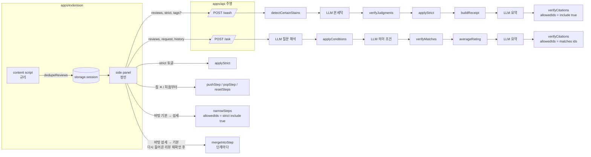

# Design Document

## Overview

wash-rules는 `@star-laundry/core`(`packages/core`)를 만든다. 확장과 세탁 API가 같이 쓰는 공통 타입과 순수 함수 15개(단계 스택 `pushStep`, `popStep`, `resetSteps`와 바탕 전환 `narrowSteps`, `mergeIntoStep` 포함)를 TypeScript 소스 그대로 내보낸다. 빌드 단계는 없다.

설계 원칙:

- 시그니처와 타입은 `.kiro/steering/api-contract.md` "코어 함수" 절과 글자 그대로 같다. 바꿀 일이 생기면 api-contract.md와 타입을 같은 커밋에서 고친다.
- 함수 하나에 파일 하나. 클래스, 전략 패턴, 설정 객체 없이 함수와 상수만 쓴다.
- 숫자(평점, 개수)는 이 패키지만 계산한다. LLM 응답의 숫자는 받지 않는다.
- 15:25 PR(task 1)에서 최종 파일 경로, 최종 시그니처, 최종 `index.ts`를 먼저 내보내고, 이후 task는 함수 본문만 바꾼다. 소비자(주영, 규리, 정민)의 import 문은 15:25 이후 바뀌지 않는다.

### 15:25 PR 순서 제약

| 순서 | 시점 | 내용 | 소비자에게 보장되는 것 |
|---|---|---|---|
| task 1 (PR 1) | 15:25, 가장 먼저 `main`에 합침 | 라이브러리 일괄 설치, `tsconfig.base.json`, `packages/core/package.json`, 공통 타입 4개 파일, 함수 15개의 임시 구현, `index.ts` | 모든 타입과 함수를 최종 이름·경로로 import할 수 있고 `tsc --noEmit`이 통과한다 |
| task 2~ | 15:35~16:35 | 본문 구현 + 속성 테스트 | 시그니처 변경 없음. 본문만 바뀐다 |
| 16:35 | 통합 1 | 주영의 `/wash`, `/ask`가 실제 코어 함수로 동작 | |

PR 1에서 하지 않는 것: 함수 본문, 테스트, fixture. PR 1은 리뷰 부담이 작아야 5분 안에 합쳐진다.

## Architecture

### 패키지 구조

```
tsconfig.base.json                     # 루트. strict 공통 설정 (task 1)
package.json                           # 루트 devDependencies: typescript, vitest, fast-check (task 1)
packages/core/
├── package.json                       # name @star-laundry/core, exports → src/index.ts, test: vitest --run
├── tsconfig.json                      # extends base, lib ES2022, types [] (DOM·Node 전역 금지)
├── __fixtures__/
│   └── powerbank.json                 # AI로 만든 가상 리뷰
└── src/
    ├── index.ts                       # 공개 경계 (barrel). 타입 + 함수 15개
    ├── types/
    │   ├── review.ts                  # Site, Source, Review
    │   ├── wash.ts                    # Stain, Signal, WashTag, Cited, Receipt, ReceiptCounts
    │   ├── ask.ts                     # Conditions, Match, Step
    │   └── messages.ts                # Intake 메시지 4종 + IntakeMessage 유니온
    ├── utils/
    │   ├── normalizeText.ts           # normalizeForQuote, normalizeLoose (내부)
    │   ├── dedupeReviews.ts           # dedupeReviews
    │   └── testArbitraries.ts         # fast-check 생성기, deepFreeze (테스트 전용, index에서 내보내지 않음)
    ├── rules/
    │   ├── stainKeywords.ts           # 규칙 문구 상수 (유일한 정의 위치)
    │   ├── containsQuote.ts           # containsQuote
    │   ├── detectCertainStains.ts     # 애벌빨래
    │   ├── verifyJudgments.ts         # 판정 검수
    │   ├── applyStrict.ts             # 섬세 세탁 적용
    │   ├── verifyCitations.ts         # 요약 근거 검증
    │   └── verifyMatches.ts           # 부분 세탁 결과 검수
    ├── rating/
    │   ├── averageRating.ts
    │   └── buildReceipt.ts
    └── filter/
        ├── applyConditions.ts
        ├── steps.ts                   # pushStep, popStep, resetSteps, MAX_STEPS
        ├── stepRating.ts              # Step_Rating 계산 (내부, index에서 내보내지 않음)
        ├── narrowSteps.ts             # 바탕 좁히기 (기본 → 섬세)
        └── mergeIntoStep.ts           # 바탕 넓히기 (섬세 → 기본)
```

각 함수 파일 옆에 `*.test.ts`를 둔다 (structure.md). 별도 `tests/` 폴더는 만들지 않는다.

배치 근거: structure.md는 `rules/`를 "규칙 기반 확실한 얼룩 탐지, evidence·quote 원문 확인"으로 정한다. 그래서 원문·근거를 확인하는 함수(`containsQuote`, `verifyJudgments`, `verifyCitations`, `verifyMatches`)와 `applyStrict`는 `rules/`에 둔다. `dedupeReviews`는 어느 폴더 설명에도 없는 입고 보조 함수라서 `utils/`에 둔다. `narrowSteps`, `mergeIntoStep`은 단계 스택을 다루므로 `steps.ts`와 같은 `filter/`에 둔다. `steps.ts`에 합치지 않고 함수마다 파일을 나누는 이유는 두 함수가 `averageRating`, `verifyCitations`를 import하기 때문이다. `steps.ts`는 다른 모듈에 기대지 않는 작은 파일로 남긴다.

### 소비자와 데이터 흐름



### 빌드 없는 소스 공유

- `packages/core/package.json`의 `exports`, `main`, `types`가 모두 `./src/index.ts`를 가리킨다. npm workspaces가 `node_modules/@star-laundry/core`를 `packages/core`로 심볼릭 링크하므로, 소비자는 `.ts` 소스를 직접 받는다.
- 해석 경로: Vite(확장), Vitest(테스트), esbuild(CDK Lambda 번들)는 `.ts`를 그대로 변환한다. TypeScript는 `moduleResolution: "Bundler"`로 `exports`의 `.ts`를 따라간다.
- 주영의 로컬 API 서버가 Node 타입 스트리핑(`node --experimental-strip-types`, Node 22.6 이상)으로 돌 수도 있으므로, 코어는 그 방식에서도 깨지지 않게 쓴다.
  - 내부 상대 import는 `.ts` 확장자를 붙인다 (`import { containsQuote } from './containsQuote.ts'`). `allowImportingTsExtensions: true` + `noEmit: true`.
  - 런타임 코드가 생기는 TS 전용 문법(`enum`, `namespace`, 생성자 매개변수 속성)을 쓰지 않는다. 리터럴 유니온과 `as const`만 쓴다.
  - 타입은 `import type` / `export type`으로 가져온다 (`verbatimModuleSyntax: true`).
- Node는 심볼릭 링크를 실제 경로(`packages/core/src`)로 풀기 때문에 "node_modules 안의 .ts는 스트리핑하지 않는다" 제한에 걸리지 않는다.

### 설정 파일

`tsconfig.base.json` (루트, task 1):

```json
{
  "compilerOptions": {
    "target": "ES2022",
    "module": "ESNext",
    "moduleResolution": "Bundler",
    "strict": true,
    "noUncheckedIndexedAccess": true,
    "verbatimModuleSyntax": true,
    "allowImportingTsExtensions": true,
    "resolveJsonModule": true,
    "isolatedModules": true,
    "noEmit": true,
    "skipLibCheck": true
  }
}
```

`packages/core/tsconfig.json`:

```json
{
  "extends": "../../tsconfig.base.json",
  "compilerOptions": { "lib": ["ES2022"], "types": [] },
  "include": ["src/**/*.ts", "__fixtures__/*.json"],
  "exclude": ["src/**/*.test.ts", "src/utils/testArbitraries.ts"]
}
```

- `lib: ["ES2022"]`, `types: []`이므로 `document`, `window`, `fetch`, `setTimeout`, `process`, `Buffer` 같은 전역을 쓰면 `tsc`가 실패한다. Requirement 4.1의 일부를 컴파일 단계에서 막는다. `Math.random`과 `Date.now`는 ES 표준이라 막히지 않으므로 리뷰로 확인한다.
- 테스트 파일은 vitest 타입이 Node 타입을 끌어올 수 있어 `tsc` 대상에서 뺀다. 테스트는 Vitest가 실행한다.
- `apps/api`, `apps/extension`, `infra`의 `tsconfig.json`은 같은 base를 `extends`한다. 각 앱의 `lib`/`types`(DOM, chrome, node)는 그 앱 담당이 정한다. task 1은 각 앱에 base만 상속하는 최소 `tsconfig.json`과 `package.json`(의존성만)을 만든다.

`packages/core/package.json`:

```json
{
  "name": "@star-laundry/core",
  "version": "0.0.0",
  "private": true,
  "type": "module",
  "exports": { ".": "./src/index.ts" },
  "main": "./src/index.ts",
  "types": "./src/index.ts",
  "scripts": {
    "test": "vitest --run --passWithNoTests",
    "typecheck": "tsc --noEmit -p ."
  },
  "dependencies": { "zod": "<설치 시점 버전>" }
}
```

- `build` 스크립트와 `dist/`는 없다 (Requirement 1.6).
- `--passWithNoTests`: PR 1에는 테스트가 없다. 이 플래그가 없으면 `vitest --run`이 "No test files found"로 실패해 루트 `npm test --workspaces`가 깨진다. 테스트가 생긴 뒤에도 해가 없다.
- 소비자 쪽 `package.json`에는 `"@star-laundry/core": "*"`를 dependencies에 넣는다.
- 라이브러리 버전은 15:10~15:25 설치 시점의 최신 안정판을 `npm install`이 고른 그대로 둔다. 이 문서에서 버전을 고정하지 않는다.

## Components and Interfaces

### 공통 타입 (`src/types`)

api-contract.md의 정의를 그대로 옮긴다. 추가는 아래 두 가지뿐이다.

- `ReceiptCounts = Omit<Receipt, 'summary' | 'pros' | 'cons'>`: `buildReceipt` 반환 타입에 이름을 붙인 별칭. 구조는 계약과 같다.
- `messages.ts`의 메시지 타입 (intake.md 표 기준).

```ts
// types/messages.ts
import type { Review } from './review.ts';

export type IntakeDoneReason = null | 'blocked' | 'captcha' | 'unexpected' | 'hidden_tab';
export type IntakeErrorReason = 'not_product_page' | 'blocked' | 'parse_failed';

export interface IntakeStartMessage { type: 'intake:start'; tabId: number; }
export interface IntakeProgressMessage { type: 'intake:progress'; tabId: number; done: number; total: number; }
export interface IntakeDoneMessage { type: 'intake:done'; tabId: number; reviews: Review[]; partial: boolean; reason: IntakeDoneReason; }
export interface IntakeErrorMessage { type: 'intake:error'; tabId: number; reason: IntakeErrorReason; }

export type IntakeMessage =
  | IntakeStartMessage | IntakeProgressMessage | IntakeDoneMessage | IntakeErrorMessage;
```

`tabId`는 `chrome.tabs.Tab.id`와 같은 `number`다.

### 공개 함수 (`src/index.ts`)

```ts
export type { Site, Source, Review } from './types/review.ts';
export type { Stain, Signal, WashTag, Cited, Receipt, ReceiptCounts } from './types/wash.ts';
export type { Conditions, Match, Step } from './types/ask.ts';
export type {
  IntakeStartMessage, IntakeProgressMessage, IntakeDoneMessage, IntakeErrorMessage,
  IntakeMessage, IntakeDoneReason, IntakeErrorReason,
} from './types/messages.ts';

export { dedupeReviews } from './utils/dedupeReviews.ts';
export { containsQuote } from './rules/containsQuote.ts';
export { detectCertainStains } from './rules/detectCertainStains.ts';
export { verifyJudgments } from './rules/verifyJudgments.ts';
export { applyStrict } from './rules/applyStrict.ts';
export { verifyCitations } from './rules/verifyCitations.ts';
export { verifyMatches } from './rules/verifyMatches.ts';
export { averageRating } from './rating/averageRating.ts';
export { buildReceipt } from './rating/buildReceipt.ts';
export { applyConditions } from './filter/applyConditions.ts';
export { pushStep, popStep, resetSteps, MAX_STEPS } from './filter/steps.ts';
export { narrowSteps } from './filter/narrowSteps.ts';
export { mergeIntoStep } from './filter/mergeIntoStep.ts';
```

| 함수 | 시그니처 | PR 1 임시 구현 |
|---|---|---|
| `dedupeReviews` | `(best: Review[], latest: Review[]) => { reviews: Review[]; sources: Receipt['sources'] }` | `{ reviews: [], sources: { best: 0, latest: 0, duplicates: 0 } }` |
| `detectCertainStains` | `(reviews: Review[]) => WashTag[]` | `[]` |
| `verifyJudgments` | `(reviews: Review[], ruleTags: WashTag[], llmTags: WashTag[]) => WashTag[]` | `[]` |
| `applyStrict` | `(tags: WashTag[], strict: boolean) => WashTag[]` | `[]` |
| `averageRating` | `(reviews: Review[]) => number \| null` | `null` |
| `buildReceipt` | `(reviews: Review[], tags: WashTag[], sources: Receipt['sources'], partial: boolean) => ReceiptCounts` | `basedOn: 0`, `sources: { 0, 0, 0 }`, `before: null`, `after: null`, `stains` 네 키 모두 0, `removed: 0`, `partial: false` |
| `verifyCitations` | `(cited: Cited[], allowedIds: string[]) => Cited[]` | `[]` |
| `applyConditions` | `(reviews: Review[], conditions: Conditions) => Review[]` | `[]` |
| `verifyMatches` | `(reviews: Review[], matches: Match[]) => Match[]` | `[]` |
| `containsQuote` | `(text: string, quote: string) => boolean` | `false` |
| `pushStep` | `(steps: Step[], step: Step) => Step[]` | `[]` |
| `popStep` | `(steps: Step[]) => Step[]` | `[]` |
| `resetSteps` | `() => Step[]` | `[]` |
| `narrowSteps` | `(steps: Step[], reviews: Review[], allowedIds: string[]) => Step[]` | `steps.slice()` (입력 단계 배열의 얕은 복사본) |
| `mergeIntoStep` | `(step: Step, reviews: Review[], addedIds: string[]) => Step` | `{ ...step }` (입력 Step의 얕은 복사) |

임시 구현은 Requirement 3.2대로 빈 결과를 돌려준다. 예외는 두 바탕 전환 함수다. `Step`을 돌려주는 `mergeIntoStep`에는 "빈 Step"이 없으므로 입력의 얕은 복사를 돌려준다. `narrowSteps`도 `[]`를 돌려주면 정민의 화면에서 바탕을 바꾸는 순간 쌓은 단계가 모두 사라지므로, 아무것도 줄이지 않은 복사본을 돌려준다. 두 경우 모두 화면은 "바탕을 바꿔도 단계는 그대로"인 상태로 동작한다. 사용하지 않는 매개변수는 `_` 접두사를 붙여 strict 경고를 피하고, 본문 첫 줄에 `// TODO(wash-rules task N)`을 단다. PR 1의 `stainKeywords.ts`는 Requirement 6의 초기값을 그대로 담아 함께 올린다 (규리가 어댑터에서 배지 문구를 맞춰 볼 수 있도록).

### 텍스트 정규화 (`utils/normalizeText.ts`, 내부)

두 가지 정규화가 있고 섞어 쓰지 않는다.

| 함수 | 지우는 것 | 대소문자 | 쓰는 곳 |
|---|---|---|---|
| `normalizeForQuote(s)` | 공백·줄바꿈(`\s`), 문장부호(`\p{P}`), 기호(`\p{S}`, 이모지·`~`·`^` 포함) | 유지 | `containsQuote` |
| `normalizeLoose(s)` | 공백·줄바꿈(`\s`) | `toLowerCase()` | `applyConditions`의 `option`, `includes`, `excludes` |
| `compact(s)` | 공백·줄바꿈(`\s`) | 유지 | `detectCertainStains` 문구 비교 |

```ts
const QUOTE_NOISE = /[\s\p{P}\p{S}]/gu;
export const normalizeForQuote = (s: string): string => s.replace(QUOTE_NOISE, '');
export const normalizeLoose = (s: string): string => s.replace(/\s/gu, '').toLowerCase();
export const compact = (s: string): string => s.replace(/\s/gu, '');
```

- 세 함수 모두 코드 포인트 단위로 문자를 하나씩 지우는 필터다. 그래서 원문의 연속 부분 문자열을 정규화하면 정규화된 원문의 연속 부분 문자열이 된다. Requirement 7.4가 이 성질에 기댄다.
- 유니코드 정규화(NFC)는 하지 않는다. NFD 원문을 음절 중간에서 자른 인용문이 NFC 변환 후 원문에 없게 되어 7.4가 깨진다. 쿠팡 본문과 LLM 출력은 둘 다 NFC로 들어온다고 본다.

### `containsQuote(text, quote)`

```ts
export function containsQuote(text: string, quote: string): boolean {
  const q = normalizeForQuote(quote);
  if (q.length === 0) return false;
  return normalizeForQuote(text).includes(q);
}
```

### `dedupeReviews(best, latest)`

1. `Map<string, Review>`와 순서 배열을 둔다.
2. `best`를 앞에서부터 돈다. 처음 보는 `id`면 `{ ...review, source: 'best' }`를 넣는다.
3. `latest`를 돈다. 처음 보는 `id`면 `{ ...review, source: 'latest' }`를 넣는다. 이미 있으면 건너뛴다.
4. `sources = { best: best.length, latest: latest.length, duplicates: best.length + latest.length - reviews.length }`.

- `best` 안에서 같은 ID가 두 번 나와도 첫 번째만 남고 `duplicates`에 세어진다.
- 리뷰 객체는 얕은 복사로 새로 만든다. `photos`, `badges` 배열은 공유하지만 바꾸지 않으므로 입력 불변은 지켜진다.

### `stainKeywords.ts`

```ts
export const PLATFORM_BADGE_TERM = '체험단';
export const PLATFORM_NOTICE = '쿠팡체험단 이벤트로 상품을 무료로 제공받아 작성된 후기입니다';
export const DISCLOSURE_PHRASES = ['체험단', '제공받아', '제공 받아', '협찬', '원고료', '소정의',
  '무상으로 제공', '무료로 제공', '업체로부터', '지원받아'] as const;
export const REVIEW_EVENT_PHRASES = ['리뷰 이벤트', '리뷰이벤트', '포토리뷰 이벤트', '리뷰 작성 시',
  '리뷰 쓰면', '사은품 받', '적립금 받'] as const;
export const NEGATIONS = ['아니', '아님', '아닙', '않', '안 받', '없이', '내돈내산', '내 돈 내 산',
  '직접 구매', '제 돈으로'] as const;
export const NEGATION_WINDOW = 15;
```

- **"아닙" 추가**: stain-rules.md의 예시 "체험단 아닙니다"는 원래 부정 목록으로는 걸러지지 않는다. "아닙"의 "닙"은 "아니"의 "니"와 다른 완성형 음절이라 "아니"가 부분 문자열로 들어 있지 않기 때문이다. Requirement 16.3의 예시 테스트를 통과시키려고 `NEGATIONS`에 "아닙"을 넣는다. 같은 PR에서 stain-rules.md 부정 표현 목록과 requirements.md 6.7에도 "아닙"을 추가한다.
- 문구가 바뀌면(Requirement 17) 이 파일과 예시 테스트만 고친다. 속성 테스트 S4의 생성기는 이 상수에서 문구를 읽으므로 고칠 필요가 없다.

### `detectCertainStains(reviews)`

리뷰마다 아래 순서로 검사하고 처음 걸린 것을 쓴다 (우선순위 `platform_badge` → `disclosure` → `review_event`).

1. **배지**: `badges.some(b => compact(b).includes(compact(PLATFORM_BADGE_TERM)))` → `certain / platform_badge / evidence null`.
2. **본문 고지 문장**: `PLATFORM_NOTICE`를 띄어쓰기 무시로 찾는다 → `certain / platform_badge / evidence = 걸린 문장`. 부정 검사는 하지 않는다 (쿠팡 고정 문구).
3. **대가성 문구**: `DISCLOSURE_PHRASES` 각각의 모든 등장 위치 중 부정 창에 걸리지 않은 첫 위치(원문 위치 기준 가장 앞)를 쓴다 → `certain / disclosure`.
4. **리뷰 이벤트 문구**: 같은 방식 → `certain / review_event`.
5. 아무것도 없으면 `none / null / null / include true`.

`certain`이면 항상 `include: false`.

**띄어쓰기 무시 검색** (내부 함수 `findPhrase(text, phrase)`):

- 원문에서 공백이 아닌 문자만 모은 `compactText`와, `compactText`의 각 문자가 원문의 몇 번째 문자였는지 담은 `indexMap: number[]`을 만든다.
- `compact(phrase)`를 `compactText`에서 `indexOf`로 반복해서 찾는다. 찾은 위치를 `indexMap`으로 원문 범위 `[start, end)`로 바꾼다.
- 반환: 원문 범위 목록.

**부정 창**: 원문 `text.slice(max(0, start - 15), min(text.length, end + 15))`를 `compact`한 문자열에 `compact(negation)`이 하나라도 들어 있으면 그 등장은 무시한다. 15자는 원문 문자 수(공백 포함) 기준이다.

**근거 문장** (내부 함수 `sentenceAround(text, start, end)`):

- 문장 경계는 `.`, `!`, `?`, `。`, `…`, 줄바꿈이다.
- `start` 앞의 마지막 경계 다음 위치부터 `end` 이후 첫 경계(경계 문자 포함)까지 자르고 앞뒤 공백을 지운다. 문구가 경계를 가로질러도(예: "제공\n받아") 두 문장을 이어 붙인 범위가 된다.
- 결과는 항상 원문의 연속 부분 문자열이고 걸린 문구를 포함하므로 `containsQuote(text, evidence)`가 `true`다 (P6이 구조적으로 성립).

알려진 한계: "협찬 없이"처럼 정확한 부정은 맞게 거르지만, "리뷰 이벤트 참여했는데 문제없이 잘 써요"처럼 창 안에 관계없는 부정 표현이 있으면 얼룩을 놓친다. `certain`은 정밀도를 우선하므로 받아들인다. 놓친 리뷰는 LLM 본세탁이 `suspected` 이상으로 다시 볼 수 있다.

### `verifyJudgments(reviews, ruleTags, llmTags)`

```
ruleById = 첫 등장 기준 Map(ruleTags)
llmById  = 첫 등장 기준 Map(llmTags)            // 입력에 없는 id는 자연히 쓰이지 않는다
for review of reviews:
  rule = ruleById.get(review.id) ?? NONE_TAG(review.id)
  if rule.stain === 'certain': emit normalized(rule); continue
  llm = llmById.get(review.id)
  if !llm: emit normalized(rule); continue
  ok = llm.evidence !== null && containsQuote(review.text, llm.evidence)
  switch llm.stain:
    'certain':
      if !ok                                         → suspected / 'suspected' / null
      else if signal ∈ {disclosure, review_event}    → certain / llm.signal / llm.evidence
      else                                           → suspected / 'suspected' / llm.evidence
    'suspected':
      if !ok → none / null / null
      else   → suspected / 'suspected' / llm.evidence
    'none'   → none / null / null
  include = (stain !== 'certain')
```

- `normalized(tag)`는 `id`를 리뷰 ID로, `include`를 `stain !== 'certain'`으로 맞추고, `none`이면 `signal`과 `evidence`를 `null`로 맞춘다. 규칙 태그를 그대로 믿지 않고 형태만 정리한다.
- `certain`의 `evidence`가 원문 밖이면 `suspected`로 내리고 `evidence: null`이 된다 (Requirement 8.5, 8.7). 이 `suspected`는 "LLM이 대가성을 주장했지만 원문 근거를 확인하지 못함"이다. 사이드 패널은 근거 없는 의심 얼룩으로 표시한다.
- LLM은 `platform_badge`를 낼 수 없다. 배지는 코드만 본다 (8.8).
- `include`는 여기서 기본 세탁 기준으로 정하고, 섬세 세탁 여부는 `applyStrict`가 최종 결정한다.

### `applyStrict(tags, strict)`

```ts
tags.map(t => ({ ...t, include: t.stain === 'none' || (t.stain === 'suspected' && !strict) }));
```

### `averageRating(reviews)`

```ts
if (reviews.length === 0) return null;
const sum = reviews.reduce((s, r) => s + r.rating, 0);
return Math.round((sum * 10) / reviews.length) / 10;
```

- `sum`과 개수는 정수다. `sum * 10 / n`의 정확한 값이 `k + 0.5`일 때 이 값은 double로 정확히 표현되고 IEEE 나눗셈이 그 값을 그대로 낸다. 양수에서 `Math.round`는 0.5를 올리므로 "반올림(half up)"과 같다.
- 테스트 오라클은 정수 연산 `Math.floor((20 * sum + n) / (2 * n)) / 10`이다.

### `buildReceipt(reviews, tags, sources, partial)`

```
tagById = 첫 등장 기준 Map(tags)
stains  = { platform_badge: 0, disclosure: 0, review_event: 0, suspected: 0 }
included = []; removed = 0
for review of reviews:
  tag = tagById.get(review.id)                 // 없으면 none / include true
  if tag && tag.stain !== 'none': stains[tag.signal ?? 'suspected'] += 1
  if tag && !tag.include: removed += 1 else included.push(review)
return { basedOn: reviews.length, sources: { ...sources }, before: averageRating(reviews),
         after: averageRating(included), stains, removed, partial }
```

- `stain`이 `none`이 아닌데 `signal`이 `null`인 태그(타입상 가능)는 `suspected`로 센다. 그래야 `stains` 합이 얼룩 리뷰 수와 항상 같다 (P10).
- 입력에 없는 ID의 태그는 `tagById`에서 조회되지 않으므로 무시된다.

### `verifyCitations(cited, allowedIds)`

```
allowed = new Set(allowedIds)
out = []
for c of cited:
  if c.text.trim() === '': continue
  ids = c.reviewIds 중 allowed에 있는 것, 첫 등장 순서로 중복 제거
  if ids.length === 0: continue
  out.push({ text: c.text, reviewIds: ids })
```

`/wash`에서 주영은 `allowedIds`에 `include: true` 리뷰 ID를, `/ask`에서는 검수된 `matches`의 ID를 넘긴다. 이 선택은 호출하는 쪽의 책임이고, 코어는 주어진 `allowedIds`만 본다.

### `applyConditions(reviews, conditions)`

조건 필드마다 술어를 만들고 모두 만족하는 리뷰를 입력 순서대로 남긴다 (`reviews.filter`).

| 필드 | 무시하는 경우 | 통과 조건 |
|---|---|---|
| `rating.min` | `undefined` | `r.rating >= min` |
| `rating.max` | `undefined` | `r.rating <= max` |
| `date.from` | `undefined` | `r.date >= from` (문자열 비교) |
| `date.to` | `undefined` | `r.date <= to` |
| `hasPhoto` | `undefined` | `r.hasPhoto === hasPhoto` |
| `source` | `undefined` | `r.source === source` |
| `option` | `undefined`, 정규화 후 빈 항목만 있음 | `r.option !== null`이고 `normalizeLoose(r.option)`이 정규화된 항목 중 하나 이상을 포함 |
| `includes` | `undefined`, 정규화 후 빈 항목만 있음 | `normalizeLoose(r.text)`가 정규화된 항목을 모두 포함 |
| `excludes` | `undefined`, 정규화 후 빈 항목만 있음 | `normalizeLoose(r.text)`가 정규화된 항목을 하나도 포함하지 않음 |
| `semantic` | 항상 무시 | — |

- 정규화 후 빈 문자열이 되는 항목(예: `" "`)은 버린다. 남은 항목이 없으면 그 필드는 빈 배열과 같게 취급한다 (Requirement 13.11).
- `min > max`처럼 모순된 조건은 그대로 적용해 빈 결과가 된다. 해석 오류 처리는 주영의 `/ask` 해석 단계 몫이다.
- `date.from`, `date.to`가 YYYY-MM-DD 형식인지는 검사하지 않는다. 형식 검증은 API 입력 검증(zod)에서 한다.

### `verifyMatches(reviews, matches)`

```
byId = 첫 등장 기준 Map(reviews)
seen = new Set(); out = []
for m of matches:
  review = byId.get(m.id); if !review: continue
  if m.quote !== null && !containsQuote(review.text, m.quote): continue
  if seen.has(m.id): continue
  seen.add(m.id); out.push({ id: m.id, quote: m.quote })
```

`seen`은 통과한 항목만 기록한다. 그래서 같은 ID의 앞 항목이 검수에 떨어지면 뒤의 유효한 항목이 남는다 (Requirement 14.4 "첫 번째 유효 항목").

**`/ask` 평균 별점(P15)**: 별도 함수를 만들지 않는다. 주영은 `verifyMatches` 결과를 `byId`로 리뷰에 대응시켜 `averageRating`에 넘기고 `count = matches.length`로 둔다. 테스트는 이 조합을 그대로 검증한다.

### 단계 스택 (`filter/steps.ts`)

```ts
export const MAX_STEPS = 5;
export const pushStep = (steps: Step[], step: Step): Step[] =>
  step.ids.length === 0 || steps.length >= MAX_STEPS ? steps.slice() : [...steps, step];
export const popStep = (steps: Step[]): Step[] => steps.slice(0, -1);
export const resetSteps = (): Step[] => [];
```

- 항상 새 배열을 돌려준다. 정민은 React 상태에 결과를 그대로 넣는다.
- "빈 스택 = 세탁된 리뷰 전체"는 화면의 해석이다. 현재 목록은 `steps.at(-1)?.ids ?? 세탁된 리뷰 ID 전체`로 구한다.
- `pushStep`이 거절했는지는 `result.length === steps.length`로 알 수 있다. 정민은 이때 "결과 없음" 또는 "처음부터" 안내를 보여준다.

### 단계 평균 별점 (`filter/stepRating.ts`, 내부)

`narrowSteps`와 `mergeIntoStep`이 같이 쓰는 Step_Rating 계산이다.

```ts
export function stepRating(ids: string[], reviews: Review[]): Step['rating'] {
  const byId = new Map<string, Review>();
  for (const r of reviews) if (!byId.has(r.id)) byId.set(r.id, r);   // 첫 등장 기준
  const selected = ids.flatMap(id => { const r = byId.get(id); return r ? [r] : []; });
  return { average: averageRating(selected), count: ids.length };
}
```

- `reviews`에 같은 ID가 여러 번 있으면 첫 번째 리뷰의 별점을 쓴다 (`verifyMatches`의 `byId`와 같은 규칙).
- `count`는 Requirement 정의대로 `ids.length`다. 정상 흐름에서 `ids`는 중복이 없고 모두 `reviews`에 있으므로 `selected.length`와 같다. `reviews`에 없는 ID가 섞이면 그 ID는 평균에서만 빠지고 `count`에는 남는다. 이 어긋남은 호출하는 쪽이 세탁된 리뷰 전체를 `reviews`로 넘기면 생기지 않는다.
- `ids`가 비면 `{ average: null, count: 0 }`.

### `narrowSteps(steps, reviews, allowedIds)`

바탕을 기본 → 섬세로 바꿀 때 정민이 부른다. `allowedIds`는 `applyStrict(tags, true)`에서 `include: true`인 ID, `reviews`는 입고한 리뷰 전체다.

```ts
export function narrowSteps(steps: Step[], reviews: Review[], allowedIds: string[]): Step[] {
  const allowed = new Set(allowedIds);
  const out: Step[] = [];
  for (const step of steps) {
    const ids = step.ids.filter(id => allowed.has(id));
    if (ids.length === 0) break;                        // 비게 된 단계부터 뒤는 잘라낸다
    out.push({
      request: step.request, label: step.label, conditions: step.conditions,
      ids,
      rating: stepRating(ids, reviews),
      summary: verifyCitations(step.summary, ids),
      pros: verifyCitations(step.pros, ids),
      cons: verifyCitations(step.cons, ids),
    });
  }
  return out;
}
```

- 단계 ID 거르기는 입력 순서를 지키는 `filter`다. 입력 `ids`에 중복이 있으면 그대로 남는다 (Requirement 19.1. 정상 흐름의 단계 `ids`는 `verifyMatches` 결과라 중복이 없다).
- 요약 근거는 `verifyCitations`를 그대로 다시 쓴다. 근거 ID가 모두 빠진 문장은 사라진다. 새 문장을 만들지 않으므로 지금 보는 단계의 요약을 `/ask`로 다시 만드는 일은 정민의 몫이다 (api-contract.md "세탁 순서 자유롭게 섞기").
- 비게 된 단계에서 멈추는 이유: 뒤 단계는 앞 단계의 목록을 다시 거른 결과다. 앞 단계가 비면 뒤 단계는 근거가 될 목록이 없다. 단계를 건너뛰고 뒤 단계를 살리면 칩 줄의 "›" 관계가 깨진다.
- 단계마다 같은 `allowed`로 거르므로, 입력 단계들이 중첩(`ids[k] ⊆ ids[k-1]`)이면 출력도 중첩이다 (P16).
- `conditions` 객체는 복사하지 않고 같은 참조를 넘긴다. 코어는 이 객체를 바꾸지 않는다.
- 결과 길이는 입력보다 길어지지 않으므로 `MAX_STEPS`를 다시 검사하지 않는다.

### `mergeIntoStep(step, reviews, addedIds)`

바탕을 섬세 → 기본으로 바꿀 때 정민이 단계마다 부른다. `addedIds`는 다시 들어온 리뷰(의심 얼룩) 중 그 단계의 정해진 조건(`applyConditions`)과 의미 조건(`/ask` 재확인)을 통과한 ID다. 통과 여부를 정하는 일은 호출하는 쪽 몫이고, 코어는 받은 ID를 합치고 평균을 다시 낸다.

```ts
export function mergeIntoStep(step: Step, reviews: Review[], addedIds: string[]): Step {
  const seen = new Set<string>();
  const ids: string[] = [];
  for (const id of [...step.ids, ...addedIds]) {
    if (!seen.has(id)) { seen.add(id); ids.push(id); }
  }
  return { ...step, ids, rating: stepRating(ids, reviews) };
}
```

- 기존 `ids`가 먼저, 더한 ID가 뒤에 온다. 같은 ID는 첫 등장만 남는다. `addedIds`가 비어도 입력 `ids`의 중복은 제거되고 `rating`은 다시 계산된다 (Requirement 20.5, 20.3).
- `request`, `label`, `conditions`, `summary`, `pros`, `cons`는 입력과 같다. 요약은 더한 리뷰를 반영하지 않으므로, 지금 단계의 요약을 다시 만드는 일은 정민이 `/ask`로 한다.
- 단계 하나만 다룬다. 단계 사이 중첩 관계(뒤 단계에 더한 ID가 앞 단계에도 있는지)는 호출 순서로 지킨다: 정민은 앞 단계부터 차례로 다시 확인하고, 뒤 단계에는 앞 단계 결과 안에서 통과한 ID만 넘긴다.

### 세탁 품질 검사 (`scripts/eval`, 선택)

- 파일: `scripts/eval/evalRules.ts`. 실행: `node --experimental-strip-types scripts/eval/evalRules.ts` (Node 22.6 이상). 코어는 `../../packages/core/src/index.ts`로 import한다.
- 입력: `scripts/eval/data/labeled-reviews.json` = `Array<{ review: Review; label: 'certain' | 'suspected' | 'none' }>`. 파일이 없거나 비어 있으면 이 경로를 출력하고 `process.exit(1)`.
- 출력: 전체 수, TP/FP/FN, `certain` 정밀도 = TP/(TP+FP), 재현율 = TP/(TP+FN). 분모가 0이면 `N/A`. 리뷰 본문과 ID는 출력하지 않는다.
- 이 스크립트는 `fs`를 쓰므로 `packages/core` 밖에 둔다.

## Data Models

api-contract.md의 타입이 데이터 모델이다. 코어가 지키는 불변식은 다음과 같다.

| 대상 | 불변식 |
|---|---|
| `Review.id` | `dedupeReviews` 결과 안에서 유일 |
| `WashTag` | `stain === 'none'` ⇔ `signal === null`. `stain === 'none'` ⇒ `evidence === null`. `stain === 'suspected'` ⇒ `signal === 'suspected'`. `stain === 'certain'` ⇒ `include === false`. `stain === 'none'` ⇒ `include === true`. `evidence !== null` ⇒ `containsQuote(review.text, evidence)` |
| `ReceiptCounts` | `basedOn === reviews.length`. `removed === include:false 수`. `sum(stains) === stain≠none 수`. `before`, `after` ∈ `{null} ∪ [1.0, 5.0]`이고 소수 첫째 자리 |
| `Cited` | `text.trim() !== ''`. `reviewIds`는 비어 있지 않고 중복 없음 |
| `Match` | `id`는 입력 리뷰에 있음. ID 중복 없음. `quote !== null` ⇒ 원문에 포함 |
| `Step[]` | 길이 ≤ 5. 모든 `step.ids`가 비어 있지 않음. `narrowSteps` 뒤에도 유지된다 (빈 단계에서 자르고 길이가 늘지 않음) |
| `Step.rating` | `narrowSteps`, `mergeIntoStep` 결과에서 `rating === stepRating(ids, reviews)` |

### 테스트 데이터

- `__fixtures__/powerbank.json`: AI로 만든 가상 보조배터리 리뷰 약 12개. 각 신호(배지, 고지 문장, 대가성 문구, 리뷰 이벤트), 띄어쓰기 변형("제공 받아"), 부정 예시("제공받은 거 아니고 내돈내산입니다", "체험단 아닙니다"), 의심 기준 예시, 사진·옵션 유무를 하나 이상 포함한다. 실존 업체·인물·실제 리뷰 문장은 넣지 않는다.
- `utils/testArbitraries.ts`:
  - `arbReview`: `id`는 `cp-0`~`cp-19`의 작은 풀에서 뽑아 충돌이 자주 나게 한다. `rating` 1~5, `date`는 2025-01-01~2026-12-31의 YYYY-MM-DD, `text`는 고정 조각(fixture에서 뽑은 문장, 키워드 문구, 부정 표현, 문장부호)과 `fc.string()`을 섞어 이어 붙인다. `option`은 `null` 또는 작은 문자열 풀, `badges`는 `[]` 또는 `["쿠팡체험단"]` 등.
  - `arbUniqueReviews`: ID가 유일한 리뷰 배열 (`fc.uniqueArray`, selector `r => r.id`).
  - `arbWashTagFor(review)`: 리뷰에 대한 임의 LLM 태그. `evidence`는 `null`, 원문의 코드 포인트 부분 문자열, 원문에 없는 문자열 중 하나.
  - `arbConditions`: 각 필드를 `fc.option`으로 넣거나 뺀다. `includes`/`excludes`/`option` 항목은 리뷰 생성에 쓴 조각 풀에서 뽑아 실제로 걸리게 한다.
  - `arbStep`, `arbSteps`(길이 0~5). `ids`와 `summary`/`pros`/`cons`의 `reviewIds`는 리뷰와 같은 `cp-0`~`cp-19` 풀에서 뽑는다.
  - `arbNestedSteps`: 각 단계 `ids`를 직전 단계 `ids`의 부분 시퀀스(`fc.subarray`)로 만든 단계 배열 (P16의 중첩 체인).
  - `arbIdSubset`: 같은 ID 풀의 부분집합. `allowedIds`, `addedIds`에 쓴다. 빈 배열과 풀 전체를 포함한다.
  - `codePointSlice(s, a, b)`: `Array.from(s).slice(a, b).join('')`. 부분 문자열 생성은 항상 코드 포인트 단위로 한다 (서로게이트 쌍을 자르지 않음).
  - `deepFreeze(x)`: 입력 불변 검사용.

## Correctness Properties

*A property is a characteristic or behavior that should hold true across all valid executions of a system-essentially, a formal statement about what the system should do. Properties serve as the bridge between human-readable specifications and machine-verifiable correctness guarantees.*

속성 1~15는 testing.md의 P1~P15와 번호가 같다 (괄호 안 표기). P15는 testing.md 표에서 P14 앞에 있지만 번호 순으로 적는다. 속성 16~23은 testing.md 표에 없는 요구사항을 덮는 보조 속성 S1~S8이다. 속성 24, 25는 나중에 testing.md에 추가된 P16, P17이다. 기존 속성 번호를 바꾸지 않으려고 뒤에 붙였다. 테스트 이름에는 괄호 안 표기(`P3:`, `S4:`, `P16:`)를 쓴다. 속성 번호와 testing.md 번호가 달라도 테스트 이름으로 testing.md 표를 바로 찾을 수 있다.

### Property 1: (P1) 입고 중복 제거는 멱등이다

*For any* 리뷰 배열 `best`, `latest`에 대해 `r = dedupeReviews(best, latest).reviews`의 ID는 모두 다르고, `dedupeReviews(r, []).reviews`는 `r`과 ID 목록·순서가 같고 `source`를 뺀 나머지 필드가 같다. 다시 넣으면 모든 항목이 `best`에서 오므로 `source`는 `"best"`로 바뀔 수 있다 (Requirement 5.3과 충돌하지 않게 `source`는 비교에서 뺀다).

**Validates: Requirements 5.1, 5.6**

### Property 2: (P2) basedOn은 중복 제거 후 리뷰 수와 같다

*For any* 리뷰 배열 `best`, `latest`와 그 결과 `{ reviews, sources }`에 대해, 임의 태그 배열 `tags`와 `partial`로 만든 `buildReceipt(reviews, tags, sources, partial).basedOn`은 `reviews.length`와 같고, `sources.duplicates`는 `best.length + latest.length - reviews.length`와 같다.

**Validates: Requirements 5.5, 11.1**

### Property 3: (P3) strict는 포함 집합을 줄이기만 한다

*For any* WashTag 배열 `tags`에 대해 `applyStrict(tags, true)`에서 `include: true`인 ID 집합은 `applyStrict(tags, false)`에서 `include: true`인 ID 집합의 부분집합이다.

**Validates: Requirements 9.6**

### Property 4: (P4) after는 포함 리뷰 평균의 반올림이고 1.0~5.0 사이다

*For any* 비어 있지 않은 리뷰 배열에 대해 `averageRating`은 `Math.floor((20 * sum + n) / (2 * n)) / 10`과 같고 1.0 이상 5.0 이하다. *For any* 리뷰 배열과 태그 배열에 대해 `buildReceipt(...).after`는 `include: true`(태그 없는 리뷰 포함) 리뷰에 대한 `averageRating`과 같다.

**Validates: Requirements 10.1, 10.2, 11.4**

### Property 5: (P5) 포함 리뷰가 없을 때만 after가 null이다

*For any* 리뷰 배열 `reviews`에 대해 `averageRating(reviews) === null`은 `reviews.length === 0`과 같다. *For any* 리뷰 배열과 태그 배열에 대해 `buildReceipt(...).after === null`은 포함 리뷰가 0개인 것과 같다.

**Validates: Requirements 10.3, 10.4, 11.4**

### Property 6: (P6) evidence가 null이 아니면 항상 원문에 들어 있다

*For any* 리뷰 배열과 임의 LLM 태그 배열에 대해 `detectCertainStains(reviews)`와 `verifyJudgments(reviews, detectCertainStains(reviews), llmTags)`가 낸 모든 태그 `t`는 `t.evidence === null`이거나 `containsQuote(review.text, t.evidence)`가 `true`다 (`review`는 `t.id`의 리뷰).

**Validates: Requirements 6.3, 6.4, 6.5, 6.11, 8.12**

### Property 7: (P7) 원문에 없는 evidence를 댄 LLM 판정은 한 단계 낮아진다

*For any* 규칙에 걸리지 않은 리뷰와, `evidence`가 `null`이거나 `containsQuote`를 통과하지 못하는 LLM 태그에 대해, LLM 태그가 `certain`이면 결과는 `suspected / "suspected" / evidence null`이고, `suspected`이면 결과는 `none / null / null`이다.

**Validates: Requirements 8.5, 8.6, 8.7**

### Property 8: (P8) 요약 근거 ID는 비어 있지 않은 허용 ID 부분집합이다

*For any* Cited 배열과 `allowedIds`에 대해 `verifyCitations` 결과의 모든 항목은 `reviewIds`가 비어 있지 않고 모두 `allowedIds`에 있다. `/wash` 조합(`allowedIds` = `applyStrict` 결과의 `include: true` ID)과 `/ask` 조합(`allowedIds` = `verifyMatches` 결과 ID)에서도 같다.

**Validates: Requirements 12.1, 12.3, 12.6**

### Property 9: (P9) /ask의 quote는 항상 원문에 들어 있다

*For any* 리뷰 배열과 Match 배열에 대해 `verifyMatches` 결과에서 `quote !== null`인 모든 항목은 같은 ID 리뷰의 원문에 대해 `containsQuote`가 `true`다.

**Validates: Requirements 14.2, 14.6**

### Property 10: (P10) stains 합은 얼룩 리뷰 수, removed는 제외 리뷰 수다

*For any* 리뷰 배열과 WashTag 배열에 대해 `buildReceipt` 결과의 `stains` 네 값의 합은 태그의 `stain`이 `none`이 아닌 입력 리뷰 수와 같고, `removed`는 태그의 `include`가 `false`인 입력 리뷰 수와 같다.

**Validates: Requirements 11.6, 11.7**

### Property 11: (P11) 정해진 조건 필터는 정확하다

*For any* 리뷰 배열과 Conditions에 대해 `applyConditions(reviews, c)`는 테스트에 따로 쓴 오라클 술어로 거른 `reviews.filter(oracle(c))`와 같다 (결과의 모든 리뷰가 조건을 만족하고, 만족하는 입력 리뷰는 입력 순서대로 모두 결과에 있다). `semantic` 값을 바꿔도 결과는 같다.

**Validates: Requirements 13.1, 13.2, 13.3, 13.4, 13.5, 13.6, 13.7, 13.8, 13.9, 13.10, 13.11, 13.12**

### Property 12: (P12) 정해진 조건 필터는 멱등이고 순서와 무관하다

*For any* 리뷰 배열과 Conditions `c`, 그리고 `c`의 필드를 두 묶음으로 나눈 `c1`, `c2`에 대해 `applyConditions(applyConditions(r, c), c)`, `applyConditions(applyConditions(r, c1), c2)`, `applyConditions(applyConditions(r, c2), c1)`은 모두 `applyConditions(r, c)`와 같다.

**Validates: Requirements 13.13, 13.14**

### Property 13: (P13) /ask 결과는 입력의 부분집합이고 단계를 쌓을수록 줄거나 같다

*For any* 리뷰 배열과 Match 배열에 대해 `verifyMatches` 결과 ID는 입력 리뷰 ID의 부분집합이고 서로 다르다. *For any* 리뷰 배열과 Match 배열의 연속(단계 1~5)에 대해, 각 단계의 다음 입력을 직전 결과 ID에 해당하는 리뷰로 정하면 목록 길이는 단계마다 줄거나 같다.

**Validates: Requirements 14.7, 14.8**

### Property 14: (P14) popStep(pushStep(s, x))는 s와 같다

*For any* 길이 0~4인 Step 배열 `s`와 `ids`가 비어 있지 않은 Step `x`에 대해 `pushStep(s, x)`는 `[...s, x]`이고 `popStep(pushStep(s, x))`는 `s`와 같다. *For any* Step 배열 `s`에 대해 `ids`가 빈 Step이나 길이 5인 `s`에서는 `pushStep`이 `s`와 같은 배열을 돌려주고, `popStep(s)`는 `s.slice(0, -1)`, `resetSteps()`는 `[]`다.

**Validates: Requirements 15.1, 15.2, 15.3, 15.4, 15.5, 15.6, 15.7**

### Property 15: (P15) /ask의 rating은 matches 평균이고 count는 matched와 같다

*For any* 리뷰 배열과 Match 배열에 대해 `m = verifyMatches(reviews, matches)`, `selected = m.map(x => byId(x.id))`일 때 `{ average: averageRating(selected), count: m.length }`의 `count`는 `m.length`이고, `average`는 `count === 0`일 때만 `null`이며 `selected` 평균의 반올림과 같다.

**Validates: Requirements 10.5**

### Property 16: (S1) 모든 공개 함수는 입력을 바꾸지 않고 결정적이다

*For any* 생성된 입력에 대해 공개 함수 15개 각각은 깊게 얼린(`deepFreeze`) 입력으로 호출해도 예외를 던지지 않고, 같은 입력을 `structuredClone`해 두 번 호출한 결과가 서로 같다.

**Validates: Requirements 4.2, 4.3**

### Property 17: (S2) 중복 제거는 best 우선 합집합 모델과 같다

*For any* 리뷰 배열 `best`, `latest`에 대해 `dedupeReviews` 결과는 "best를 앞에서부터, 그다음 latest를 앞에서부터 보며 처음 나온 ID만 남기고 best에서 온 것은 `source: "best"`, latest에서만 온 것은 `source: "latest"`로 바꾼" 모델 결과와 같고, `sources.best === best.length`, `sources.latest === latest.length`다.

**Validates: Requirements 5.1, 5.2, 5.3, 5.4, 5.5**

### Property 18: (S3) 판정 태그는 형태 불변식을 지킨다

*For any* 리뷰 배열, 임의 LLM 태그 배열, `strict` 값에 대해 `detectCertainStains`, `verifyJudgments`, `applyStrict`의 결과는 입력 리뷰(또는 태그)와 길이·순서·`id`가 같고, 모든 태그가 Data Models 표의 WashTag 불변식(`none` ⇔ `signal null`, `none` ⇒ `evidence null`, `suspected` ⇒ `signal "suspected"`, `certain` ⇒ `include false`, `none` ⇒ `include true`)을 지킨다. `applyStrict`는 `stain`, `signal`, `evidence`를 바꾸지 않고 `include`를 `stain === "none" || (stain === "suspected" && !strict)`로 정한다.

**Validates: Requirements 6.1, 6.9, 6.10, 8.1, 8.9, 8.10, 8.11, 9.1, 9.2, 9.3, 9.4, 9.5**

### Property 19: (S4) 규칙 문구 탐지는 띄어쓰기에 무관하고 부정과 우선순위를 따른다

*For any* 키워드와 부정 표현이 생길 수 없는 문자로만 만든 앞뒤 filler, `DISCLOSURE_PHRASES` 또는 `REVIEW_EVENT_PHRASES`에서 고른 문구, 문구 글자 사이에 임의로 넣은 공백에 대해: (a) `filler + 문구 + filler`는 `certain`과 해당 `signal`로 판정되고, (b) 문구 바로 뒤나 앞(15자 안)에 `NEGATIONS` 중 하나를 붙이면 `none`이며, (c) 같은 리뷰의 `badges`에 `PLATFORM_BADGE_TERM`이 들어간 문자열을 넣으면 `platform_badge / evidence null`, 대가성 문구와 리뷰 이벤트 문구를 함께 심으면 `disclosure`다.

**Validates: Requirements 6.2, 6.4, 6.5, 6.6, 6.7, 6.8, 17.2**

### Property 20: (S5) 원문 포함 확인은 정규화 포함 모델과 같다

*For any* 문자열 `text`, `quote`에 대해 `containsQuote(text, quote)`는 `normalizeForQuote(quote) !== '' && normalizeForQuote(text).includes(normalizeForQuote(quote))`와 같다. *For any* `text`의 코드 포인트 단위 연속 부분 문자열 `q`에 대해 `normalizeForQuote(q)`가 비어 있지 않으면 `containsQuote(text, q)`는 `true`다. 공백과 문장부호만으로 된 `quote`는 항상 `false`다.

**Validates: Requirements 7.1, 7.2, 7.3, 7.4**

### Property 21: (S6) 판정 검수는 규칙 우선이고 LLM은 platform_badge를 낼 수 없다

*For any* 리뷰 배열, 규칙 태그, LLM 태그(입력에 없는 ID 포함)에 대해 `verifyJudgments` 결과는: 규칙 태그가 `certain`인 리뷰에서 규칙 태그와 `stain`, `signal`, `evidence`가 같고; LLM 태그가 없는 리뷰에서 규칙 태그와 같으며; 입력에 없는 ID의 LLM 태그를 지워도 결과가 같고; 결과가 `certain`이면서 규칙 태그가 `certain`이 아니면 `signal`은 `disclosure` 또는 `review_event`다.

**Validates: Requirements 8.2, 8.3, 8.4, 8.8**

### Property 22: (S7) 근거 검증과 매치 검수는 순서를 지키는 필터 모델과 같다

*For any* Cited 배열과 `allowedIds`에 대해 `verifyCitations` 결과는 "빈 `text` 제거, `reviewIds`를 허용 ID로 거르고 첫 등장 순서로 중복 제거, 빈 근거 제거, `text`는 그대로" 모델과 같다. *For any* 리뷰 배열과 Match 배열에 대해 `verifyMatches` 결과는 "입력에 없는 ID 제거, 원문 밖 `quote` 제거, `quote: null`은 유지, 같은 ID는 첫 유효 항목만, 입력 순서 유지" 모델과 같다.

**Validates: Requirements 12.1, 12.2, 12.3, 12.4, 12.5, 14.1, 14.2, 14.3, 14.4, 14.5**

### Property 23: (S8) 영수증은 리뷰와 태그의 직접 집계와 같다

*For any* 리뷰 배열, WashTag 배열(입력에 없는 ID, 빠진 리뷰 포함), `sources`, `partial`에 대해 `buildReceipt` 결과는 `sources`, `partial`이 입력과 같고, `before === averageRating(reviews)`이며, `stains`는 네 키를 모두 가지고 각 값이 해당 `signal`의 얼룩 리뷰 수이고, 태그 없는 리뷰는 `none / include true`로, 입력에 없는 ID의 태그는 없는 것으로 집계한 결과와 같다.

**Validates: Requirements 11.2, 11.3, 11.5, 11.8, 11.9**

### Property 24: (P16) 바탕 좁히기는 허용 ID로 단계를 줄이고 평균을 다시 계산한다

*For any* Step 배열 `steps`, 리뷰 배열 `reviews`, `allowedIds`에 대해, `k`를 `steps[i].ids.filter(id ∈ allowedIds)`가 처음으로 비는 인덱스(없으면 `steps.length`)라 할 때 `out = narrowSteps(steps, reviews, allowedIds)`는 길이가 `k`이고, 모든 `i < k`에서 `out[i].ids`는 `steps[i].ids.filter(id ∈ allowedIds)`와 같으며(따라서 `allowedIds`와 `steps[i].ids`의 부분집합), `out[i].rating`은 `{ average: averageRating(out[i].ids의 리뷰, ID마다 reviews의 첫 등장), count: out[i].ids.length }`이고, `out[i].summary`, `pros`, `cons`는 `verifyCitations(steps[i].필드, out[i].ids)`이며, `request`, `label`, `conditions`는 `steps[i]`와 같다. *For any* 중첩 단계 배열(각 `ids`가 직전 단계 `ids`의 부분집합)에 대해 출력의 각 단계 `ids`도 직전 출력 단계 `ids`의 부분집합이다.

**Validates: Requirements 19.1, 19.2, 19.3, 19.4, 19.5, 19.6, 19.7, 19.8, 19.9, 19.10**

### Property 25: (P17) 바탕 넓히기는 합집합을 만들고 평균을 다시 계산한다

*For any* Step `step`, 리뷰 배열 `reviews`, `addedIds`에 대해 `m = mergeIntoStep(step, reviews, addedIds)`의 `ids`는 `[...step.ids, ...addedIds]`에서 첫 등장만 남긴 배열과 같아 중복이 없고 집합으로 `step.ids ∪ addedIds`와 같으며, `m.rating`은 `{ average: averageRating(m.ids의 리뷰, ID마다 reviews의 첫 등장), count: m.ids.length }`이고, `request`, `label`, `conditions`, `summary`, `pros`, `cons`는 `step`과 같다.

**Validates: Requirements 20.1, 20.2, 20.3, 20.4, 20.5**

### 테스트로 덮지 않는 요구사항

| 요구사항 | 확인 방법 |
|---|---|
| 1.1~1.6, 2.1~2.6, 3.1, 3.3, 4.4 | `npm run typecheck --workspace packages/core`, PR 리뷰, `grep -r "apps/\|infra" packages/core/src` |
| 1.5 | 16:35 통합에서 `apps/api`, `apps/extension`의 import 확인 |
| 3.2 | PR 1 시점의 `tsc --noEmit`. 본문이 채워지면 사라지는 상태라 테스트하지 않는다 |
| 4.1 | core `tsconfig`의 `lib`/`types` 제한 + 리뷰(`Math.random`, `Date` 미사용) |
| 6.12, 17.1 | 리뷰. 문구 문자열이 `stainKeywords.ts` 밖에 없는지 grep |
| 16.1~16.6 | `npm test --workspace packages/core` 한 번 실행 |
| 18.1~18.4 | 로컬 실행 (선택 기능) |

## Error Handling

코어 함수는 타입에 맞는 입력에서 예외를 던지지 않는다. 잘못된 형식(스키마 위반)은 API 경계의 zod 검증에서 막고, 코어는 타입 안에서 생길 수 있는 어긋남만 조용히 정리한다.

| 상황 | 처리 | 위치 |
|---|---|---|
| 같은 ID 리뷰가 여러 번 | 첫 번째만 쓴다 | `dedupeReviews`, `verifyMatches`(`byId`), `buildReceipt`(`tagById`) |
| 리뷰에 대응하는 태그 없음 | `none / include true`로 본다 | `verifyJudgments`, `buildReceipt` |
| 입력에 없는 ID의 태그·매치·근거 | 버린다 | `verifyJudgments`, `buildReceipt`, `verifyMatches`, `verifyCitations` |
| LLM `evidence`가 원문에 없음 / `null` | 한 단계 낮추고 `evidence: null` | `verifyJudgments` |
| LLM이 `certain`에 `platform_badge`·`suspected` 신호 | `suspected`로 낮춤 | `verifyJudgments` |
| `stain ≠ none`인데 `signal: null` | `suspected`로 집계 | `buildReceipt` |
| 원문에 없는 `quote` | 그 매치를 버린다 | `verifyMatches` |
| 공백만 있는 요약 문장, 근거 없는 요약 문장 | 버린다 | `verifyCitations` |
| 정규화 후 빈 조건 항목 | 그 항목을 무시 | `applyConditions` |
| 정규화 후 빈 `quote` | `false` | `containsQuote` |
| 평균 낼 리뷰 없음 | `null` (UI는 "계산할 리뷰 없음") | `averageRating` |
| 결과 0개 단계, 6번째 단계 | 쌓지 않고 같은 배열의 복사본 반환 | `pushStep` |
| 빈 스택에서 뒤로 | `[]` | `popStep` |
| 바탕을 좁히니 단계가 빔 | 그 단계와 뒤 단계를 잘라낸다. 정민은 남은 마지막 단계(없으면 바탕 세탁 목록)를 보여준다 | `narrowSteps` |
| 바탕을 좁히니 요약 근거 ID가 모두 빠짐 | 그 문장을 지운다 | `narrowSteps` (`verifyCitations`) |
| 단계 `ids`나 `addedIds`에 `reviews`에 없는 ID | 평균에서만 빠지고 `count`에는 남는다 | `stepRating` |
| `addedIds`가 이미 단계에 있는 ID | 첫 등장만 남긴다 | `mergeIntoStep` |
| eval 데이터 없음 | 경로 안내 후 종료 코드 1 | `scripts/eval/evalRules.ts` |

## Testing Strategy

- 도구: Vitest + fast-check. 실행은 `npm test --workspace packages/core` (= `vitest --run --passWithNoTests`).
- 속성 테스트는 속성마다 `it` 하나다. 테스트 이름은 속성 번호로 시작한다: `it('P3: strict는 포함 집합을 줄이기만 한다', ...)`. 바로 위에 `// Feature: wash-rules, Property 3 (P3): strict의 include 집합은 기본 세탁 include 집합에 포함된다` 주석을 단다. 보조 속성은 `S4:`처럼 S 번호로 시작한다.
- 반복 횟수: `fc.assert(fc.property(...), { numRuns: 100 })` 이상. S1은 함수 15개를 한 번에 돌리므로 `numRuns: 50`으로 낮춰도 된다.
- 테스트 파일 배치:

| 테스트 파일 | 속성 | 예시 테스트 |
|---|---|---|
| `utils/dedupeReviews.test.ts` | P1, S2 | `best`·`latest` 겹침 1건 |
| `rules/containsQuote.test.ts` | S5 | 줄바꿈·문장부호 차이, 빈 `quote`, 이모지 |
| `rules/detectCertainStains.test.ts` | P6(규칙 부분), S4 | fixture 신호별 1건, "제공 받아", "제공받은 거 아니고 내돈내산입니다" → none, "체험단 아닙니다" → none, 고지 문장 → platform_badge + 문장 |
| `rules/verifyJudgments.test.ts` | P6, P7, S6 | LLM `certain` + 원문 문장 → 유지 |
| `rules/applyStrict.test.ts` | P3, S3 | |
| `rules/verifyCitations.test.ts` | P8, S7(근거) | |
| `rules/verifyMatches.test.ts` | P9, P13, P15, S7(매치) | |
| `rating/averageRating.test.ts` | P4(평균), P5 | `[4, 5]` → 4.5, `[4, 4, 5]` → 4.3, `[]` → null |
| `rating/buildReceipt.test.ts` | P2, P4(after), P10, S8 | api-contract.md 응답 예시 형태 1건 |
| `filter/applyConditions.test.ts` | P11, P12 | "사진 있음", "3점 이하" fixture 예시 |
| `filter/steps.test.ts` | P14 | 6번째 push 거절 |
| `filter/narrowSteps.test.ts` | P16 (Property 24) | 2단계 중 둘째 단계가 비면 첫 단계만 남음, 근거 ID가 모두 빠진 요약 문장 삭제, 빈 `steps` → `[]` |
| `filter/mergeIntoStep.test.ts` | P17 (Property 25) | 이미 있는 ID를 더하면 중복 없음, 빈 `addedIds`면 `ids` 그대로·`rating` 재계산 |
| `index.test.ts` | S1, S3(조합) | `index.ts`가 15개 함수를 내보내는지 |

- P11의 오라클은 `applyConditions.ts`를 import하지 않고 테스트 파일 안에 필드별 술어로 따로 쓴다. 같은 코드를 두 번 돌리는 테스트가 되지 않게 하기 위해서다. 정규화 함수(`normalizeLoose`)만 공유한다.
- P16, P17의 오라클도 `stepRating.ts`를 import하지 않는다. 테스트 안에서 첫 등장 `byId`를 따로 만들고 공개 함수 `averageRating`, `verifyCitations`만 쓴다. 이 두 함수는 P4, S7이 따로 검증한다.
- P16 생성기의 `reviews`에는 같은 ID가 두 번 나오는 경우를 넣는다 (`arbReview`의 작은 ID 풀). "ID마다 첫 등장 리뷰" 규칙이 실제로 시험된다.
- 예시 테스트는 fixture(`__fixtures__/powerbank.json`)만 쓰고, 속성 테스트는 fast-check 생성 데이터만 쓴다. 실제 리뷰 원문은 쓰지 않는다 (Requirement 16.4, 16.5).
- 시간이 모자라면 S1~S8을 먼저 미룬다. P1~P17과 Requirement 16.3의 예시 테스트는 제출 체크리스트 항목이라 미루지 않는다.

### 구현 순서 (tasks.md 근거)

1. **task 1, 15:25 PR**: 라이브러리 설치, `tsconfig.base.json`, 앱별 최소 `package.json`·`tsconfig.json`, core `package.json`·`tsconfig.json`, 타입 4개, `stainKeywords.ts`, 함수 15개 임시 구현(`narrowSteps.ts`, `mergeIntoStep.ts` 포함), `index.ts`. 확인: `npm run typecheck --workspace packages/core`, `npm test --workspace packages/core`(테스트 없음으로 통과).
2. `normalizeText.ts` + `containsQuote` + `testArbitraries.ts` (다른 함수와 테스트가 모두 기대는 기반).
3. `dedupeReviews` (규리의 입고가 15:35부터 쓴다).
4. `detectCertainStains` + fixture (주영의 애벌빨래).
5. `verifyJudgments`, `applyStrict`.
6. `averageRating`, `buildReceipt`.
7. `verifyCitations`.
8. `applyConditions`, `verifyMatches`, 단계 스택 (부분 세탁. 16:35 통합 전에 합친다).
9. `stepRating`, `narrowSteps`, `mergeIntoStep` + P16, P17 (바탕 전환. `averageRating`(6)과 `verifyCitations`(7)에 기대므로 그 뒤에 한다. 정민의 방식 전환 작업이 16:45부터라 16:45 전에 합친다).
10. 보조 속성 S1~S8, `scripts/eval` (16:45 이후, 선택).

hackathon.md의 자르는 순서에서 "기본 바탕 전환"은 앞쪽에 있다. 시간이 모자라면 9를 미루고 임시 구현(단계를 그대로 두는 복사본)을 남긴다. 이때도 P16, P17은 체크리스트 항목이므로 tasks.md에 미완료로 남겨 실제 상태와 맞춘다.

2~9는 끝날 때마다 30분 규칙에 따라 작은 PR로 합친다. 시그니처는 1에서 고정했으므로 이 순서가 소비자 코드를 깨지 않는다.

### 열린 결정

- **zod 의존성**: tech.md 표에 따라 `packages/core`에 zod를 설치하지만 이 spec의 함수는 zod를 쓰지 않는다. wash-llm이 공용 스키마(`Review`, `WashTag`)를 코어에 두기로 하면 그쪽 spec에서 추가한다. 마감 때까지 쓰지 않으면 hackathon.md "쓰지 않은 설정 정리"에 따라 core 의존성에서 뺀다.
- **"아닙" 부정 표현**: 위 `stainKeywords.ts` 절대로 추가한다. stain-rules.md, requirements.md 6.7을 같은 PR에서 고친다.
