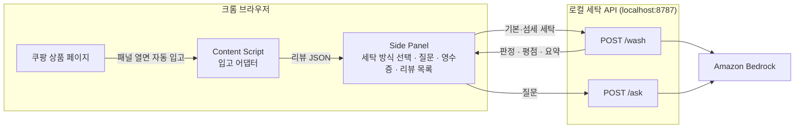

# 🧺 별점세탁소

[시연영상]
https://youtu.be/pqPKkVvwT8U


> **"리뷰한테 물어보세요. 얼룩은 빼고 답해드릴게요."**
> 쿠팡 상품 페이지에서 패널을 열면 리뷰를 읽어 오고, **기본 · 섬세 · 부분 세탁** 중 하나를 고르면 체험단, 제품 제공 같은 대가성 리뷰(**얼룩**)를 걷어낸 **세탁 후 평점**과 **세탁 후 요약**을 보여주는 크롬 확장 프로그램이에요.
> 궁금한 것만 자연어로 물어보면, 세탁된 리뷰 중에서 골라 근거가 달린 요약으로 답해요.

Kirothon 2026 출품작 · 주제: *내 일상에 바로 적용할 수 있는 서비스*
**팀 규랑이 탐험대** · 재현(세탁 규칙) · 주영(세탁 LLM) · 규리(입고·태그) · 정민(사이드 패널)

> 쿠팡과 제휴하지 않은 비공식 도구입니다.

```
📥 입고         베스트순 50 + 최신순 50 → 중복 제외 96개
⭐ 세탁 전 평점  4.8
🧼 얼룩 제거      25개  (체험단 18 · 대가성 문구 7)
🟡 의심 얼룩       6개  (표시만, 평점에는 반영 안 함)
✨ 세탁 후 평점  4.3   ▼0.5
📝 세탁 후 요약  가볍고 충전이 빠르다는 평가가 많지만, 오래 쓰면 뜨거워진다는 리뷰도 꾸준히 있다.
```

> 📸 *(스크린샷/GIF: 쿠팡 세탁 전후 평점 · 문장으로 좁혀 간 리뷰 카드 목록 · 근거 문장 강조)*

---

## ⚡ 평가자용 빠른 체험

API는 클라우드에 배포하지 않았다. 레포 루트에 확장 zip 두 개가 있다.

| 파일 | 내용 | 필요한 것 |
|---|---|---|
| `byeoljeom-laundry-demo.zip` | **예시 데이터판.** 서버 없이 화면 흐름 전체(시작 화면, 영수증, 리뷰 카드, 부분 세탁, 조건 칩)를 확인 | 없음 |
| `byeoljeom-laundry-extension.zip` | **실제 동작판.** 쿠팡 리뷰를 입고하고 로컬 세탁 API(`http://localhost:8787`)로 세탁 | 아래 "개발자용 실행 방법"의 로컬 API 서버 (Amazon Bedrock 권한 필요) |

실제 쿠팡 페이지에서 처음부터 끝까지 동작하는 장면은 별도로 제출한 데모 영상에서 볼 수 있다.

1. zip을 풀고 크롬 `chrome://extensions` → 오른쪽 위 **개발자 모드** 켜기 → **압축해제된 확장 프로그램 로드** → 압축을 푼 폴더를 선택한다.
2. 쿠팡 예시 상품 페이지를 열고 툴바의 🧺 아이콘을 눌러 사이드 패널을 연다. 리뷰 입고가 자동으로 시작된다.
   - 쿠팡 예시 상품: [맥세이프 보조배터리 10000mAh](https://www.coupang.com/vp/products/8476098818?itemId=25071030734&vendorItemId=92075130632)
3. 시작 화면에 **🧺 기본 세탁 · 🔍 섬세 세탁 · 🎯 부분 세탁** 버튼과 각 설명이 나온다. **🧺 기본 세탁**을 누르면 세탁 후 평점, 세탁 후 요약, 세탁된 리뷰 카드 목록이 나온다. **빠진 리뷰 보기**에서 🔴🟡 태그와 근거를 확인한다.
4. 위쪽에서 **🔍 섬세 세탁**으로 바꿔 본다. 의심 얼룩까지 뺀 평점이 바로 나온다.
5. **🎯 이 결과에서 원하는 리뷰 찾기**를 누르고 원하는 리뷰를 문장으로 입력한다. 조건에 맞는 리뷰 카드와 평균 별점, 요약, 장점·단점이 뜬다.
   - `사진 있는 리뷰만 보여줘`
6. 그 결과에 이어서 질문해 더 좁힌다. 칩의 ✕로 한 단계 뒤로 간다.
   - `그중에 3점 이하이고 발열 얘기한 것만`

---

## 1. 문제: 별점에 얼룩이 묻어 있다

- 우리는 **매일** 리뷰와 별점을 보고 물건을 산다.
- 그런데 리뷰에는 **체험단, 제품 제공, 리뷰이벤트**("리뷰 쓰면 사은품 증정") 리뷰가 섞여 있어서 **별점이 부풀려진다**.
- 대가성 리뷰는 원래 그 사실을 밝혀야 한다(공정위 「추천·보증 등에 관한 표시·광고 심사지침」). 하지만 실제로는 표기가 없거나 눈에 잘 띄지 않는다.
- 궁금한 건 하나인데("이거 무거워?", "오래 쓰면 뜨거워?") **리뷰 수백 개를 직접 스크롤**해야 한다.

> 📊 **숫자로 본 문제** — 한국소비자원, 배달 플랫폼 3사 이용자 1,000명 조사 (2024)
> - 음식 주문 후 후기를 쓴 소비자 중 **65.2%**가 "리뷰이벤트에 참여하려고" 썼다고 답했다.
> - 리뷰이벤트에 참여해 후기를 쓴 소비자 **10명 중 8명**은 이벤트가 별점에 영향을 줬고, 대부분 **실제 만족도보다 높게** 줬다고 답했다.
> - 소비자원은 별점 중심 후기 시스템 개선과 이벤트 참여 후기 명시를 권고했다.
>
> 출처: [YTN, 2024.07.23](https://www.ytn.co.kr/_ln/0102_202407231204212645) · [YTN, 2024.07.24](https://www.ytn.co.kr/_ln/0103_202407242052571964)

**→ 플랫폼이 바뀌기를 기다리는 대신, 소비자가 지금 바로 쓸 수 있는 도구를 만든다.**

## 2. 해결: 리뷰를 세탁한다

사이드 패널을 열면 별점세탁소가 지금 보고 있는 상품의 리뷰를 **자동으로 입고**한다. 그다음 두 가지를 할 수 있다.

시작 화면에서 세 가지 세탁 중 하나를 고른다. 버튼마다 무엇을 하는지 설명과 예시가 붙어 있다.

1. **🧺 기본 세탁 / 🔍 섬세 세탁 (버튼)**: 얼룩을 빼고 세탁 후 평점을 계산한다. 섬세 세탁은 광고로 의심되는 리뷰까지 뺀다. LLM이 **얼룩을 뺀 리뷰로만** 세탁 후 요약을 쓴다.
2. **🎯 부분 세탁 (문장형 질문)**: "사진 있는 3점 이하 리뷰 중에 발열 얘기만"처럼 자유롭게 물어보면, 세탁된 리뷰 중 조건에 맞는 **리뷰 원문 목록**과 요약을 보여준다. 그 목록에 다시 질문해서 원하는 리뷰를 **계속 좁혀 갈 수 있다**.

요약 문장마다 근거 리뷰가 달려 있어서 누르면 원본 리뷰로 이동한다.

### 세탁소 용어
| 용어 | 의미 |
|---|---|
| **입고** | 사이드 패널을 열면 페이지에서 리뷰를 읽어 오는 단계 |
| **얼룩** | 대가성 리뷰. 🔴 **확실한 얼룩**(플랫폼 체험단 표시, "제공받아" 같은 명시)과 🟡 **의심 얼룩**(명시는 없지만 대가성 신호가 있는 리뷰)으로 나뉜다 |
| **세탁 전 / 세탁 후 평점** | 입고한 리뷰 전체의 평균 / 얼룩을 제외하고 다시 계산한 평균 |
| **세탁 후 요약** | 얼룩을 뺀 리뷰로만 LLM이 쓴 2~3문장 요약. 문장마다 근거 리뷰 ID가 있다 |
| **세탁 요청** | 부분 세탁에서 사용자가 입력하는 자유로운 문장 |
| **부분 세탁** | 세탁된 리뷰를 문장으로 거르고, 결과에 다시 질문해 계속 좁혀 가기 |
| **조건 칩** | 쌓인 단계 표시. ✕로 한 단계 뒤로 간다 |
| **세탁 영수증** | 결과 카드. 기준 리뷰 수, 제거한 얼룩, 세탁 후 평점, 세탁 후 요약, 장점·단점과 근거 |
| **세탁 태그** | 리뷰 카드에 붙는 판정 배지 (🔴 확실한 얼룩, 🟡 의심 얼룩)와 근거 |
| **리뷰 카드** | 사이드 패널에 뜨는 리뷰 한 개. 별점, 작성일, 구매 옵션, 사진, 본문 전체, 세탁 태그. 작성자 이름은 보여주지 않는다 |

### 세탁 방식
| 방식 | 사용자 동작 | 결과 |
|---|---|---|
| 🧺 **기본 세탁** | 시작 화면 🧺 버튼 | 🔴 확실한 얼룩을 빼고 세탁 전 4.8 → **세탁 후 4.3**, 세탁 후 요약과 장점·단점. 🟡 의심 얼룩은 태그만 붙인다 |
| 🔍 **섬세 세탁** | 시작 화면 🔍 버튼 (결과 화면에서 바로 전환 가능) | 🟡 의심 얼룩도 평점과 요약에서 뺀다 |
| 🎯 **부분 세탁** | 시작 화면 🎯 버튼 → 문장 입력: "사진 있는 리뷰만" → "그중에 3점 이하 발열 얘기만" | 조건에 맞는 리뷰 카드 목록, 근거 문장 강조, 평균 별점, 요약과 장점·단점. 질문할수록 좁아진다 |

- 부분 세탁은 기본 세탁 결과를 그대로 쓴다. 아직 세탁하지 않았다면 기본 세탁을 먼저 자동으로 한다.
- 기본·섬세 세탁 직후에도 세탁된 리뷰 목록을 볼 수 있다. 얼룩으로 빠진 리뷰는 "빠진 리뷰 보기"로 따로 본다.
- 별점, 기간, 사진, 구매 옵션 같은 조건은 **LLM이 아니라 코드가** 거른다. 그래서 "3점 이하"라고 하면 4점 리뷰는 절대 섞이지 않는다.

### 세탁 원칙
1. **AI는 판정만, 숫자는 코드가.** 평점과 개수는 코드로 계산해서 정확하게 낸다.
2. **근거 없는 요약은 없다.** 요약 문장을 누르면 사이드 패널에서 근거 리뷰 카드로 이동하고 근거 문장을 강조한다.
3. **정직한 표시.** "리뷰 N개 기준"과 입고 범위를 밝힌다. 의심 얼룩은 "가짜"라고 단정하지 않고 **신호와 근거**로만 보여준다.

## 3. 대상: 쿠팡 상품 페이지

| 판정 | 신호 |
|---|---|
| 🔴 확실한 얼룩 | 쿠팡 체험단 표시, "제공받아", "협찬", "원고료" 같은 대가성 명시, 판매자 리뷰 이벤트 참여 명시 |
| 🟡 의심 얼룩 | 사용 경험 없는 칭찬만, 홍보 문구 반복, 구매 링크·할인 코드·다른 채널 언급, 판매자 말투 |

### 리뷰 수집 원칙 (입고 정책)
- **사용자가 보고 있는 페이지에서, 사용자가 사이드 패널을 열었을 때만** 리뷰를 읽는다.
- 쿠팡은 **베스트순 50개 + 최신순 50개**를 읽고 중복을 뺀다. 베스트순은 사용자가 처음 보는 리뷰이고, 최신순은 상품의 지금 상태다. 리뷰가 100개보다 적으면 있는 만큼 읽는다.
- 요청은 **한 번에 하나씩, 1~2초 간격**으로만 보낸다. 상품 하나당 최대 10번이다.
- 차단 응답(403, 429, 확인 페이지)을 받으면 **바로 멈추고**, 그때까지 읽은 리뷰와 화면에 보이는 리뷰로만 분석한다. 우회하지 않는다.
- 서버에서 크롤링하지 않는다. 리뷰를 **디스크나 서버에 저장하지 않는다.** 탭이 열려 있는 동안 메모리에만 두고, 탭을 닫으면 버린다.

## 4. 시스템 구성



| 구성 | 역할 |
|---|---|
| **크롬 확장** (`apps/extension`) | Manifest V3. 패널을 열면 입고 어댑터가 리뷰를 읽고, 사이드 패널(세탁 방식 선택·질문·영수증·조건 칩·리뷰 카드 목록)에 결과와 리뷰 원문을 모두 보여준다 |
| **세탁 API** (`apps/api`) | Node.js 로컬 서버(`src/dev/localServer.ts`). 핸들러는 Lambda 형식으로 작성해 나중에 그대로 배포할 수 있다. `POST /wash`: 애벌빨래(규칙) → 본세탁(Bedrock) → 검수(코드 계산) → 세탁 후 요약. `POST /ask`: 질문 해석 → 코드 필터 → 의미 조건 고르기 → 요약 |
| **코어 로직** (`packages/core`) | 리뷰 타입, 세탁 후 평점 계산, 규칙 기반 얼룩 탐지, 정해진 조건 필터, 단계 스택, 근거 검증. 순수 함수로 작성하고 속성 기반 테스트를 붙인다 |

## 5. 세탁 과정

### 🧺 기본 · 🔍 섬세 세탁 (`POST /wash`)
```
① 애벌빨래 규칙으로 확실한 얼룩 탐지 (쿠팡 체험단 표시, "제공받아" …)
② 본세탁   경량 LLM이 리뷰별로 판정: { stain: none | certain | suspected, signal, evidence }
            LLM의 certain은 원문에 있는 대가성 문장을 evidence로 댈 때만 인정한다
③ 검수     코드로 evidence 원문 포함 여부 확인, 세탁 전·후 평점, 얼룩 수 계산
④ 세탁 후 요약  상위 LLM이 얼룩을 뺀 리뷰로만 2~3문장 요약 + 장점·단점. 문장마다 근거 리뷰 ID
```

### 🎯 부분 세탁 (`POST /ask`): 문장으로 계속 좁혀 가기
```
① 해석     질문을 조건으로 바꾼다
            "그중에 3점 이하이고 발열 얘기한 것만" → { rating: { max: 3 }, semantic: "발열" }
② 거르기   정해진 조건(별점·기간·사진·정렬·구매 옵션·단어)은 코드가 거른다
③ 고르기   의미 조건("발열", "발볼 넓은 사람")이 있으면 LLM이 리뷰를 고르고 원문 문장(quote)을 댄다
④ 검수     quote가 원문에 있는지, 리뷰 ID가 지금 목록에 있는지 코드로 확인
⑤ 평균 별점 남은 리뷰의 평균 별점을 코드가 계산
⑥ 요약     남은 리뷰로 2~3문장 요약 + 장점·단점 + 근거 리뷰 ID
```

결과는 **조건에 맞는 리뷰 원문 목록**으로 뜬다. 그 목록에 다시 질문하면 그 안에서 더 좁힌다.

```
세탁된 리뷰 96 ★4.3  ›  사진 있음 31 ★4.1  ›  3점 이하 · 발열 4 ★2.3 ✕   [처음부터]
📝 4개 모두 30분 이상 쓰면 손으로 잡기 힘들 만큼 뜨거워진다고 한다.
👍 충전 속도는 빠르다   👎 오래 쓰면 뜨거워 주머니에 넣기 어렵다
───────────────────────────────────────────────
★★☆☆☆  2026.10.02  ·  블랙 / 10000mAh  ·  최신순                 
[사진] [사진]
30분 쓰니까 **손으로 못 잡을 만큼 뜨거워요**. 충전은 빨라서 좋은데
여름에 주머니에 넣긴 어려울 것 같아요. … [더보기]
```
- 단계마다 그 조건에 맞는 리뷰의 **평균 별점**(코드 계산)과 **요약, 장점·단점**(LLM)을 보여준다. 결과가 4개 미만이면 장점·단점 없이 요약만 보여준다.
- 세탁 순서는 자유롭게 섞을 수 있다. 첫 칩이 바탕 세탁(기본/섬세)이라, 좁혀 가던 중에도 바탕을 섬세로 바꾸면 쌓은 조건을 유지한 채 의심 얼룩만 빠진다.
- 칩의 ✕는 한 단계 뒤로 간다. 저장해 둔 직전 결과를 보여주므로 다시 기다리지 않는다.
- 리뷰 원문은 **사이드 패널의 리뷰 카드**로 모두 보여준다. 쿠팡 화면에는 지금 페이지의 리뷰 10개 정도만 있어서, 쿠팡 화면으로 이동하는 방식은 쓰지 않는다.
- 리뷰 카드: 별점, 작성일, 구매 옵션, 사진 썸네일(누르면 크게), 본문 전체(긴 글은 더보기), 근거 문장 강조, 세탁 태그. **작성자 이름은 보여주지 않는다.**

- 본세탁은 25개씩 나눠 병렬로 판정한다. 20초 안에 끝나지 않으면 남은 리뷰는 애벌빨래 결과로 대신하고 영수증에 표시한다 (응답 29초 안에 끝나도록 시간 예산을 둔다).
- 판정 결과는 탭 메모리에 두고, 부분 세탁에서는 다시 판정하지 않는다. 그래서 질문은 빠르게 답한다.

### API (초안)
```http
POST /wash
{ "site": "coupang", "strict": false,
  "reviews": [{ "id": "cp-017", "rating": 5, "date": "2026-10-21", "text": "...", "badges": ["체험단"], "hasPhoto": false, "option": "블랙 / 10000mAh", "source": "best" }] }
```
```json
{
  "tags": [
    { "id": "cp-017", "stain": "certain", "signal": "platform_badge", "evidence": null, "include": false },
    { "id": "cp-042", "stain": "suspected", "signal": "suspected", "evidence": "최고예요 강추합니다!!", "include": true }
  ],
  "receipt": {
    "basedOn": 96, "sources": { "best": 50, "latest": 50, "duplicates": 4 },
    "before": 4.8, "after": 4.3,
    "stains": { "platform_badge": 18, "disclosure": 7, "review_event": 0, "suspected": 6 },
    "removed": 25, "partial": false,
    "summary": [{ "text": "가볍고 충전이 빠르다는 평가가 많다.", "reviewIds": ["cp-003", "cp-021"] }],
    "pros": [{ "text": "충전 속도가 빠르다", "reviewIds": ["cp-003", "cp-021"] }],
    "cons": [{ "text": "오래 쓰면 뜨거워진다", "reviewIds": ["cp-008", "cp-030"] }]
  }
}
```
```http
POST /ask
{ "site": "coupang", "request": "그중에 3점 이하이고 발열 얘기한 것만", "today": "2026-11-14",
  "history": ["사진 있는 리뷰만"],
  "reviews": [{ "id": "cp-003", "rating": 2, "date": "2026-10-02", "text": "...", "hasPhoto": true, "option": "블랙 / 10000mAh", "source": "latest" }] }
```
```json
{
  "conditions": { "rating": { "max": 3 }, "semantic": "발열" },
  "label": "3점 이하 · 발열",
  "unsupported": null,
  "matches": [{ "id": "cp-003", "quote": "30분 쓰니까 손으로 못 잡을 만큼 뜨거워요" }],
  "matched": 4,
  "rating": { "average": 2.3, "count": 4 },
  "summary": [{ "text": "4개 모두 30분 이상 쓰면 뜨거워진다고 한다.", "reviewIds": ["cp-003", "cp-041"] }],
  "pros": [{ "text": "충전 속도는 빠르다", "reviewIds": ["cp-003"] }],
  "cons": [{ "text": "오래 쓰면 뜨거워 주머니에 넣기 어렵다", "reviewIds": ["cp-003", "cp-041"] }]
}
```
- `reviews`에는 지금 목록(직전 단계 결과)만 보낸다. API는 상태를 갖지 않고, 단계는 확장이 기억한다.

## 6. 세탁 품질 검사 (실제 데이터로 평가)

코드로 검증한 것과 아직 측정하지 못한 것을 구분해 적는다.

| 지표 | 검증 방법 | 결과 |
|---|---|---|
| 코어 로직 정확성 | correctness property P1~P17 (fast-check 속성 기반 테스트) + 예시 테스트 | 테스트 42개 통과 (`npm test --workspaces`) |
| 정해진 조건 필터 | P11 (조건을 만족하는 리뷰만, 빠짐없이), P12 (멱등, 순서 무관) | 통과. P11이 빈 조건 항목 버그를 찾아 수정 |
| 근거 검증 | P6 (evidence는 원문에 있음), P8 (요약 근거는 얼룩 아닌 리뷰), P9 (quote는 원문에 있음) | 통과 |
| 확실한 얼룩 규칙 | 가상 리뷰 fixture 예시 테스트 (배지, 고지 문구, 대가성 문구, 부정 문장 "체험단 아닙니다") | 10개 통과 |
| 실제 쿠팡 리뷰 정확도 (정밀도·재현율) | 팀원 라벨링 | **측정 전.** 시간 안에 라벨링과 평가 스크립트를 만들지 못했다 |
- **실제 리뷰 원문은 레포에 올리지 않는다.** 평가용 원문은 로컬 `scripts/eval/data/`(git 제외)에만 둔다.
- 단위 테스트에는 AI로 만든 소량의 가상 리뷰(`packages/core/__fixtures__`)를 쓴다. 이건 테스트 전용이고 평가 수치에는 쓰지 않는다.

## 7. 한계 (정직하게)

- **대가성 표시를 하지 않은 리뷰이벤트 리뷰는 리뷰 한 개만 보고 확실히 가려낼 수 없다.** 그래서 이런 리뷰는 🟡 의심 얼룩으로만 표시하고, 근거 문장을 함께 보여준다. 세탁 후 평점은 기본적으로 🔴 확실한 얼룩만 제외하고 계산한다(섬세 세탁에서는 의심 얼룩도 뺀다).
- 분석 범위는 **입고한 리뷰(베스트순 50 + 최신순 50, 중복 제외)**다. 그래서 결과에 기준 리뷰 수를 항상 표시한다.
- 사이트 구조가 바뀌면 어댑터를 수정해야 한다.
- 세탁 API를 클라우드에 배포하지 않았다. 실제 동작판은 로컬 API 서버와 본인의 Amazon Bedrock 권한이 있어야 쓸 수 있다.

## 8. 기술 스택

| 영역 | 선택 |
|---|---|
| 확장 | Chrome Extension MV3, TypeScript, Side Panel API |
| API | Node.js (TypeScript) 로컬 서버. 핸들러는 AWS Lambda 형식 |
| LLM | Amazon Bedrock. 판정은 경량 모델, 요약은 상위 모델을 쓰고 환경 변수로 교체할 수 있다 |
| 테스트 | Vitest + fast-check (코어 로직 속성 기반 테스트, 어댑터 파싱) |

> ⚠️ AWS 자격 증명과 모델 설정은 서버의 `.env`에만 둔다(git 제외). 확장 프로그램 코드에는 비밀 정보를 넣지 않는다.

## 9. 레포 구조

```
.
├─ AGENTS.md      에이전트 안내
├─ .kiro/
│  ├─ steering/   always 5 · fileMatch 4 · manual 1
│  ├─ specs/      wash-rules · wash-llm · review-intake · side-panel-receipt
│  ├─ hooks/      7개 (보안, 품질 검사, task, 동기화)
│  ├─ agents/     fairness-reviewer · kiro-evidence-writer
│  └─ skills/     tune-wash-prompt
├─ apps/
│  ├─ extension/  크롬 확장 (쿠팡 입고, 사이드 패널)
│  └─ api/        세탁 API (로컬 서버, Lambda 형식 핸들러)
├─ packages/core/ 타입 · 세탁 후 평점 · 규칙 얼룩 탐지 (+ 테스트, __fixtures__)
├─ infra/         (사용하지 않음. 배포 계획용 자리)
├─ scripts/hooks/ hook이 실행하는 검사 스크립트
├─ docs/          Kiro 활용 기록(KIRO.md), 품질 검사 기록
└─ README.md
```

## 10. Kiro 활용

> 전체 기록과 숫자: **[docs/KIRO.md](docs/KIRO.md)**

| 기능 | 별점세탁소에서의 활용 |
|---|---|
| **Specs** | [wash-rules](.kiro/specs/wash-rules)(재현) · [wash-llm](.kiro/specs/wash-llm)(주영) · [review-intake](.kiro/specs/review-intake)(규리) · [side-panel-receipt](.kiro/specs/side-panel-receipt)(정민). 각각 requirements → design → tasks를 검토·승인하고 tasks로 구현했다. 커밋에 task 번호를 남겼다 |
| **속성 기반 테스트** | design의 correctness property 17개(예: "요약 근거는 항상 얼룩 아닌 리뷰", "evidence는 항상 원문에 있다")를 fast-check 테스트로 검증 ([testing.md](.kiro/steering/testing.md)) |
| **Steering** | [10개](.kiro/steering). 공통 규칙 5개는 always, 입고·API 계약·얼룩 규칙·테스트 규칙은 fileMatch, 기록 규칙은 manual로 나눠 컨텍스트를 아꼈다. 루트에 [AGENTS.md](AGENTS.md) |
| **Hooks** | [7개](.kiro/hooks). 비밀 정보 쓰기 차단, 커밋 전 비밀 정보·리뷰 원문 검사, 배포 전 사람 확인, API 계약 변경 시 README 동기화, task 시작·완료 시 spec 확인과 테스트·커밋, 세션 시작 시 최근 작업 공유 |
| **Custom agents** | [fairness-reviewer](.kiro/agents/fairness-reviewer.md)(문구·프롬프트 공정성 검토, 읽기 전용), [kiro-evidence-writer](.kiro/agents/kiro-evidence-writer.md)(이 기록 갱신) |
| **Skills** | [tune-wash-prompt](.kiro/skills/tune-wash-prompt)(프롬프트 수정 → 품질 검사 전후 비교) |
| **MCP** | GitHub(spec task → 이슈 생성, PR 생성·병합, `Closes #번호`로 이슈 연결) |
| **Autopilot / Supervised** | spec 승인 후 구현은 Autopilot. `guard-shell` hook이 강제 push와 배포 명령은 사람 확인을 요청한다 |

## 11. 로드맵

- 다른 쇼핑몰 리뷰 지원
- 블로그 리뷰 협찬 표기 탐지
- "나와 비슷한 사람" 리뷰 우선 정렬 (체형, 입맛 등)

---

## 개발자용 실행 방법

필요한 것: Node.js 22.6 이상, Chrome 116 이상, Amazon Bedrock 모델 사용 권한

```bash
git clone https://github.com/beblack127/GyuTam.git && cd GyuTam
npm install

# 1) 세탁 API 환경 변수 (레포 루트 .env, git 제외)
cp .env.example .env
#   AWS_REGION=...
#   BEDROCK_JUDGE_MODEL_ID=...      판정·질문 해석용 경량 모델
#   BEDROCK_SUMMARY_MODEL_ID=...    요약용 상위 모델
#   AWS_BEARER_TOKEN_BEDROCK=...    Bedrock API 키 (없으면 기본 AWS 자격 증명 사용)

npm run ping --workspace apps/api   # Bedrock 연결 확인
npm run dev  --workspace apps/api   # http://localhost:8787 (POST /wash, POST /ask). 켜 둔다

# 2) 확장 빌드 (새 터미널)
cp apps/extension/.env.example apps/extension/.env
#   VITE_API_BASE_URL=http://localhost:8787   비워 두면 예시 데이터판
npm run build --workspace apps/extension     # → apps/extension/dist
```

3. 크롬 `chrome://extensions` → 개발자 모드 → **압축해제된 확장 프로그램 로드** → `apps/extension/dist` 선택
4. 예시 상품 페이지에서 🧺 아이콘

테스트: `npm test --workspaces --if-present` · 타입 검사: `npm run typecheck --workspaces --if-present`

## 라이선스
[MIT](LICENSE)
