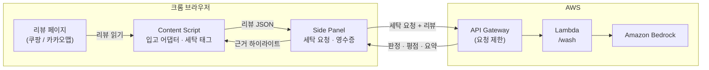

# 🧺 별점세탁소

> **"리뷰한테 물어보세요. 얼룩은 빼고 답해드릴게요."**
> 쿠팡과 카카오맵 리뷰에서 체험단, 대가성, 리뷰이벤트 리뷰(**얼룩**)를 걷어내고 **세탁 후 평점**을 보여주는 크롬 확장 프로그램이에요.
> 궁금한 것만 자연어로 물어보면, 근거가 달린 요약으로 답해요.

Kirothon 2026 출품작 · 주제: *내 일상에 바로 적용할 수 있는 서비스*
**팀 규랑이 탐험대** · 재현 · 규리 · 주영 · 정민

> 쿠팡, 카카오와 제휴하지 않은 비공식 도구입니다.

```
⭐ 세탁 전 평점  4.8   (최근 리뷰 100개 기준)
🧼 얼룩 제거      25개  (체험단 18 · 대가성 문구 7)
🟡 의심 얼룩       6개  (표시만, 평점에는 반영 안 함)
✨ 세탁 후 평점  4.3   ▼0.5
```

> 📸 *(스크린샷/GIF: 쿠팡 세탁 전후 평점 · 질문 세탁 결과 · 근거 하이라이트. 리뷰 작성자 이름은 가린다)*

---

## ⚡ 평가자용 빠른 체험 (3분)

1. [Releases](../../releases)에서 `byeoljeom-laundry-extension.zip`을 내려받아 압축을 푼다.
2. 크롬에서 `chrome://extensions` → 오른쪽 위 **개발자 모드** 켜기 → **압축해제된 확장 프로그램 로드** → 압축을 푼 폴더를 선택한다.
3. 아래 페이지를 열고, 툴바의 🧺 아이콘을 눌러 사이드 패널을 연다.
   - 쿠팡 예시 상품: `(URL 기입 예정)`
   - 카카오맵 예시 음식점: `(URL 기입 예정)`
4. 세탁 요청 예시를 입력한다.
   - `체험단 리뷰 빼고 평점이랑 요약해줘`
   - `이 보조배터리 무게가 고민이야. 무게 관련 리뷰만 보여줘`
   - `리뷰이벤트 빼고 맛 평가만 알려줘`

> 백엔드는 AWS에 배포되어 있어서 API 키를 따로 설정할 필요가 없어요.

---

## 1. 문제: 별점에 얼룩이 묻어 있다

- 우리는 **매일** 리뷰와 별점을 보고 물건을 사고, 식당을 고른다.
- 그런데 리뷰에는 **체험단, 제품 제공, 리뷰이벤트**("리뷰 쓰면 음료 서비스") 리뷰가 섞여 있어서 **별점이 부풀려진다**.
- 대가성 리뷰는 원래 그 사실을 밝혀야 한다(공정위 「추천·보증 등에 관한 표시·광고 심사지침」). 하지만 실제로는 표기가 없거나 눈에 잘 띄지 않는다.
- 궁금한 건 하나인데("이거 무거워?", "웨이팅 길어?") **리뷰 수백 개를 직접 스크롤**해야 한다.

> 📊 **숫자로 본 문제** — 한국소비자원, 배달 플랫폼 3사 이용자 1,000명 조사 (2024)
> - 음식 주문 후 후기를 쓴 소비자 중 **65.2%**가 "리뷰이벤트에 참여하려고" 썼다고 답했다.
> - 리뷰이벤트에 참여해 후기를 쓴 소비자 **10명 중 8명**은 이벤트가 별점에 영향을 줬고, 대부분 **실제 만족도보다 높게** 줬다고 답했다.
> - 소비자원은 별점 중심 후기 시스템 개선과 이벤트 참여 후기 명시를 권고했다.
>
> 출처: [YTN, 2024.07.23](https://www.ytn.co.kr/_ln/0102_202407231204212645) · [YTN, 2024.07.24](https://www.ytn.co.kr/_ln/0103_202407242052571964)

**→ 플랫폼이 바뀌기를 기다리는 대신, 소비자가 지금 바로 쓸 수 있는 도구를 만든다.**

## 2. 해결: 리뷰를 세탁한다

사이드 패널에 **세탁 요청**(자연어 질문)을 입력하면, 별점세탁소가 지금 보고 있는 페이지의 리뷰를 분류하고 결과를 **세탁 영수증**으로 보여준다.

### 세탁소 용어
| 용어 | 의미 |
|---|---|
| **세탁 요청** | 사용자가 입력하는 자연어 질문 |
| **얼룩** | 대가성 리뷰. 🔴 **확실한 얼룩**(플랫폼 체험단 표시, "제공받아" 같은 명시)과 🟡 **의심 얼룩**(명시는 없지만 대가성 신호가 있는 리뷰)으로 나뉜다 |
| **세탁 전 / 세탁 후 평점** | 원래 평점 / 얼룩을 제외하고 다시 계산한 평점 |
| **부분 세탁** | 특정 주제(무게, 맛, 웨이팅 등) 리뷰만 골라 보기 |
| **세탁 영수증** | 결과 카드. 기준 리뷰 수, 제거한 얼룩, 요약과 근거 |
| **세탁 태그** | 페이지의 각 리뷰 옆에 붙는 판정 배지 |

### 세탁 코스
| 코스 | 세탁 요청 예시 | 결과 |
|---|---|---|
| 🧺 **표준 코스** | "체험단 리뷰 빼고 평점이랑 요약해줘" | 🔴 확실한 얼룩을 빼고 세탁 전 4.8 → **세탁 후 4.3**, 장점과 단점 요약. 🟡 의심 얼룩은 표시만 한다 |
| 🎯 **부분 세탁** | "무게 관련 리뷰만 보여줘" | 무게 언급 리뷰 하이라이트, 무게 평가 요약 |
| 🍽️ **이벤트 얼룩 제거** | "리뷰이벤트 빼고 맛 평가만" (카카오맵) | 서비스를 받고 쓴 리뷰를 제외한 맛 요약 |
| 🔍 **섬세 코스** | "티 안 나는 광고 리뷰도 빼줘" | 🟡 의심 얼룩도 평점에서 빼고, 리뷰마다 근거 문장 제공 |

### 세탁 원칙
1. **AI는 판정만, 숫자는 코드가.** 평점과 개수는 코드로 계산해서 정확하게 낸다.
2. **근거 없는 요약은 없다.** 영수증의 문장을 누르면 원본 리뷰로 스크롤하고 하이라이트한다.
3. **정직한 표시.** "최근 리뷰 N개 기준"을 밝힌다. 의심 얼룩은 "가짜"라고 단정하지 않고 **신호와 근거**로만 보여준다.

## 3. 지원 사이트

| 사이트 | 대상 | 얼룩 판별 신호 | 대표 세탁 |
|---|---|---|---|
| **쿠팡** (상품 페이지) | 쇼핑 리뷰 | 🔴 쿠팡 체험단 표시 · "제공받아" 등 대가성 문구<br/>🟡 구체성 없는 극찬 | 세탁 후 평점, 부분 세탁(무게·사이즈 등) |
| **카카오맵** (장소 상세 페이지) | 음식점·카페 후기 | 🔴 "리뷰 이벤트로 받은", "리뷰 약속" 등 명시<br/>🟡 "서비스 감사해요" + 5점, 짧은 극찬 | 이벤트 얼룩 제거, 세탁 후 평점, 맛·웨이팅 요약 |

### 리뷰 수집 원칙 (입고 정책)
- **사용자가 보고 있는 페이지에서, 사용자가 세탁 버튼을 눌렀을 때만** 리뷰를 읽는다.
- 리뷰는 **최대 100개**까지, 추가 요청은 **1초 이상 간격**으로만 불러온다. 쿠팡은 한 페이지에 10개라서 최대 10페이지, 카카오맵은 "후기 더보기"로 100개까지 불러온다. 실패하면 화면에 보이는 리뷰만 분석한다.
- 서버에서 크롤링하지 않는다. 리뷰를 **저장하지 않는다.** 세탁이 끝나면 바로 폐기한다.

## 4. 시스템 구성



| 구성 | 역할 |
|---|---|
| **크롬 확장** (`apps/extension`) | Manifest V3. 사이트별 입고 어댑터로 리뷰를 추출하고, 사이드 패널(세탁 요청·영수증)을 띄우고, 세탁 태그와 하이라이트를 표시한다 |
| **세탁 API** (`apps/api`) | AWS Lambda. 세탁 요청 해석 → 애벌빨래(규칙) → 본세탁(Bedrock) → 검수(코드 계산) → 영수증 |
| **코어 로직** (`packages/core`) | 리뷰 타입, 세탁 후 평점 계산, 규칙 기반 얼룩 탐지. 순수 함수로 작성하고 테스트를 붙인다 |
| **인프라** (`infra`) | API Gateway + Lambda 배포. 남용 방지를 위한 요청 제한, 입력 크기 제한, 비용 알림 |

## 5. 세탁 과정

```
① 접수     세탁 요청 해석
            "체험단 빼고 무게 관련만" → { exclude: ["sponsored"], topics: ["무게"] }
② 애벌빨래 규칙으로 확실한 얼룩 탐지 (플랫폼 체험단 표시, "제공받아", "리뷰 이벤트" …)
③ 본세탁   LLM이 리뷰별로 판정: { stain: none | certain | suspected, topics[], evidence }
            LLM의 certain은 원문에 있는 대가성 문장을 evidence로 댈 때만 인정한다
④ 검수     코드로 세탁 전·후 평점, 얼룩 수, 기준 리뷰 수 계산
⑤ 영수증   장점·단점(또는 주제별) 요약 + 근거 리뷰 ID
```

- 본세탁은 경량 모델로 25개씩 나눠 병렬로 판정한다. 판정이 20초 안에 끝나지 않으면 남은 리뷰는 애벌빨래 결과로 대신하고 영수증에 표시한다 (API Gateway 응답 제한 29초).

### API (초안)
```http
POST /wash
{
  "request": "체험단 리뷰 빼고 무게 관련만 요약해줘",
  "site": "coupang",
  "reviews": [{ "id": "r-017", "rating": 5, "date": "2026-10-21", "text": "...", "badges": ["체험단"] }]
}
```
```json
{
  "course": { "exclude": ["sponsored"], "topics": ["무게"] },
  "tags": [
    { "id": "r-017", "stain": "certain", "signal": "platform_badge", "evidence": null, "topics": ["무게"], "include": false },
    { "id": "r-042", "stain": "suspected", "signal": "suspected", "evidence": "최고예요 강추합니다!!", "topics": [], "include": true }
  ],
  "receipt": {
    "basedOn": 100,
    "before": 4.8,
    "after": 4.3,
    "stains": { "platform_badge": 18, "disclosure": 7, "review_event": 0, "suspected": 6 },
    "removed": 25,
    "matched": 14,
    "pros": [{ "text": "가방에 넣으면 부담 없는 무게", "reviewIds": ["r-003", "r-021"] }],
    "cons": [{ "text": "주머니에 넣기엔 무겁다", "reviewIds": ["r-008", "r-030"] }]
  }
}
```

## 6. 세탁 품질 검사 (실제 데이터로 평가)

실제 쿠팡·카카오맵 리뷰로 평가한다.

| 지표 | 정답 라벨 | 결과 |
|---|---|---|
| 쿠팡 확실한 얼룩 탐지 | 쿠팡이 붙인 **체험단 표시** (자동 정답) | __% |
| 카카오맵 리뷰이벤트 언급 탐지 | 팀원이 직접 라벨링한 후기 __개 | 정밀도 __% / 재현율 __% |
| 부분 세탁 정확도 | 팀원이 직접 라벨링한 주제(무게 등) __개 | 정밀도 __% / 재현율 __% |
| 세탁 후 평점 | 정답 라벨 기준 평점과의 차이 | ±__ |

- 평가 스크립트: `scripts/eval` (판별 로직을 수정할 때마다 **Kiro Hook이 자동 실행**)
- **실제 리뷰 원문은 레포에 올리지 않는다.** 평가용 원문은 로컬 `scripts/eval/data/`(git 제외)에만 두고, 레포에는 스크립트와 결과 수치만 올린다.
- 단위 테스트에는 AI로 만든 소량의 가상 리뷰(`packages/core/__fixtures__`)를 쓴다. 이건 테스트 전용이고 평가 수치에는 쓰지 않는다.

## 7. 한계 (정직하게)

- **대가성 표시를 하지 않은 리뷰이벤트 리뷰는 리뷰 한 개만 보고 확실히 가려낼 수 없다.** 그래서 이런 리뷰는 🟡 의심 얼룩으로만 표시하고, 근거 문장을 함께 보여준다. 세탁 후 평점은 기본적으로 🔴 확실한 얼룩만 제외하고 계산한다(섬세 코스에서는 의심 얼룩도 뺀다).
- 분석 범위는 **불러온 리뷰(최대 100개)**다. 그래서 결과에 기준 리뷰 수를 항상 표시한다.
- 사이트 구조가 바뀌면 어댑터를 수정해야 한다.

## 8. 기술 스택

| 영역 | 선택 |
|---|---|
| 확장 | Chrome Extension MV3, TypeScript, Side Panel API |
| API | AWS Lambda (Node.js/TypeScript), API Gateway |
| LLM | Amazon Bedrock. 판정은 경량 모델, 요약은 상위 모델을 쓰고 환경 변수로 교체할 수 있다 |
| 인프라 | AWS CDK |
| 테스트 | Vitest (코어 로직, 어댑터 파싱) |

> ⚠️ AWS 자격 증명과 모델 설정은 Lambda 환경에만 둔다. 확장 프로그램 코드에는 비밀 정보를 넣지 않는다.

## 9. 레포 구조

```
.
├─ AGENTS.md      에이전트 안내
├─ .kiro/
│  ├─ steering/   product · tech · structure · fairness · hackathon
│  ├─ specs/      review-intake · wash-pipeline · side-panel-receipt · infra
│  └─ hooks/      eval-on-save · secret-scan · readme-sync
├─ apps/
│  ├─ extension/  크롬 확장 (입고 어댑터: coupang · kakaomap, 사이드 패널)
│  └─ api/        Lambda 세탁 API
├─ packages/core/ 타입 · 세탁 후 평점 · 규칙 얼룩 탐지 (+ 테스트, __fixtures__)
├─ infra/         AWS CDK
├─ scripts/eval/  세탁 품질 검사
├─ docs/          발표 자료, 아키텍처 그림
└─ README.md
```

## 10. Kiro 활용

| 기능 | 별점세탁소에서의 활용 |
|---|---|
| **Steering** | `product.md`(문제·세탁소 용어), `tech.md`, `structure.md`, `fairness.md`("가짜" 단정 금지, 근거 필수, 리뷰 저장 금지), `hackathon.md`(MVP 우선, 비밀키 규칙) |
| **Specs** | `review-intake`(쿠팡·카카오맵 어댑터) · `wash-pipeline`(세탁 과정 ①~⑤) · `side-panel-receipt`(UI·영수증·태그) · `infra`(Lambda·API Gateway). 각각 requirements → design → tasks 순서로 진행 |
| **Hooks** | ① 얼룩 판별 로직 저장 시 세탁 품질 검사 자동 실행 ② 저장 시 비밀 정보 유출 검사 ③ 수동: README 품질 수치 갱신 |
| **MCP** | Notion(설계안 → spec 입력), GitHub(tasks → 이슈·PR), AWS 문서(Bedrock·CDK 구현 참고) |
| **Autopilot / Supervised** | spec 승인 후 구현은 Autopilot, AWS 배포와 권한 관련 작업은 Supervised |

> 각 항목의 실제 결과물은 `.kiro/` 폴더에서 확인할 수 있다.

## 11. 로드맵

- 네이버 지도 플레이스 어댑터 (2026년에 다시 생긴 별점, 영수증 인증 리뷰, 키워드 리뷰)
- 블로그 리뷰 협찬 표기 탐지
- "나와 비슷한 사람" 리뷰 우선 정렬 (체형, 입맛 등)

---

## 개발자용 실행 방법
> 구현 후 작성 (확장 빌드, Lambda 로컬 실행, CDK 배포, 환경 변수)

## 라이선스
[MIT](LICENSE)
