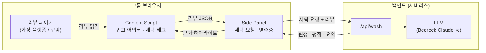

# 🧺 별점세탁소

> **"리뷰한테 물어보세요. 얼룩은 빼고 답해드릴게요."**
> 체험단, 제품 제공, 리뷰이벤트처럼 **대가성 리뷰(얼룩)**를 걷어내고 **세탁 후 평점**을 보여주는 크롬 확장 프로그램이에요.
> 궁금한 것만 자연어로 물어보면, 근거가 달린 요약으로 답해요.

Kirothon 2026 출품작 · 주제: *내 일상에 바로 적용할 수 있는 서비스*

```
⭐ 세탁 전 평점  4.7   (리뷰 55개)
🧼 얼룩 제거      11개  (체험단 7 · 제품 제공 2 · 숨은 얼룩 2)
✨ 세탁 후 평점  4.1   ▼0.6
```

---

## 1. 문제: 별점에 얼룩이 묻어 있다

- 우리는 **매일** 리뷰와 별점을 보고 상품을 사고, 가게를 고른다.
- 그런데 리뷰에는 **체험단, 제품 제공, 리뷰이벤트**("리뷰 쓰면 음료 서비스", "리뷰 쓰면 할인") 리뷰가 섞여 있어서 **별점이 부풀려진다**.
- 대가성 리뷰는 원래 그 사실을 밝혀야 한다(공정위 「추천·보증 등에 관한 표시·광고 심사지침」). 하지만 실제로는 표기가 없거나 눈에 띄지 않는 경우가 많다.
- 내가 궁금한 건 하나인데("이 보조배터리 무거워?", "이 미용실 탈색 잘해?") **리뷰 수백 개를 직접 스크롤**해야 한다.

> 📊 **현장 설문** (실제 수집한 수치만 기입)
> - 별점을 믿고 샀다가 실망한 경험: __ / __명
> - 리뷰이벤트·체험단 리뷰 때문에 판단이 헷갈린 경험: __ / __명
> - 원하는 정보를 찾느라 리뷰를 읽는 데 쓰는 시간(평균): __분

## 2. 해결: 리뷰를 세탁한다

크롬 사이드 패널에 **세탁 요청**(자연어 질문)을 입력하면, 별점세탁소가 리뷰를 분류하고 결과를 **세탁 영수증**으로 보여준다.

### 세탁소 용어
| 용어 | 의미 |
|---|---|
| **세탁 요청** | 사용자가 입력하는 자연어 질문 |
| **얼룩** | 대가성 리뷰. 🔴 **눈에 띄는 얼룩**(체험단·제공 명시)과 🟡 **숨은 얼룩**(명시는 없지만 대가성이 의심되는 리뷰)으로 나뉜다 |
| **세탁 전 / 세탁 후 평점** | 원래 평점 / 얼룩을 제외하고 다시 계산한 평점 |
| **부분 세탁** | 특정 주제(무게, 맛, 탈색 등)에 관한 리뷰만 골라 보기 |
| **세탁 영수증** | 결과 카드. 기준 리뷰 수, 제거한 얼룩, 요약과 근거 |
| **세탁 태그** | 페이지의 각 리뷰 옆에 붙는 판정 배지 |

### 세탁 코스
| 코스 | 세탁 요청 예시 | 결과 |
|---|---|---|
| 🧺 **표준 코스** | "제공받은 리뷰 빼고 평점이랑 요약해줘" | 세탁 전 4.7 → **세탁 후 4.1**, 장점과 단점 요약 |
| 🎯 **부분 세탁** | "이 보조배터리 무게가 고민이야. 무게 관련 리뷰만 보여줘" | 무게 리뷰 12개 하이라이트, 무게 평가 요약 |
| 🍽️ **이벤트 얼룩 제거** | "리뷰이벤트 빼고 맛 평가만 알려줘" (음식점) | 서비스 받고 쓴 리뷰 제외, 맛 관련 요약 |
| 🔍 **섬세 코스** | "티 안 나는 광고 리뷰도 걸러줘" | LLM이 숨은 얼룩까지 판정하고 근거 문장을 표시 |

### 세탁 원칙
1. **AI는 판정만, 숫자는 코드가.** 평점과 개수는 코드로 계산해서 정확하게 낸다.
2. **근거 없는 요약은 없다.** 영수증의 문장을 누르면 원본 리뷰로 스크롤하고 하이라이트한다.
3. **정직한 표시.** "최근 리뷰 N개 기준"을 밝히고, "가짜 리뷰"라고 단정하지 않고 "대가성 가능성 + 근거"로 표현한다.

## 3. 데모 시나리오

1. 가상 리뷰 플랫폼의 보조배터리 상품 페이지에 들어간다. 평점은 ⭐4.7이다.
2. 사이드 패널에서 **별점세탁소**를 연다. "리뷰 55개 입고 완료"라고 표시된다.
3. "제공받은 리뷰 빼고 평점 알려줘"라고 입력한다.
   - 별점이 **4.7 → 4.1**로 줄어드는 애니메이션이 나오고, 얼룩 리뷰에 🔴🟡 세탁 태그가 붙는다.
4. "무게 관련 리뷰만 요약해줘"라고 입력한다. (부분 세탁)
   - 영수증에 "무겁다 6건 / 적당하다 5건"이 나온다. 근거를 누르면 해당 리뷰로 이동한다.
5. 장소 탭의 음식점에서 "리뷰이벤트 빼고 맛 평가만"이라고 입력한다.
6. **실제 쿠팡 상품 페이지**에서도 세탁이 되는 장면을 보여준다.

## 4. 시스템 구성



| 구성 | 역할 |
|---|---|
| **가상 리뷰 플랫폼** (`apps/web`) | 쇼핑 탭(보조배터리, 러닝화)과 장소 탭(음식점, 카페, 미용실). 가상 브랜드로 만들고 라벨이 붙은 리뷰를 렌더링한다 |
| **크롬 확장** (`apps/extension`) | Manifest V3. 입고 어댑터로 리뷰를 추출하고, 사이드 패널(세탁 요청·영수증)을 띄우고, 세탁 태그와 하이라이트를 표시한다 |
| **세탁 API** (`apps/web` 의 `/api/wash`) | 세탁 요청 해석 → 리뷰별 판정 → 코드로 평점 계산 → 근거 포함 요약 |
| **코어 로직** (`packages/core`) | 리뷰 타입, 세탁 후 평점 계산, 규칙 기반 1차 판별. 순수 함수로 작성하고 테스트를 붙인다 |

### 입고 어댑터 (사이트별 리뷰 추출)
| 어댑터 | 방식 |
|---|---|
| `mock` | 가상 플랫폼 DOM의 `data-*` 속성으로 추출 |
| `coupang` | 사용자가 버튼을 눌렀을 때만, 최대 15페이지, 1초 간격으로 가져온다. 실패하면 화면에 보이는 리뷰만 분석한다 |
| 무신사 · 스마트스토어 · 지도 플레이스 | 로드맵 (어댑터만 추가하면 확장된다) |

## 5. 세탁 과정

```
① 접수   세탁 요청 해석
          "제공받은 리뷰 빼고 무게 관련만" → { exclude: ["sponsored"], topics: ["무게"] }
② 애벌빨래 규칙으로 눈에 띄는 얼룩 탐지 ("제공받아", "체험단", "리뷰이벤트" …)
③ 본세탁  LLM이 리뷰별로 판정: { stain: none | explicit | hidden, topics[], evidence }
④ 검수   코드로 세탁 전·후 평점, 얼룩 수, 기준 리뷰 수 계산
⑤ 영수증  장점·단점(또는 주제별) 요약 + 근거 리뷰 ID
```

### API (초안)
```http
POST /api/wash
{
  "request": "제공받은 리뷰 빼고 무게 관련만 요약해줘",
  "category": "product",
  "reviews": [{ "id": "pb-017", "rating": 5, "date": "2026-10-21", "text": "..." }]
}
```
```json
{
  "course": { "exclude": ["sponsored"], "topics": ["무게"] },
  "tags": [{ "id": "pb-017", "stain": "explicit", "topics": ["무게"], "include": false, "evidence": "제품을 제공받아 작성한" }],
  "receipt": {
    "basedOn": 55,
    "before": 4.7,
    "after": 4.1,
    "stainsRemoved": { "explicit": 9, "hidden": 2 },
    "matched": 12,
    "pros": [{ "text": "가방에 넣으면 부담 없는 무게", "reviewIds": ["pb-003", "pb-021"] }],
    "cons": [{ "text": "주머니에 넣기엔 무겁다", "reviewIds": ["pb-008", "pb-030"] }]
  }
}
```

## 6. 데이터: 직접 만든 라벨 데이터셋

- **AI로 생성한 가상 리뷰**다. 실존 브랜드, 업체, 인물은 등장하지 않는다. 정답 라벨이 포함되어 있다.
- 위치: `data/reviews/{targetId}.json`

```json
{
  "id": "pb-017",
  "targetId": "powerbank-01",
  "category": "product",
  "author": "김**",
  "rating": 5,
  "date": "2026-10-21",
  "text": "업체로부터 제품을 무료로 제공받아 작성한 후기입니다. ...",
  "label": { "stain": "explicit", "topics": ["디자인", "무게"], "sentiment": "positive" }
}
```

| 대상 | 개수 | 얼룩 유형 | 주요 주제 |
|---|---|---|---|
| 보조배터리 | 50 | 체험단, 제품 제공 | 무게, 발열, 충전 속도 |
| 러닝화 | 50 | 체험단, 협찬 | 사이즈, 발볼, 쿠션 |
| 음식점 | 50 | 리뷰이벤트(음료·사이드 서비스) | 맛, 양, 대기 |
| 카페 | 50 | 리뷰이벤트, 체험단 | 공부, 콘센트, 소음 |
| 미용실 | 50 | 리뷰 쓰면 할인 | 탈색, 펌, 상담 |

대상마다 분포는 깨끗한 리뷰 약 65%, 눈에 띄는 얼룩 약 20%, 숨은 얼룩 약 15%로 맞춘다.

## 7. 세탁 품질 검사 (정확도)

`scripts/eval` 스크립트로 정답 라벨과 비교한다. **판별 로직을 수정할 때마다 Kiro Hook이 자동으로 실행한다.**

| 지표 | 설명 | 결과 |
|---|---|---|
| 얼룩 탐지 정확도 | 눈에 띄는 얼룩 + 숨은 얼룩 | __% |
| 숨은 얼룩 재현율 | LLM 본세탁의 기여도 | __% |
| 부분 세탁 재현율 | 주제 질문 → 관련 리뷰 탐지 | __% |
| 세탁 후 평점 오차 | 정답 라벨 기준 평점과의 차이 | __ |

## 8. 기술 스택

| 영역 | 선택 |
|---|---|
| 확장 | Chrome Extension MV3, TypeScript, Side Panel API |
| 웹·API | Next.js (가상 플랫폼 + `/api/wash`), Vercel 배포 |
| LLM | Amazon Bedrock (Claude) · 대체 API 키 (`.env`) |
| 테스트 | Vitest (코어 로직, 어댑터 파싱) |

> ⚠️ API 키는 서버의 `.env`에만 둔다. 확장 프로그램 코드에는 절대 넣지 않는다.

## 9. 레포 구조

```
.
├─ .kiro/
│  ├─ steering/   product · tech · structure · fairness · hackathon
│  ├─ specs/      review-intake · wash-pipeline · side-panel-receipt
│  └─ hooks/      eval-on-save · secret-scan · readme-sync
├─ apps/
│  ├─ web/        가상 리뷰 플랫폼 + /api/wash
│  └─ extension/  크롬 확장 (입고 어댑터, 사이드 패널)
├─ packages/core/ 타입 · 세탁 후 평점 · 규칙 판별 (+ 테스트)
├─ data/reviews/  라벨이 붙은 가상 리뷰 JSON
├─ scripts/eval   세탁 품질 검사
└─ README.md
```

## 10. Kiro 활용

| 기능 | 별점세탁소에서의 활용 |
|---|---|
| **Steering** | `product.md`(문제·페르소나·세탁소 용어), `tech.md`, `structure.md`, `fairness.md`("가짜" 단정 금지, 근거 필수), `hackathon.md`(MVP 우선, 비밀키 규칙) |
| **Specs** | `review-intake`(입고 어댑터) · `wash-pipeline`(세탁 과정 ①~⑤) · `side-panel-receipt`(세탁 요청 UI·영수증·태그). 각각 requirements → design → tasks 순서로 진행 |
| **Hooks** | ① 판별 로직 저장 시 세탁 품질 검사 자동 실행 ② 저장 시 API 키 유출 검사 ③ 수동: README 품질 수치 갱신 |
| **MCP** | Notion(설계안 → spec 입력), GitHub(tasks → 이슈·PR) |
| **Autopilot / Supervised** | spec 승인 후 구현은 Autopilot, API 키·배포 관련 작업은 Supervised |

> 각 항목의 실제 결과물은 `.kiro/` 폴더에서 확인할 수 있다.

## 11. 세탁 원칙 (윤리·법적 기준)

- 서버에서 크롤링하지 않는다. **사용자가 보고 있는 페이지에서, 사용자가 실행할 때만** 세탁한다.
- 리뷰를 저장하지 않는다. 세탁이 끝나면 바로 폐기한다.
- "가짜 리뷰"라고 단정하지 않는다. **대가성 가능성 + 근거**로 표시한다.
- 가상 플랫폼은 실존 서비스의 디자인과 브랜드를 사용하지 않는다.

## 12. 로드맵

- 무신사, 스마트스토어, 지도 플레이스 입고 어댑터
- 시점 패턴 분석 (특정 기간에 몰린 별점 5개 = 얼룩 신호)
- "나와 비슷한 사람" 리뷰 우선 정렬 (체형, 피부 타입 등)

---

## 실행 방법
> 구현 후 작성 (가상 플랫폼 실행, 확장 프로그램 로드, 환경 변수)

## 데이터 출처
리뷰 데이터는 전부 AI로 생성한 가상 데이터이며, 실존 상품·업체·인물과 무관하다.
